# 5.1 机器人运动估计：视觉与激光惯性里程计

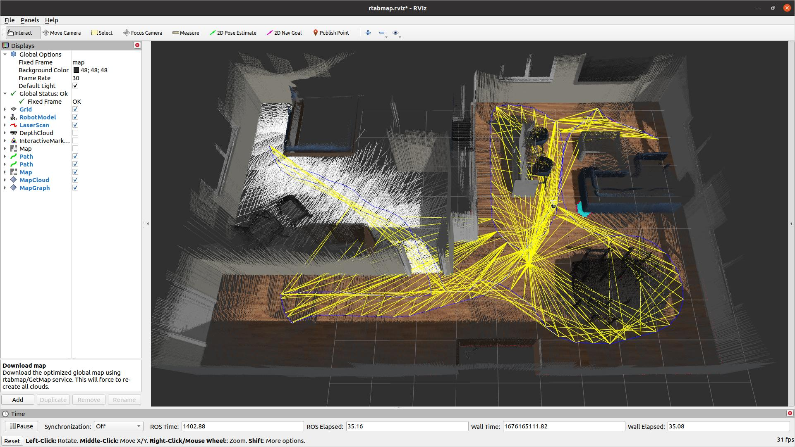

*图片来源：https://limo-agx.github.io/navigation_rtabmap.html*

在前面的课程中，我们已经学习了如何在 Jetson 上接入 Camera、LiDAR 和 IMU，并获取图像、点云以及惯性测量数据。但是，当机器人开始移动时，仅仅获取传感器数据是不够的。机器人还需要回答一个最基本的问题：我刚才移动了多远？朝哪个方向移动？现在处于什么位置和姿态？

本节课将从这个问题出发，介绍机器人运动估计（Motion Estimation）的基本原理。本节课程的学习目标：

1. **理解 6DoF 位姿**：机器人如何表达位置与旋转；
2. **掌握里程计原理**：VO、VIO、LIO 的工作方式；
3. **认识典型算法**：RTAB-Map、ORB-SLAM3、FAST-LIO2；
4. **完成 ROS 2 实操**：实时输出里程计并观察运动。

## 一、机器人运动估计

机器人要在真实环境中自主移动，首先需要解决一个基本问题：**机器人如何知道自己移动了多远，以及当前朝向哪里？**对于人类来说，我们可以通过视觉、身体感觉等信息判断自己的运动。但机器人并没有这样的天然能力，它必须依靠相机、IMU、轮式编码器等传感器，持续估计自身的运动状态。这个过程就是**机器人运动估计（Motion Estimation）**。运动估计是机器人定位、建图、路径规划与自主导航的重要基础。下面我们以 RGB-D 相机为例，理解机器人如何从传感器数据中推断自身运动。

### 1.1 从环境变化推断机器人运动

假设我们将一个 RGB-D 相机安装在机器人上。在时刻 $t_0$，相机看到一张桌子；当机器人向右移动一段距离后，在时刻 $t_1$ 又看到同一张桌子。虽然桌子在世界坐标系中的位置没有发生变化，但它在相机图像中的位置却改变了。通过分析这些视觉变化，我们就有机会反推出相机自身的运动。

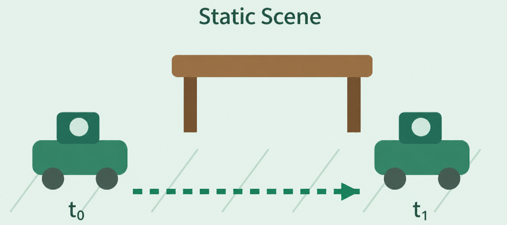

这揭示了视觉运动估计的核心思想：**通过观察静态环境相对于相机的变化，反向推断相机自身的运动。**

一个典型的运动估计过程包括三个步骤：

1. **寻找共同的场景特征**：在 `t₀` 和 `t₁` 两帧图像中，识别桌角、物体边缘等能够重复观测的特征点，并建立对应关系。
2. **建立空间几何约束**：结合相机内参和深度信息，将匹配的图像特征转换为三维空间中的点，分析它们在两个相机坐标系下的位置关系。
3. **计算相对位姿变换**：寻找能够最好地解释这些空间对应关系的旋转和平移，得到相机从 `t₀` 到 `t₁` 的相对运动。

最终，我们使用一个相对位姿变换 ΔT 来描述这段运动。

需要注意，机器人在这里并不是直接测量自己在世界中的绝对位置，而是通过两次观测之间的几何关系，估计**自己相对于上一时刻移动了多少、旋转了多少**。这就是视觉里程计（Visual Odometry，VO）的基本思想。

### 1.2 从相对运动到 6DoF 位姿

通过比较连续两帧图像，我们可以估计相机发生了怎样的运动。但如何用数学方式描述这段运动呢？对于在三维空间中运动的机器人，仅仅知道移动距离是不够的。我们还需要同时描述它的位置和朝向。因此，一个完整的三维刚体位姿通常包含六个自由度（Six Degrees of Freedom，6DoF）。

三个平移自由度（Translation）来描述机器人沿三维坐标轴的位置变化：沿 X 轴平移、沿 Y 轴平移、沿 Z 轴平移；三个旋转自由度（Rotation）来描述机器人绕三个坐标轴的姿态变化：横滚角、俯仰角和偏航角。

因此，**6DoF = 3 个平移自由度 + 3 个旋转自由度**。

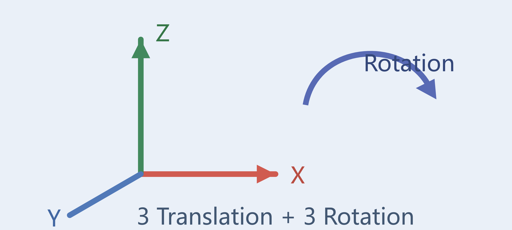

在 SLAM 和机器人学中，通常使用一个 4×4 的齐次变换矩阵来统一描述三维刚体的位置与姿态：

$$T = \begin{bmatrix}R & t \\0_{1 \times 3} & 1\end{bmatrix}$$

其中：

- **R** 是 3×3 旋转矩阵，用来描述三维空间中的姿态；
- **t** 是 3×1 平移向量，用来描述位置；
- **T** 属于特殊欧氏群 SE(3)，表示一个完整的三维刚体变换。

与分别存储位置和欧拉角相比，齐次变换矩阵可以方便地完成坐标转换和连续运动的组合。

回到前面的 RGB-D 相机示例。假设机器人启动时，相机位于初始位置 `t₀`，我们暂时将这个位置定义为参考坐标系的原点，初始位姿为 $T_0 = I_{4 \times 4}$。当机器人运动到 `t₁` 时，视觉运动估计算法计算出从 `t₀` 到 `t₁` 的相对位姿变换 ΔT₀。此时，相机在参考坐标系中的新位姿可以表示为 $T_1 = T_0 \Delta T_0$。如果机器人继续运动到 `t₂`，则 $T_2 = T_1 \Delta T_1$。可参考此规律推广到任意相邻时刻。

采用右乘方式进行位姿更新。通过不断估计相邻时刻的运动，并将它们依次组合，我们就能够获得机器人相对于初始位置的连续位姿，以及运动轨迹。这就是**里程计（Odometry）**的基本工作方式。如果进一步知道相邻两帧的时间间隔，还可以根据位姿变化估计机器人的平均线速度和角速度。

> 需要强调的是，视觉里程计直接估计的是相机运动。如果需要获得机器人底盘自身的位姿，还需要考虑相机与机器人底盘之间的固定安装变换。

### 1.3 为什么运动估计会产生漂移？

从上面的公式可以发现，机器人的当前位姿依赖于之前所有时刻的运动估计。但在真实环境中，每一次运动估计都可能存在误差。这种由于连续累积相对运动误差，导致估计轨迹逐渐偏离真实轨迹的现象，就叫作**里程计漂移（Odometry Drift）**。导致误差的原因有很多，例如：

- 图像模糊或纹理不足，导致特征匹配不准确；
- 深度相机存在测量噪声，导致三维点的位置不够准确；
- 场景中存在运动物体，干扰静态环境的几何估计；
- 相机快速旋转或受到震动，使连续帧之间的匹配变得困难。

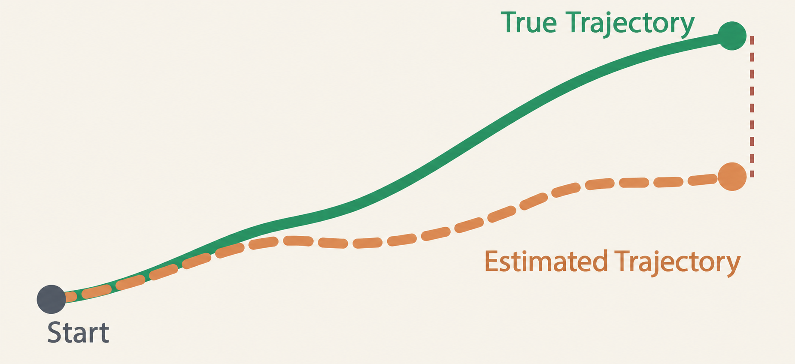

这也揭示了仅依靠运动估计的一个重要局限：**运动估计能够告诉机器人"我相对于上一时刻移动了多少"，但无法仅凭连续累积的局部运动，保证长期位置始终准确。**

因此，实际的 SLAM 系统通常还需要借助地图中的稳定特征、历史观测、回环检测以及全局优化等方法，对累积的位姿误差进行约束和修正。这里先建立一个基础认知：**运动估计解决的是相邻时刻的相对运动问题，里程计通过连续组合这些运动估计得到轨迹，而 SLAM 则进一步利用环境地图和多时刻观测，提高长期定位与建图的一致性。**

## 二、VO、VIO 和 LIO 的区别

机器人可以通过不同的传感器估计自身运动，但这些技术并不是完全相同的。

<table>
  <tr>
    <td width="45%">
      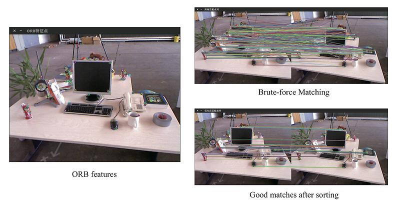
    </td>
    <td>
      <strong>VO — Visual Odometry</strong><br/>
      利用连续图像中的特征位置、光度信息及场景几何关系，估计相机运动。<br/>
      适合 RGB-D、双目或具有充分视觉纹理的环境。
    </td>
  </tr>
  <tr>
    <td width="45%">
      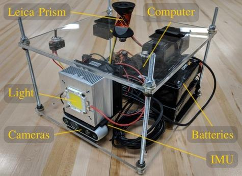
    </td>
    <td>
      <strong>VIO — Visual-Inertial Odometry</strong><br/>
      使用 Camera + IMU。视觉提供环境约束，IMU 提供高频惯性预测。<br/>
      适合机器人快速移动、需要平滑姿态估计的场景。
    </td>
  </tr>
  <tr>
    <td width="45%">
      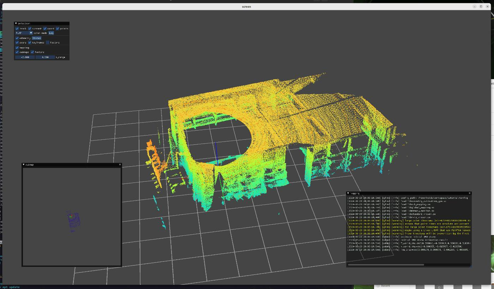
    </td>
    <td>
      <strong>LIO — LiDAR-Inertial Odometry</strong><br/>
      使用 LiDAR + IMU，通过三维点云的几何匹配与惯性约束估计运动。<br/>
      不依赖环境光照，但可能在几何结构单一的环境下退化。
    </td>
  </tr>
</table>

**典型算法对比：**

| 算法 | 技术路线 | 主要特点 | 本课定位 |
|-|-|-|-|
| ORB-SLAM3 | 特征法 SLAM，可融合 IMU | 回环、重定位、多地图 | 原理了解 |
| OpenVINS | MSCKF 滤波式 VIO | 实时视觉惯性估计 | 拓展 |
| RTAB-Map Odometry | RGB-D / Stereo 里程计 | ROS 2 接口完整，易于实验 | 核心实践 |
| FAST-LIO2 | 紧耦合 LiDAR-IMU | 迭代 EKF 与 ikd-Tree | 扩展实验 |
| LIO-SAM | LiDAR-IMU 因子图 | 里程计与图优化 | 原理了解 |

本节课选择 Fast-LIO2 作为运动估计算法，通过 Livox MID-360 的激光点云与 IMU 数据，实现实时激光惯性里程计（LIO）。实验将重点观察机器人位姿、运动轨迹和累计漂移，不涉及完整的 SLAM 回环优化。

## 三、ROS 2 如何表示机器人运动？

前面我们介绍的都是理论技术，在实际工程落地中，不同的运动估计算法有着不同的实现方式，而机器人系统中的建图、导航、路径规划等模块，都需要获取这些算法输出的运动信息。那么，如何让不同算法的结果被其他模块统一使用？又该如何将相机、雷达和机器人本体的位置关联起来？

为了解决这些问题，ROS 2 提供了一套标准化的数据通信与坐标变换机制。我们需要理解两个核心概念：

- Odometry（里程计消息）：用于描述机器人当前的位置、姿态和运动速度；
- TF2（坐标变换系统）：用于管理机器人各个坐标系之间的位置与姿态关系。

### 3.1 Odometry：机器人运动状态的统一表示

无论采用 RTAB-Map、FAST-LIO2，还是轮式编码器进行运动估计，最终都需要将计算结果提供给 ROS 2。它定义了标准消息类型 `nav_msgs/msg/Odometry`，用于传递里程计信息，主要包含以下数据：

| 数据 | 含义 | 示例 |
|-|-|-|
| Position | 机器人当前位置 | X=2m，Y=1m |
| Orientation | 机器人当前姿态 | 朝向 90° |
| Linear Velocity | 线速度 | 0.5 m/s |
| Angular Velocity | 角速度 | 0.2 rad/s |
| Covariance | 估计结果的不确定性 | 位姿与速度协方差 |

例如，当机器人向前移动时，运动估计算法会持续更新这些数据，并通过 ROS 2 Topic 发布。

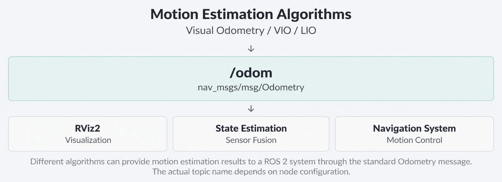

这样，其他模块就不需要关心运动估计算法内部是如何实现的，只需要订阅对应话题，就可以获取机器人的运动状态，实现功能解耦。

### 3.2 TF2：统一机器人各个部件的坐标系

Odometry 解决了运动数据如何传递的问题，但实际机器人还面临另一个问题：不同传感器的数据通常位于不同的坐标系中。例如，相机检测到一个物体位于相机前方 1 米，但机器人导航系统需要知道这个物体相对于机器人底盘的位置。由于相机和底盘的安装位置不同，因此必须进行坐标转换。在 ROS 2 中，使用 TF2 管理这些坐标关系。

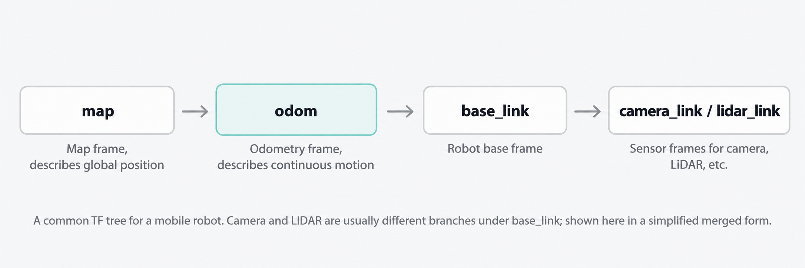

上图是移动机器人中常见的坐标系。这里重点是：Odometry 告诉我们机器人如何运动，而 TF2 让我们知道这些运动及传感器观测是相对于哪个坐标系而言的。

### 3.3 ROS 2 中查看运动信息

在 Jetson 上启动运动估计算法后，我们可以通过几条简单的命令检查结果。

1. **查看里程计消息和里程计更新频率：**

```bash
ros2 topic echo /odom --once
ros2 topic hz /odom
```

2. **查看坐标变换**

假设系统已经发布 `odom → base_link`：

```bash
ros2 run tf2_ros tf2_echo odom base_link
```

该命令会持续输出机器人相对于里程计坐标系的平移和旋转信息。

3. **使用 RViz2 可视化**

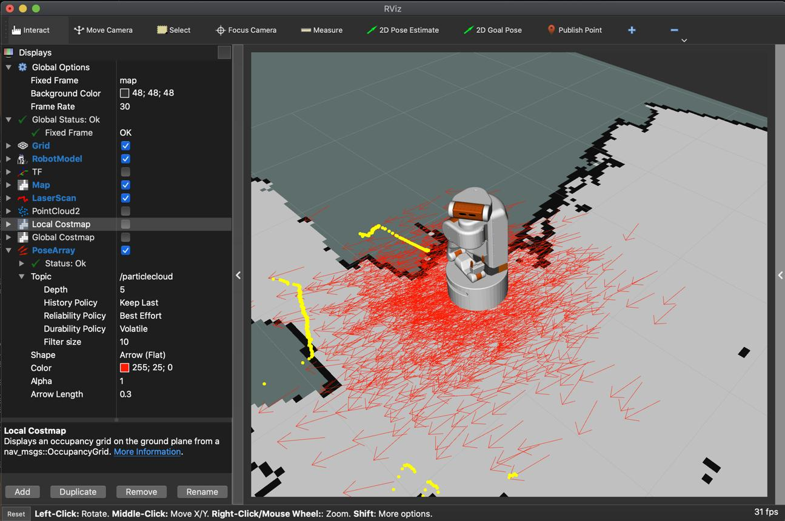

在 RViz2 中，将 `Fixed Frame` 设置为 `odom`，添加 Odometry 和 TF 显示组件，就可以直观观察机器人的运动状态和坐标关系。需要注意，不同里程计算法的话题名和坐标系配置可能不同，应以实际运行结果为准。

## 四、Jetson 实操

前面我们介绍了机器人运动估计的基本原理，以及 ROS 2 如何使用 Odometry 和 TF2 表示机器人的运动状态。接下来，我们将使用 Jetson 和 Livox MID-360 激光雷达，部署 Fast-LIO2 算法，通过激光点云与 IMU 数据实时估计机器人的位置和姿态，并在 RViz2 中观察运动轨迹。

本节实验重点关注三个问题：

1. Fast-LIO2 如何接收激光雷达与 IMU 数据？
2. 如何通过 ROS 2 查看实时位置、姿态和运动轨迹？
3. 机器人运动过程中，里程计是如何更新的，又为什么会产生漂移？

### 4.1 安装 Livox-SDK2

Livox-SDK2 是连接 Livox 激光雷达的底层软件开发套件。首先下载 SDK：

```bash
cd ~
git clone https://github.com/Livox-SDK/Livox-SDK2.git
```

进入目录，编译并安装：

```bash
cd ~/Livox-SDK2
mkdir build && cd build

cmake ..
make -j
sudo make install
```

安装完成后，可通过 SDK 提供的示例程序检查其是否能够正常启动：

```bash
cd ~/Livox-SDK2/build/samples/livox_lidar_quick_start
./livox_lidar_quick_start /home/$USER/Livox-SDK2/samples/livox_lidar_quick_start/mid360_config.json
```

如果 SDK 可以正常启动，说明底层软件安装基本完成。未连接雷达时可能出现设备连接相关提示。

### 4.2 安装 Livox ROS 2 驱动

完成 SDK 安装后，继续配置 ROS 2 驱动，使 MID-360 能够发布激光点云与 IMU 数据。

1. **下载驱动**

```bash
mkdir -p ~/ros2_ws/src
cd ~/ros2_ws/src
git clone https://github.com/Livox-SDK/livox_ros_driver2.git
```

2. **编译驱动**

```bash
cd ~/ros2_ws
colcon build --packages-select livox_ros_driver2 --cmake-args -DROS_EDITION=ROS2 -DDISTRO_ROS=humble
source install/setup.bash
```

### 4.3 配置 MID-360 网络并验证传感器数据

MID-360 通过以太网与 Jetson 通信。在运行驱动之前，需要将 Jetson 的有线网卡配置为与雷达相同的网段。本次实验使用以下网络配置：

| 项目 | 示例值 |
|-|-|
| Jetson 有线 IP | 192.168.1.5（静态） |
| 子网掩码 | 255.255.255.0 |
| 网关 | 192.168.1.1 |
| MID-360 IP | 默认 |

同时还需要修改雷达配置文件：

```bash
...
"lidar_configs" : [
  {
    "ip" : "192.168.1.3",
    ...
  }
]
...
```

完成配置后，启动 MID-360 驱动：

```bash
cd ~/ros2_ws
source /opt/ros/humble/setup.bash
source install/setup.bash
ros2 launch livox_ros_driver2 rviz_MID360_launch.py
```

正常情况下，RViz2 中应能够看到实时更新的三维点云。

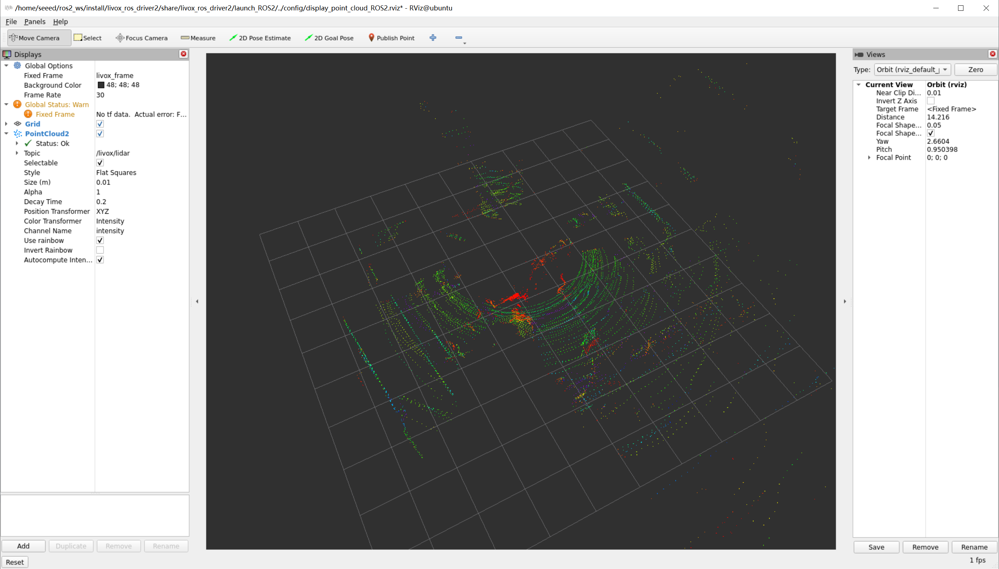

为了进一步验证传感器数据是否正常发布，打开新的终端：

```bash
source ~/ros2_ws/install/setup.bash
ros2 topic list
```

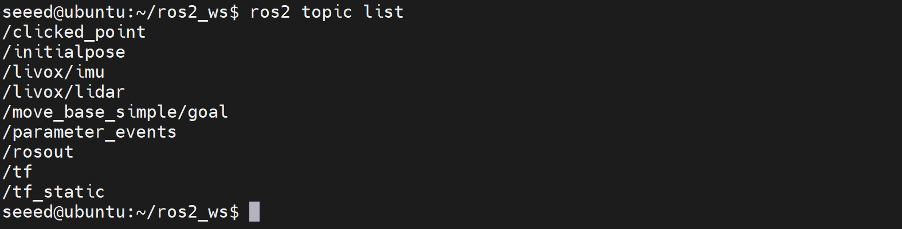

检查激光点云和 IMU 话题：

```bash
ros2 topic hz /livox/lidar
ros2 topic hz /livox/imu
```

查看 IMU 消息：

```bash
ros2 topic echo /livox/imu --once
```

正常情况下，IMU 消息包含角速度 `angular_velocity`、线加速度 `linear_acceleration` 和时间戳 `header.stamp`。只有当激光点云和 IMU 均能够稳定发布后，才继续进行 Fast-LIO2 部署。

### 4.4 安装并配置 Fast-LIO2

Fast-LIO2 通过紧耦合的激光惯性状态估计方法，将 IMU 的高频运动预测与点云几何匹配结合起来，持续计算传感器的位置和姿态。

1. **安装依赖**

```bash
sudo apt install -y libeigen3-dev libpcl-dev
sudo apt install -y ros-humble-pcl-conversions ros-humble-pcl-ros
```

2. **下载 Fast-LIO2 ROS 2 版本**

```bash
cd ~/ros2_ws/src
git clone --recursive https://github.com/Ericsii/FAST_LIO_ROS2.git
```

3. **编译 Fast-LIO2**

```bash
cd ~/ros2_ws

source /opt/ros/humble/setup.bash
source install/setup.bash
colcon build --packages-select fast_lio --symlink-install --cmake-args -DCMAKE_BUILD_TYPE=Release
source install/setup.bash
```

4. **配置 MID-360 参数**

打开 Fast-LIO2 配置文件：

```bash
vim ~/ros2_ws/src/FAST_LIO_ROS2/config/mid360.yaml
```

检查激光点云和 IMU 话题：

```yaml
common:
    lid_topic: "/livox/lidar"
    imu_topic: "/livox/imu"
```

同时检查激光与 IMU 外参配置。对于 MID-360 内置 IMU，应根据设备及驱动实际坐标关系配置，不能随意使用其他传感器的外参。

首次部署时，可以关闭在线外参估计：

```yaml
extrinsic_est_en: false
```

此时算法将使用配置文件中的固定外参。

### 4.6 启动 Fast-LIO2

完成配置后，分别在两个终端启动驱动与算法。

**终端 A：启动 Livox 驱动**

```bash
cd ~/ros2_ws

source /opt/ros/humble/setup.bash
source install/setup.bash

ros2 launch livox_ros_driver2 msg_MID360_launch.py
```

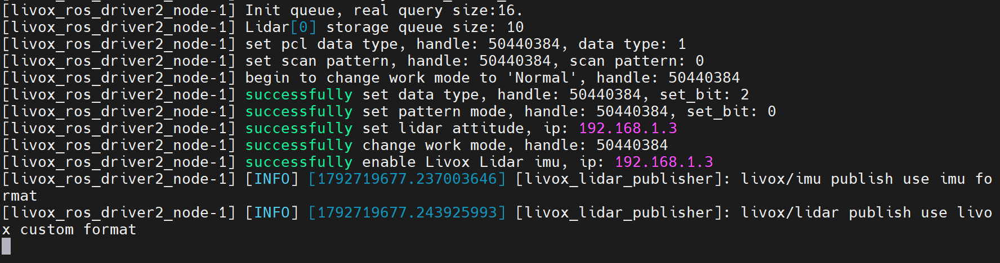

**终端 B：启动 Fast-LIO2**

```bash
cd ~/ros2_ws

source /opt/ros/humble/setup.bash
source install/setup.bash

ros2 launch fast_lio mapping.launch.py \
  config_file:=mid360.yaml \
  rviz:=true
```

启动后，首先保持 MID-360 静止约 5–10 秒，让系统完成初始状态估计。随后可以缓慢移动雷达，观察 RViz2 中实时更新的点云和运动轨迹。

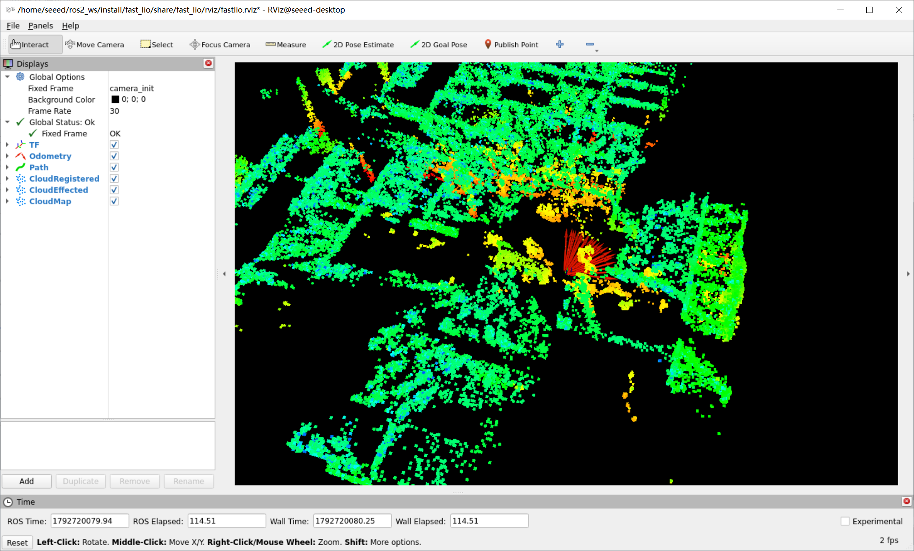

### 4.7 查看实时里程计数据

在第三部分中，我们已经介绍了 ROS 2 使用 `nav_msgs/msg/Odometry` 表示机器人的运动状态。现在，我们通过 Fast-LIO2 的实际输出来验证这一机制。

打开第三个终端：

```bash
source ~/ros2_ws/install/setup.bash
ros2 topic list
```

找到 Fast-LIO2 发布的 `/Odometry` 话题。

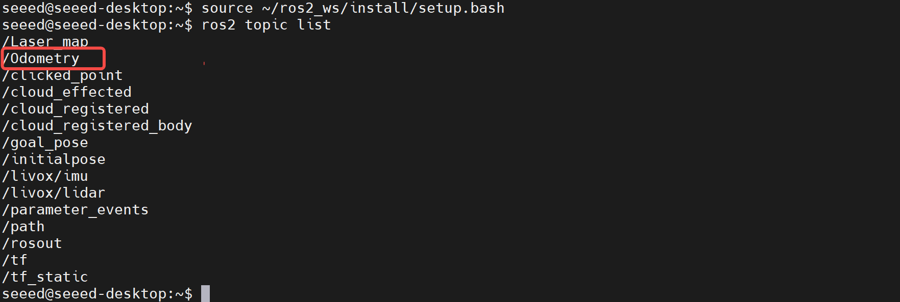

首先检查其消息类型：

```bash
ros2 topic info /Odometry
```

然后查看一条实时消息：

```bash
ros2 topic echo /Odometry --once
```

正常情况下，可以看到 `pose` 等里程计字段，其中包含当前的位置和姿态。

1. **观察位置变化**

```bash
ros2 topic echo /Odometry \
  --field pose.pose.position
```

保持雷达静止，记录初始位置。随后缓慢沿直线移动雷达，观察 X、Y、Z 三个坐标值的变化。需要注意，这三个坐标描述的是传感器相对于参考坐标系的位置，而不一定与机器人底盘的前后左右方向直接对应。

2. **观察姿态变化**

```bash
ros2 topic echo /Odometry \
  --field pose.pose.orientation
```

缓慢旋转雷达，观察四元数数据是否发生变化。这对应了前文介绍的 6DoF 位姿中的三个旋转自由度。

3. **检查里程计更新频率**

```bash
ros2 topic hz /Odometry
```

如果能够持续输出频率信息，说明 Fast-LIO2 正在发布里程计数据。

### 4.8 通过 RViz2 观察运动轨迹

完成数据验证后，我们可以通过 RViz2 更直观地观察运动估计结果。保持 Fast-LIO2 正常运行，在 RViz2 中检查点云和轨迹显示，并根据实际发布的话题配置 Odometry、Path 和 TF 显示组件。首次实验建议选择具有明显几何结构的室内环境，例如墙面、门框、立柱和走廊。

正常情况下，Fast-LIO2 应能够随着设备移动持续更新传感器位姿。如果运动过程中出现轨迹跳变、点云拉伸或明显重影，应检查 IMU 数据、时间戳、激光与 IMU 外参，以及是否存在快速旋转或剧烈振动。

## 五、总结

本节介绍了机器人运动估计的基本原理，以及 VO、VIO、LIO 和 ROS 2 里程计的工作方式，并通过 Fast-LIO2 实验实现了机器人的实时位姿估计与运动轨迹可视化。

**运动估计能够持续追踪机器人的运动状态，但难以避免长期累积误差。** 下一节，我们将进一步学习 SLAM 技术，实现环境地图构建与全局优化。
