# 5.2 Complete SLAM: Loop Closure and Global Map Optimization

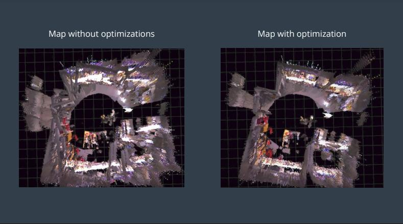

*Image source: https://learn-udacity.top/udrb552921/Robotics%20Software%20Engineer%20v5.0.0/Part%2006-Module%2001-Lesson%2004_GraphSLAM/18.%20RTAB-Map%20Optimization%20and%20Output.html*

In the previous lesson, we introduced the fundamentals of robot motion estimation and implemented real-time pose estimation. However, we also found a problem: although motion estimation algorithms can continuously compute the robot's position and orientation, they cannot completely avoid error accumulation. For example, a robot moves around an office corridor and finally returns to the starting point. Although the robot has actually returned to its original position, the trajectory estimated by odometry may fail to close.

So can a robot recognize places it has visited before, and use this information to correct its previous trajectory? This is one of the core problems that SLAM (Simultaneous Localization and Mapping) solves, and it is the focus of this lesson. In this lesson, we will focus on loop closure and pose graph optimization, and use RTAB-Map on the Jetson J501 to implement a complete RGB-D SLAM mapping pipeline.

Learning objectives of this lesson:

- **Understand the complete SLAM architecture**: distinguish the front-end odometry from the back-end optimization;
- **Master loop closure**: understand how a robot recognizes places it has visited before;
- **Understand pose graph optimization**: learn how the global trajectory and map are corrected;
- **Complete the RTAB-Map experiment**: implement loop closure, map optimization and result verification.

## 1. From Odometry to SLAM

Whether we use VO, VIO or LIO, every estimate may contain errors. As the robot keeps moving, these errors accumulate gradually. This drift creates a direct problem: when the robot passes the same position at different times, it may incorrectly record the same object at different locations in the map.

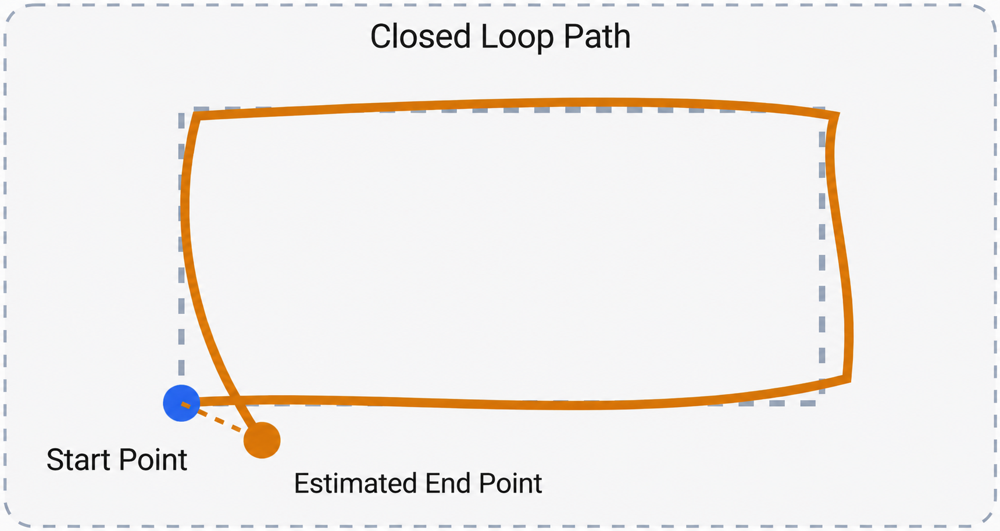

To reduce this accumulated error, a complete SLAM system usually does not rely only on the motion estimates of the most recent frames. Instead, it compares new sensor observations with the map already built. When the robot passes a previously visited position again, SLAM has an opportunity to discover a relationship between the current position and a historical position. This process is called loop closure.

Therefore, compared with odometry, which mainly focuses on continuous motion estimation, complete SLAM not only estimates robot motion, but also corrects the trajectory using historical observations and maintains an environment map with better global consistency.

## 2. The Core Workflow of a Complete SLAM System

A typical SLAM system not only needs to estimate robot motion through front-end odometry, but also records historical observations, recognizes scenes it has passed through again, and uses this information to optimize the robot trajectory. The whole process can be summarized as:

`Motion estimation` → `Pose graph construction` → `Loop closure` → `Global optimization` → `Map update`.

### 2.1 Keyframes and Pose Graph Construction

While the robot is moving, the front-end odometry continuously estimates new poses. A complete SLAM system further needs to record the relationships between these poses. To avoid the computational burden of storing all sensor data, many SLAM algorithms select representative observations to form **keyframes** or map nodes. These nodes and their relationships form a **pose graph**.

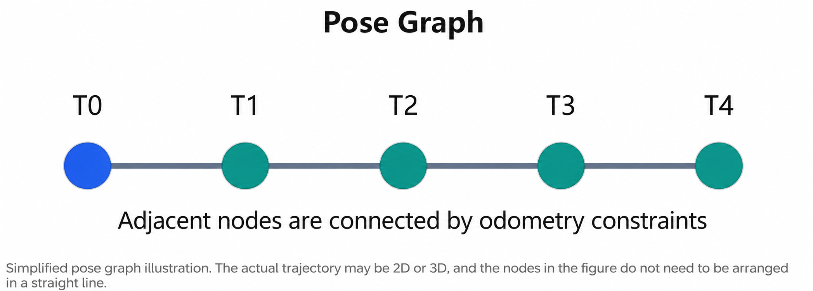

In a pose graph:

- Node: represents the robot's pose at a certain moment;
- Edge: represents the relative motion constraint between two poses.

Initially, these constraints mainly come from odometry. However, because odometry has accumulated errors, constraints between adjacent nodes alone still cannot guarantee the global consistency of the whole map. Therefore, SLAM also needs to build additional constraints from historical observations.

### 2.2 Loop Closure and Constraint Building

Suppose a robot starts from the office, passes through a corridor, and returns to the office again. Although the odometry positions at the two moments may differ, they actually correspond to the same place. The task of loop closure is to discover this relationship between a historical position and the current position.

Taking RTAB-Map as an example, it can use visual features and a bag-of-words model to retrieve historical observations similar to the current image, and then confirm whether a loop truly occurred through geometric consistency checks.

The whole process mainly consists of three steps:

1. **Scene retrieval**: find positions in the historical observations that are similar to the current scene;
2. **Geometric verification**: use feature matching and geometric relationships to rule out incorrect matches;
3. **Loop constraint**: build a new pose constraint between the current node and a historical node.

Note that loop closure is not simply judging whether two images look similar. For example, two corridors that look alike are not necessarily the same position. If a loop constraint is wrongly built, it may instead distort the entire map. Therefore, reliable geometric verification is very important.

### 2.3 Pose Graph Optimization and Map Update

Once loop closure succeeds, the SLAM system adds a new constraint to the existing pose graph. At this point a contradiction may arise: odometry thinks the robot's current position is still some distance from the starting point, while loop closure has discovered that the robot has already returned near the starting point.

The role of pose graph optimization is to combine these constraints and recompute a more consistent set of robot poses.

Optimization does not simply move the end point to the start point. Instead, it jointly adjusts the poses of the relevant nodes, taking into account the odometry constraints, the loop constraints and their respective uncertainties. When the poses are adjusted, point clouds or other map data generated from these poses can also be re-aligned, improving problems such as map ghosting and misaligned walls. In ROS 2, this global correction is usually reflected through the `map → odom` coordinate transform.

In this way, the robot can both retain its continuous local motion estimates and use SLAM to obtain corrected global map positions.

## 3. Hands-on: Complete SLAM with RTAB-Map

We have learned the core workflow of a complete SLAM system. Next, we will use the Orbbec Gemini 2 camera and RTAB-Map to implement keyframe mapping, loop closure and global map optimization.

The biggest difference between this experiment and the previous lesson is: the previous lesson only cared about how the camera moves, while this lesson further uses historical observations to correct the trajectory and build an environment map with global consistency.

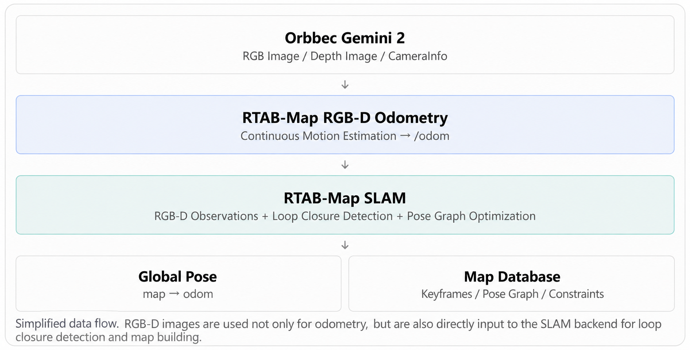

### 3.1 Preparing the Software Environment

Before starting the SLAM experiment, we need to confirm that the Jetson has ROS 2, the Orbbec camera driver, RTAB-Map and related development tools installed. If a piece of software is already installed, you can skip the corresponding installation step and continue checking the next component, to avoid reinstalling.

**Check ROS 2 Humble**

ROS 2 is the software foundation of this experiment. Both the Orbbec camera driver and RTAB-Map need to run in a ROS 2 environment.

```bash
ls /opt/ros/
source /opt/ros/humble/setup.bash
echo $ROS_DISTRO
ros2 --help
```

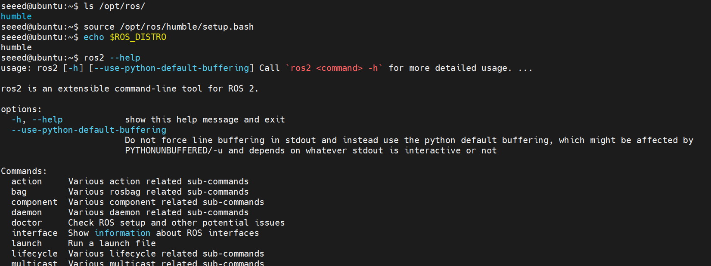

If it outputs `humble` and `ros2 --help` displays help information properly, the ROS 2 command-line environment is available. Otherwise, refer to the [Beginner's Guide](https://github.com/Seeed-Projects/reComputer-Jetson-for-Beginners) to install ROS.

**Check build tools and dependency management tools**

The Orbbec ROS 2 driver may need to be built from source, so tools such as Git, CMake, Colcon and rosdep are required.

```bash
git --version
cmake --version
colcon version-check
rosdep --version
```

If all commands output version information normally, the relevant tools are available and you can continue checking the Orbbec driver. If you see `command not found`, install the missing tools.

**Check the Orbbec Gemini 2 driver**

Make sure the ROS 2 environment is loaded. If you have previously created a `~/ros2_ws` workspace, load its environment as well:

```bash
source /opt/ros/humble/setup.bash

if [ -f ~/ros2_ws/install/setup.bash ]; then
  source ~/ros2_ws/install/setup.bash
fi

ros2 pkg prefix orbbec_camera
ls /etc/udev/rules.d/99-obsensor-libusb.rules
ros2 run orbbec_camera list_devices_node
```

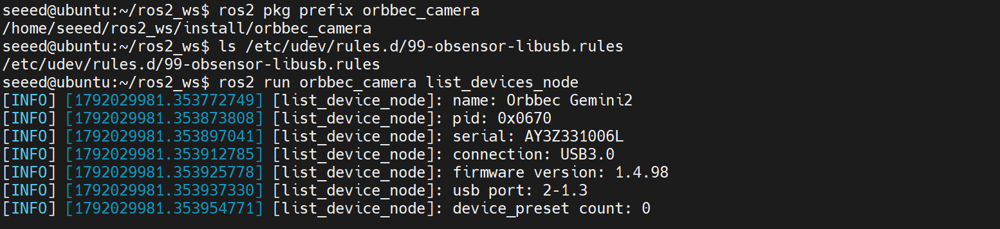

If the program recognizes the Gemini 2 and displays device information, the camera connection and SDK access are normal. Otherwise, run the following commands to install the driver.

```bash
# Download the source code
mkdir -p ~/ros2_ws/src
cd ~/ros2_ws/src
git clone -b v2-main https://github.com/orbbec/OrbbecSDK_ROS2.git
cd ~/ros2_ws

# Install the driver
sudo rosdep init
rosdep update
rosdep install --from-paths src --ignore-src -r -y
colcon build --symlink-install --cmake-args -DCMAKE_BUILD_TYPE=Release
source ~/ros2_ws/install/setup.bash

# Configure permissions
cd ~/ros2_ws/src/OrbbecSDK_ROS2/orbbec_camera/scripts
sudo bash install_udev_rules.sh
sudo udevadm control --reload-rules
sudo udevadm trigger

# Check the environment
ros2 pkg prefix orbbec_camera
ls /etc/udev/rules.d/99-obsensor-libusb.rules
```

**Install RTAB-Map**

RTAB-Map provides binary packages for ROS 2 Humble, which can be installed directly with apt:

```bash
sudo apt update
sudo apt install -y ros-humble-rtabmap-ros
ros2 pkg list | grep rtabmap
```

If the output is not empty, you can continue configuring the visualization environment.

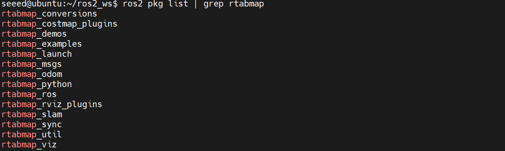

**Check visualization and debugging tools**

```bash
command -v rviz2
command -v rtabmap-databaseViewer
ros2 pkg prefix tf2_tools
```

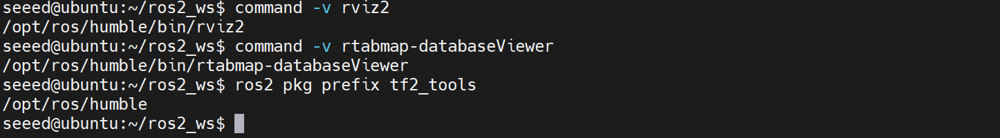

If all three tools are found, your device already has the visualization tools needed for the later experiments. Otherwise, refer to the [Beginner's Guide](https://github.com/Seeed-Projects/reComputer-Jetson-for-Beginners) to install them.

### 3.2 Starting RTAB-Map SLAM

#### Start the camera

```bash
source /opt/ros/humble/setup.bash
source ~/ros2_ws/install/setup.bash

ros2 launch orbbec_camera gemini2.launch.py \
  enable_color:=true \
  enable_depth:=true \
  depth_registration:=true \
  align_mode:=HW \
  enable_frame_sync:=true \
  depth_colorizer_mode:=none \
  enable_point_cloud:=false \
  enable_ir:=false
```

#### Start SLAM

```bash
ros2 launch rtabmap_launch rtabmap.launch.py \
  visual_odometry:=true \
  depth:=true \
  frame_id:=camera_link \
  vo_frame_id:=odom \
  odom_topic:=/odom \
  rgb_topic:=/camera/color/image_raw \
  depth_topic:=/camera/depth/image_raw \
  camera_info_topic:=/camera/color/camera_info \
  approx_sync:=true \
  qos:=2 \
  publish_tf_odom:=true \
  publish_tf_map:=true \
  database_path:=$HOME/slam_maps/m5_2_gemini2.db \
  rtabmap_viz:=true \
  rviz:=false
```

These parameters are provided by the official RTAB-Map ROS 2 launch file. In particular, `visual_odometry:=true` starts the RGB-D odometry node, so you do not need to run `rgbd_odometry` separately.

The key parameters are as follows:

| Parameter | Description |
|-|-|
| `visual_odometry:=true` | Automatically starts the RGB-D visual odometry |
| `frame_id:=camera_link` | Uses the camera body as the motion reference |
| `vo_frame_id:=odom` | Sets the local odometry coordinate frame |
| `approx_sync:=true` | Uses approximate time synchronization |
| `qos:=2` | Receives sensor data with Best Effort QoS |
| `publish_tf_odom:=true` | Publishes the local odometry TF |
| `publish_tf_map:=true` | Publishes the global map correction TF |
| `database_path` | Where the SLAM database is saved |
| `rtabmap_viz:=true` | Enables the RTAB-Map visualization interface |

If you run over SSH in a headless environment, set `rtabmap_viz:=false` to avoid GUI initialization failures.

For the first experiment, use a new database file name. If a database with the same name already exists, RTAB-Map may load and continue using the previous map.

### 3.3 Observing Real-Time SLAM Mapping

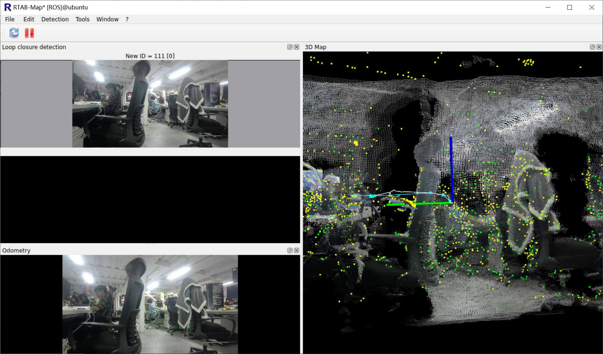

First, keep the camera pointed at an area with clear texture, such as a table, a door frame or posters on a wall, then move the camera slowly. Under normal conditions, the map expands gradually as the camera moves, and new nodes keep being added to the pose graph.

**To verify loop closure and graph optimization, this experiment requires the camera to observe previously visited positions again.**

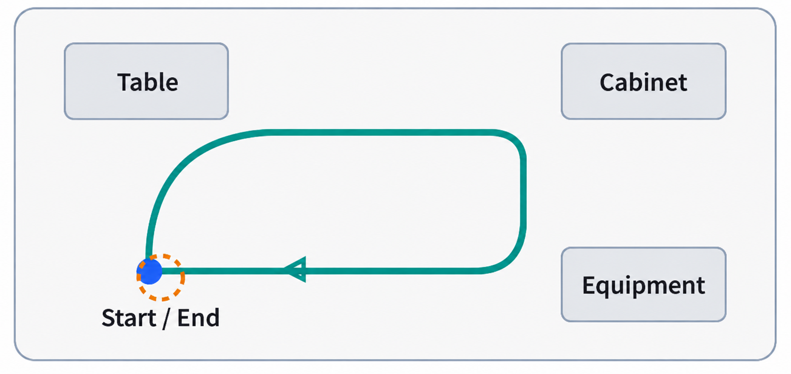

### 3.4 Viewing the Map with Database Viewer

After the experiment, press CTRL+C in the terminal window to stop the SLAM program and wait for the map to be saved. Then use RTAB-Map's dedicated Database Viewer tool to inspect the saved SLAM map.

Run it in a terminal with a graphical desktop:

```bash
rtabmap-databaseViewer ~/slam_maps/m5_2_gemini2.db
```

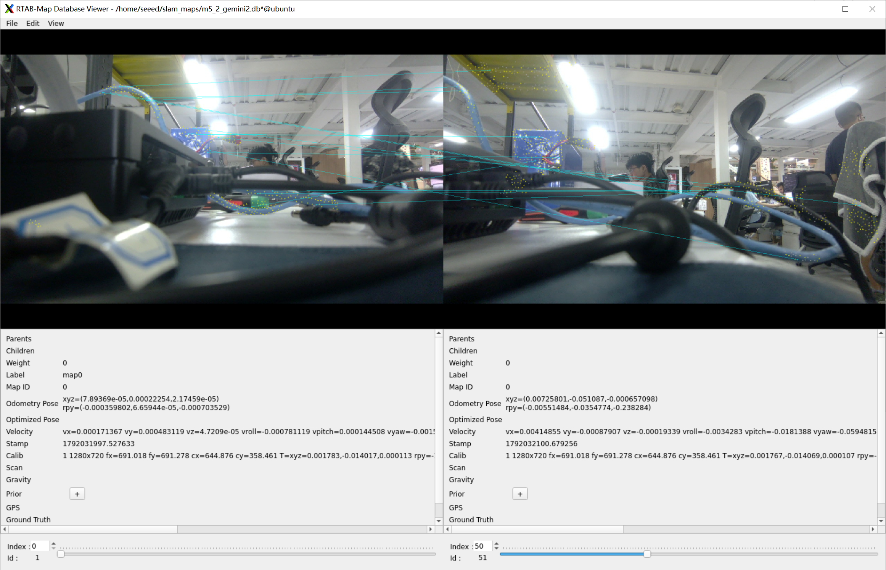

After opening the database, we recommend checking whether the historical pose nodes, loop constraints, optimized trajectory and point cloud map are consistent with the captured environment. This lesson only requires saving and inspecting the SLAM database. M5.5 will further cover map loading, relocalization, and exporting the 2D navigation map needed by Nav2.

## 4. Summary

In this lesson, we learned the core working principles of a complete SLAM system, and completed an RGB-D SLAM experiment on the Jetson using the Orbbec Gemini 2 and RTAB-Map.

From the system workflow perspective:

- Visual odometry continuously estimates camera motion and provides local pose information;
- The pose graph manages historical poses and their constraints;
- Loop closure recognizes previously visited scenes and builds new historical position constraints;
- Global optimization adjusts the relevant poses according to these constraints, improving the global consistency of the trajectory and the map.

Through this experiment, we not only implemented real-time mapping, but also learned how to inspect loop closure results, analyze map quality, and save and view SLAM databases. However, the trajectory, pose graph and point clouds output by a SLAM system cannot directly solve all of the robot's spatial understanding problems. When a robot needs to judge how much space an obstacle occupies, how far the end of a robotic arm is from a tabletop, or whether a path maintains a safe distance from obstacles, a 3D geometric representation better suited to spatial computation is needed.
