# 5.3 三维几何地图构建：从点云到稠密空间重建

在上一节课程中，我们使用 RTAB-Map 实现了 RGB-D SLAM，完成了机器人运动估计、回环检测和全局地图优化。然而，对于机器人自主导航和机械臂操作而言，仅知道自身位置还不够。机器人还需要了解**障碍物占据了哪些空间、距离障碍物有多远，以及如何利用这些信息进行运动规划。**为此，我们需要将 RGB-D 相机采集的深度数据与 SLAM 提供的位姿信息相结合，构建能够描述环境几何结构和障碍物距离的三维地图。

本节将从三维点云出发，依次介绍 **Voxel、TSDF、ESDF 和 Mesh** 的基本原理，并使用 **Isaac ROS Nvblox** 在 Jetson 上实现 GPU 加速三维建图。

---

## 一、从 SLAM 地图到三维几何地图

**SLAM 地图：** RTAB-Map 地图与优化后的轨迹示例，重点是机器人位姿及地图的全局一致性。

**三维几何地图：** Nvblox 在 RViz 中的三维表面与距离场可视化示例，重点是环境形状和障碍物距离。

前面学习的 SLAM 系统主要解决定位和地图一致性问题，而本节的几何建图进一步描述环境中物体的形状与空间分布。两者的联系可以概括为：

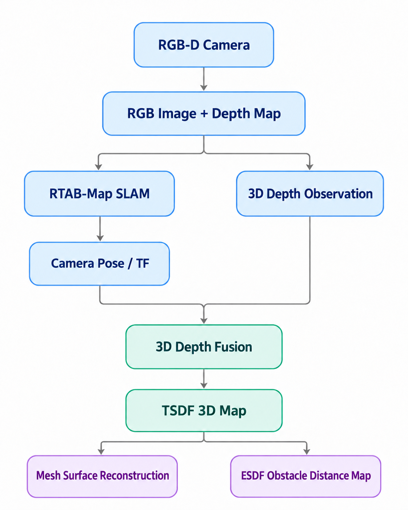

在这个流程中，RTAB-Map 提供空间位姿，Nvblox 利用深度数据和位姿构建几何地图。它们不是互相替代，而是承担不同任务。

---

## 二、三维空间地图的核心表示方法

### 2.1 稀疏点云与稠密点云

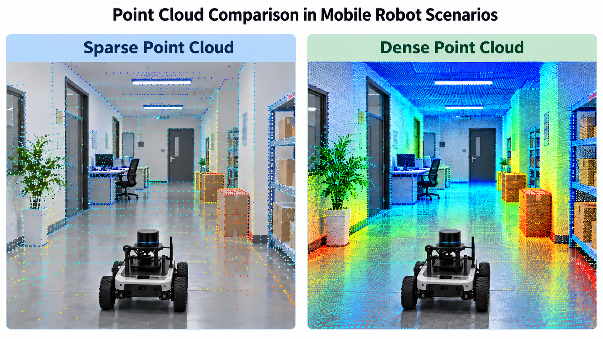

点云（Point Cloud）是最直观的三维几何表示方式，每个点通常包含 XYZ 坐标，还可能包含 RGB 颜色等信息。

| | 稀疏点云 | 稠密点云 |
|-|-|-|
| 数据来源 | 图像特征点 | 大量有效深度像素 |
| 点的密度 | 低 | 高 |
| 主要用途 | SLAM 定位和特征匹配 | 三维空间重建 |
| 几何细节 | 不完整 | 相对丰富 |

例如，一帧 640×480 的深度图包含 307,200 个像素。如果所有像素都具有有效深度，理论上最多可以反投影出约 30.7 万个三维点。但是，点云本身只是一组离散坐标。机器人如果希望进行高效的碰撞检查和障碍物距离计算，还需要更结构化的空间表示。

### 2.2 Voxel：把三维空间划分成小立方体

> 图：三维空间体素化示例。空间被离散成许多小立方体，每个体素都可以保存局部地图信息。

Voxel（体素）可以理解为三维版本的像素。二维图像由一个个 Pixel 组成，而三维体素地图则由一个个具有体积的小立方体组成。每个体素可以记录占据状态、距离、颜色或语义等信息。体素分辨率决定了地图的几何精细程度和资源消耗。体素分辨率提高时，理论数据量会迅速增加。因此，地图精度与 Jetson GPU 的计算资源之间需要取得平衡。

### 2.3 三种核心地图：Occupancy、TSDF 和 ESDF

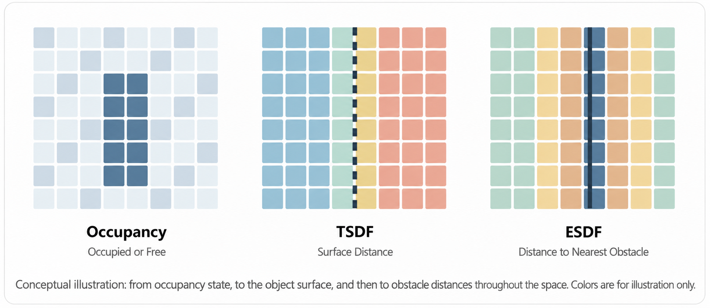

**Occupancy Grid：哪里有障碍物？**

每个栅格或体素记录空闲、占据或未知状态，适合判断空间是否可以通行。

**TSDF：物体表面在哪里？**

TSDF（Truncated Signed Distance Field，截断符号距离场）主要描述物体表面附近的有符号距离，并融合多次深度观测。上图中黑色虚线表示物体表面，附近网格以有符号距离值表达表面两侧的空间。

**ESDF：距离障碍物还有多远？**

ESDF（Euclidean Signed Distance Field，欧氏符号距离场）描述空间中的位置到最近障碍物表面的欧氏距离。

TSDF 与 ESDF 的关键区别：TSDF 的距离主要围绕物体表面的有限截断区域表示，更适合进行表面重建；ESDF 关注空间位置到最近障碍物的距离，更适合用于安全距离查询与运动规划。

### 2.4 Mesh：将三维空间恢复为连续表面

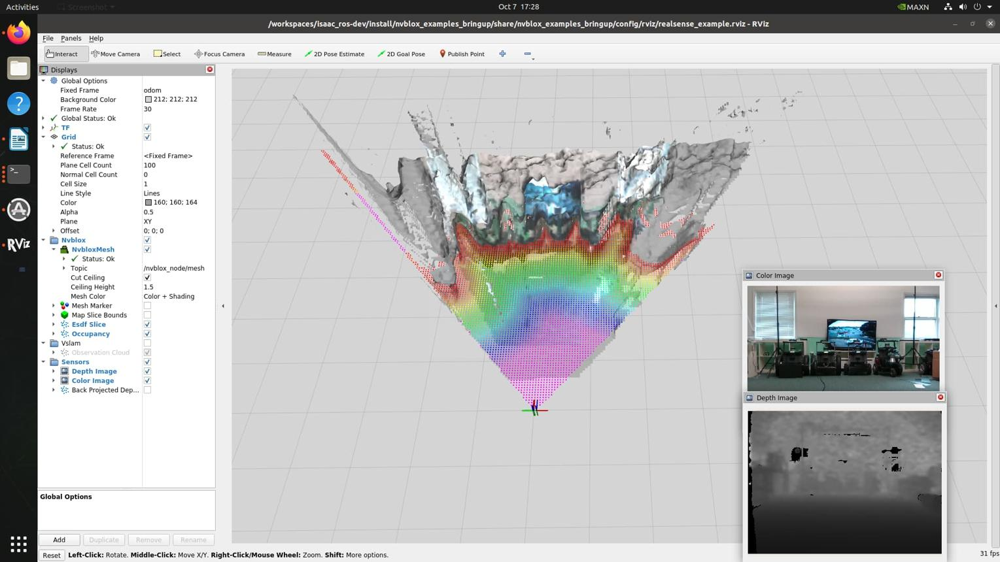

*图片来源：https://forums.developer.nvidia.com/t/isaac-ros-nvblox-2-1-with-live-realsense-camera/346703*

前面介绍的 TSDF 和 ESDF 都属于体素距离场表示。但如果我们希望在屏幕上显示一个完整的三维房间，仅仅显示体素通常并不是最直观的方式。因此，我们还可以从 TSDF 中进一步提取 Mesh（三角网格）。

常见的表面提取算法是 Marching Cubes。它根据周围体素的距离值找到表面零交叉位置，并构建三角形。这样，机器人就能够获得更加直观的三维几何表面模型。

---

## 三、Isaac ROS Nvblox：在 Jetson 上实现 GPU 加速三维建图

在前面的内容中，我们已经了解了点云、Voxel、TSDF、ESDF 和 Mesh 等三维地图表示方式。其中，TSDF 可以用于融合深度观测并重建物体表面，ESDF 则能够进一步提供机器人与障碍物之间的距离信息。那么，如何将这些理论应用到实际机器人系统中？

在 M5.2 中，我们已经利用 RTAB-Map 获得了相机的实时位姿。接下来，只需要结合 RGB-D 相机采集的深度图像，就可以将不同视角下的空间观测融合到统一的三维地图中。

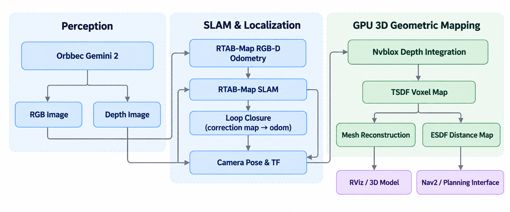

为了实现这一过程，本节将使用 NVIDIA Isaac ROS Nvblox。它能够利用 Jetson GPU 加速深度融合、TSDF 地图更新、Mesh 重建和 ESDF 计算，让机器人从运动轨迹估计进一步走向实时三维空间建图。

### 3.1 Nvblox 的核心工作流程

Isaac ROS Nvblox 是 NVIDIA 提供的三维重建与机器人空间地图计算组件。它接收深度图像、相机内参和位姿信息，利用 GPU 更新三维地图，同时提供 Mesh 可视化和 ESDF 距离地图。

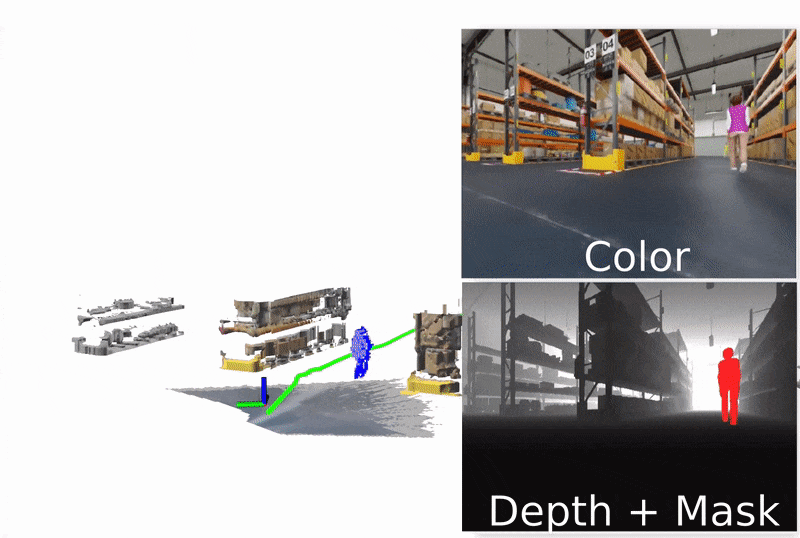

与上一节 RTAB-Map 的关系：RTAB-Map 通过回环检测可以修正历史轨迹，但 Nvblox 在进行实时增量融合时，并不会自动根据新的历史位姿完整重建已经融合的 TSDF 地图。因此，下面的实验首先使用连续的 `odom` 坐标系作为 Nvblox 建图坐标系，验证实时局部三维重建。大范围全局地图的重融合和长期维护属于进一步研究内容。

---

## 四、实操：使用 Nvblox 实现实时三维 Mesh 重建

### 4.1 检查基础环境

首先在 Jetson 主机中确认 ROS 2 和 RTAB-Map 是否可用：

```bash
source /opt/ros/humble/setup.bash

echo $ROS_DISTRO
ros2 pkg prefix rtabmap_launch
ros2 pkg prefix rtabmap_odom
ros2 pkg prefix orbbec_camera
```

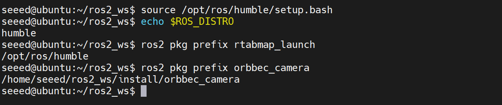

如果所有软件包都能够找到安装路径，说明环境满足后续实验。否则请参考前面的内容配置软件运行环境。

### 4.2 安装 Isaac ROS Nvblox

在 Jetson 设备中准备工作空间：

```bash
mkdir -p ~/workspaces/isaac_ros-dev/src
cd ~/workspaces/isaac_ros-dev/src

git clone -b release-3.2 https://github.com/NVIDIA-ISAAC-ROS/isaac_ros_common.git
cd ~/workspaces/isaac_ros-dev
./src/isaac_ros_common/scripts/run_dev.sh
```

> 如果您的 Jetson 设备中没有 Docker，请参考[小白课程](https://github.com/Seeed-Projects/reComputer-Jetson-for-Beginners/blob/main/3-Basic-Tools-and-Getting-Started/3.7-Docker/README.md)完成 Docker 安装。

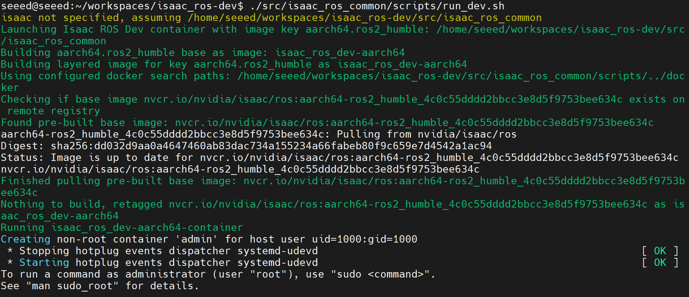

在容器内部安装 Nvblox：

```bash
source /opt/ros/humble/setup.bash
sudo apt update
sudo apt install -y ros-humble-isaac-ros-nvblox
```

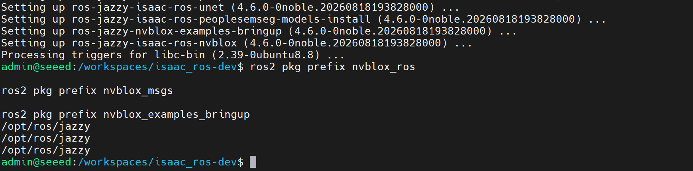

### 4.3 启动相机与 SLAM

这一阶段需要四个终端，最终构成以下运行结构：

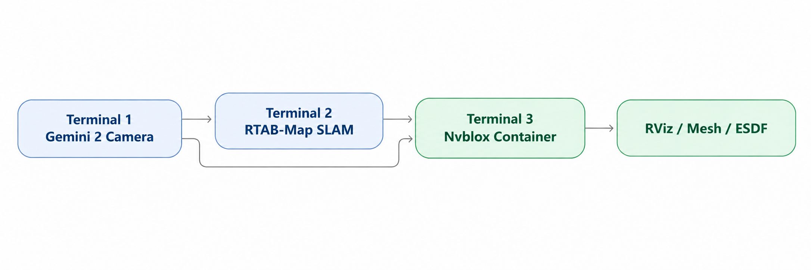

**终端 1：启动 Orbbec Gemini 2**

在 Jetson 主机执行：

```bash
source /opt/ros/humble/setup.bash
source ~/ros2_ws/install/setup.bash

ros2 launch orbbec_camera gemini2.launch.py \
    enable_color:=true \
    enable_depth:=true \
    depth_registration:=true \
    align_mode:=HW \
    enable_frame_sync:=true \
    depth_colorizer_mode:=none \
    enable_point_cloud:=false \
    enable_ir:=false
```

检查相机数据：

```bash
ros2 topic list | grep camera
ros2 topic hz /camera/depth/image_raw
ros2 topic echo /camera/depth/image_raw --once --field header
ros2 topic echo /camera/depth/image_raw --once --field encoding
```

Nvblox 支持以米为单位的浮点深度，以及 OpenNI 格式、以毫米为单位的 16 位深度图。但图像对应的 CameraInfo 必须包含正确的相机内参。

**终端 2：启动 RTAB-Map**

沿用 M5.2 的 SLAM 配置，将可视化窗口关闭：

```bash
source /opt/ros/humble/setup.bash
source ~/ros2_ws/install/setup.bash

ros2 launch rtabmap_launch rtabmap.launch.py \
    visual_odometry:=true \
    depth:=true \
    frame_id:=camera_link \
    vo_frame_id:=odom \
    odom_topic:=/odom \
    rgb_topic:=/camera/color/image_raw \
    depth_topic:=/camera/depth/image_raw \
    camera_info_topic:=/camera/color/camera_info \
    approx_sync:=true \
    qos:=2 \
    publish_tf_odom:=true \
    publish_tf_map:=true \
    database_path:=$HOME/slam_maps/m5_3_gemini2.db \
    rtabmap_viz:=false \
    rviz:=false
```

检查 TF：

```bash
ros2 run tf2_ros tf2_echo \
  odom camera_link
```

这里还需要进一步确认深度图像 `header.frame_id` 对应的光学坐标系能够通过 TF 转换到 `odom`。

### 4.4 配置 Gemini 2 与 Nvblox 的接口

NVIDIA 官方提供了 RealSense 和 Isaac Sim 等示例，但本节使用的是 Gemini 2，因此需要建立自定义话题映射。

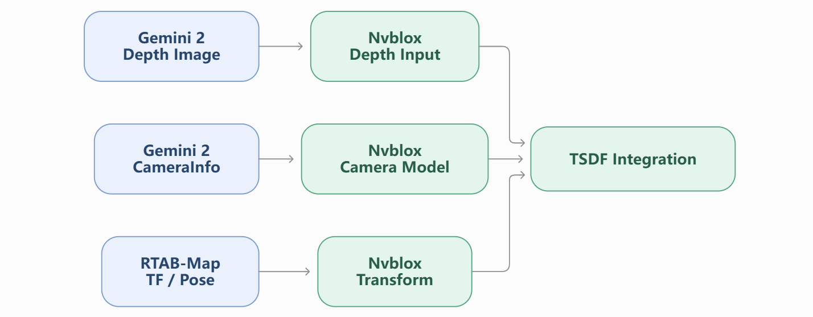

先创建 Launch 目录：

```bash
mkdir -p ~/workspaces/isaac_ros-dev/m5_3_launch
```

然后创建 `gemini2_nvblox.launch.py`，使用下列示例配置：

```python
from launch import LaunchDescription
from launch_ros.actions import ComposableNodeContainer
from launch_ros.descriptions import ComposableNode


def generate_launch_description():

    nvblox = ComposableNode(
        package='nvblox_ros',
        plugin='nvblox::NvbloxNode',
        name='nvblox_node',

        remappings=[
            ('camera_0/depth/image',
             '/camera/depth/image_raw'),

            ('camera_0/depth/camera_info',
             '/camera/depth/camera_info'),

            ('camera_0/color/image',
             '/camera/color/image_raw'),

            ('camera_0/color/camera_info',
             '/camera/color/camera_info'),
        ],

        parameters=[{
            'global_frame': 'odom',
            'num_cameras': 1,
            'voxel_size': 0.05,
            'mapping_type': 'static_tsdf',
            'esdf_mode': '2d',

            'use_depth': True,
            'use_color': True,
            'use_lidar': False,

            'use_tf_transforms': True,
            'use_topic_transforms': False,
            'input_qos': 'SENSOR_DATA',

            'map_clearing_frame_id': 'camera_link',
            'map_clearing_radius_m': 0.0,

            'esdf_slice_bounds_visualization_attachment_frame_id':
                'camera_link',

            'static_mapper.esdf_slice_min_height': 0.0,
            'static_mapper.esdf_slice_max_height': 1.2,
            'static_mapper.esdf_slice_height': 0.5,
        }]
    )

    container = ComposableNodeContainer(
        name='nvblox_container',
        namespace='',
        package='rclcpp_components',
        executable='component_container_mt',
        composable_node_descriptions=[nvblox],
        output='screen'
    )

    return LaunchDescription([container])
```

其中，几个核心参数分别为：

| 参数 | 意义 |
|-|-|
| `global_frame` | 三维地图的坐标系 |
| `voxel_size` | 体素边长，本例 5 cm |
| `mapping_type` | 静态 TSDF 建图 |
| `esdf_mode` | 二维 ESDF 距离切片 |
| `use_tf_transforms` | 通过 TF 获取位姿 |
| `map_clearing_radius_m` | 0 表示关闭按半径清除地图 |

参数名称与含义可以参考 NVIDIA 官方的 [Nvblox ROS Parameters](https://nvidia-isaac-ros.github.io/v/release-3.2/repositories_and_packages/isaac_ros_nvblox/isaac_ros_nvblox/api/parameters.html)。

这里有两个需要实测确认的地方。

首先，Gemini 2 的对齐深度图必须与提供给 Nvblox 的 CameraInfo 匹配。如果驱动发布的深度图已对齐到 RGB 坐标系，CameraInfo 需要根据实际图像尺寸、内参和 frame_id 验证，不能盲目沿用原始深度内参。

其次，二维 ESDF 默认以地图坐标系的高度轴进行切片。如果 `odom` 的 Z 轴没有与实际竖直方向正确对齐，距离切片就可能不符合真实的水平地面。需要先确认相机姿态和坐标定义，才能将它用于真实避障。

> 这份自定义 Launch 是基于官方接口编写的 Gemini 2 适配示例，尚未在实际 J501 + Gemini 2 环境下验证。

### 4.5 启动 Nvblox

**终端 3：在 Jetson 主机进入 Isaac ROS 容器**

```bash
cd ~/workspaces/isaac_ros-dev

./src/isaac_ros_common/scripts/run_dev.sh
```

进入容器后执行：

```bash
source /opt/ros/humble/setup.bash

ros2 launch /workspaces/isaac_ros-dev/m5_3_launch/gemini2_nvblox.launch.py
```

如果节点启动成功，再检查它是否能够订阅 RGB-D 数据：

```bash
ros2 node list
ros2 topic info /camera/depth/image_raw -v
ros2 topic list | grep nvblox
```

正常情况下，会出现与 Nvblox 相关的 Mesh 和 ESDF 话题。

注意：由于相机与 RTAB-Map 在主机运行，Nvblox 在 Docker 容器运行，必须保证双方能够进行 ROS 2 DDS 通信。如果容器无法发现相机话题，需要检查 ROS_DOMAIN_ID、网络模式与 DDS 配置。

### 4.6 在 RViz 中观察三维重建

**终端 4：在 Jetson 中启动 RViz2**

```bash
source /opt/ros/jazzy/setup.bash
rviz2
```

然后在 RViz 窗口中配置可视化的内容。

**Global Options → Fixed Frame：`odom`**

**Add → By display type → nvblox_rviz_plugin → NvbloxMesh**

**Topic：`/nvblox_node/mesh`**

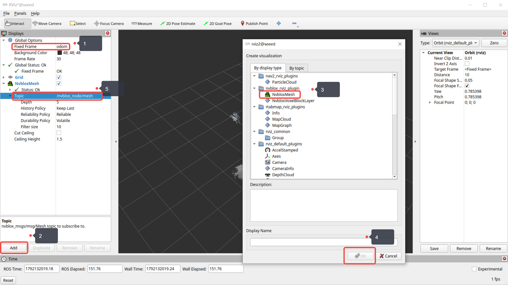

正常情况下，当 Nvblox 接收到深度图像和有效的相机位姿后，RViz 中就会出现环境的三维表面。下面是我们在 Jetson AGX Thor 上实际运行得到的结果：

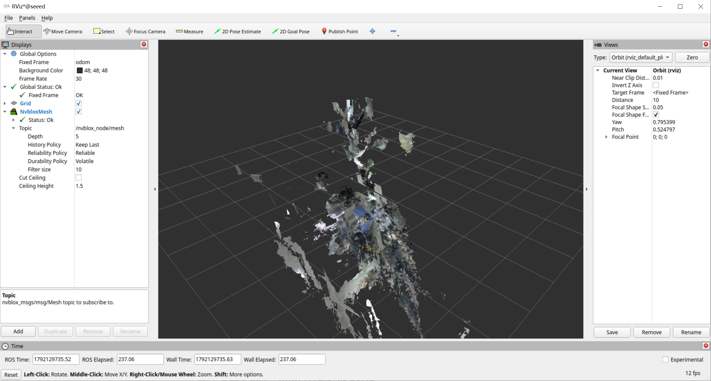

我们已经通过 Mesh 看到了物体的三维形状。接下来，我们将进一步观察 ESDF，验证三维几何地图是否能够提供障碍物距离信息。

回到 RViz，在已有 Mesh 的基础上，点击 `Add`，添加一个 `PointCloud2` 显示项。将 Topic 设置为：

```bash
/nvblox_node/static_esdf_pointcloud
```

建议暂时关闭 `NvbloxMesh`，只显示 ESDF，以便区分两种地图。

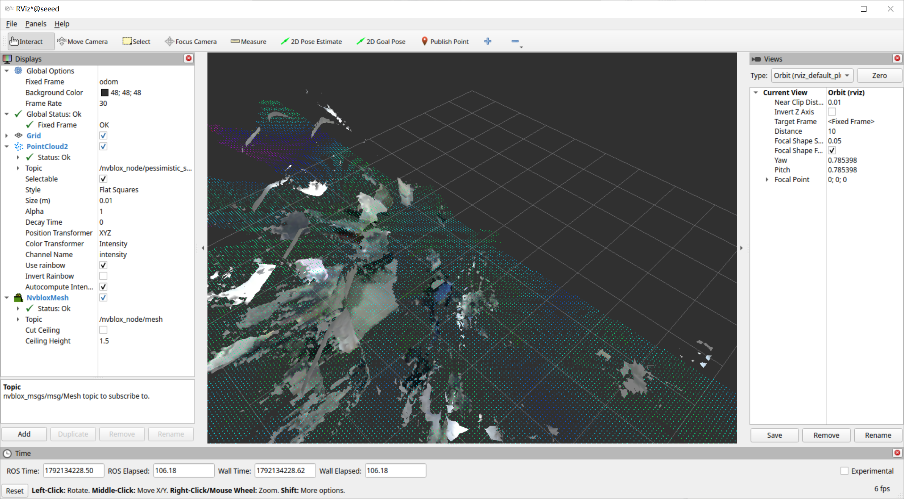

这里可以观察到 Mesh 可以用于表达障碍物的表面，ESDF 用于表达机器人距离障碍物的距离。

---

## 五、本节总结

在本节课程中，我们从 RGB-D 深度数据出发，介绍了点云、Voxel、Occupancy Grid、TSDF、ESDF 和 Mesh 等三维地图表示方法，并使用 Isaac ROS Nvblox 在 Jetson 上实现实时三维几何重建。

通过本节实验，我们已经成功在 Jetson AGX Thor 上运行 Nvblox，并在 RViz 中观察到实时三维 Mesh。接下来，通过相机运动与地图联动、ESDF 距离验证以及地图导出，我们可以进一步检查三维建图流程的完整性与输出结果。从地图表示来看，TSDF 主要用于深度融合和表面重建，Mesh 用于直观表达环境的三维几何形状，而 ESDF 则进一步提供到最近障碍物的距离信息，为机器人避障和运动规划提供基础。至此，机器人不仅能够估计自身运动，也开始具备描述周围三维空间结构的能力。

---

## 参考资料

1. [NVIDIA Isaac ROS Nvblox 文档](https://nvidia-isaac-ros.github.io/v/release-3.2/repositories_and_packages/isaac_ros_nvblox/index.html)
2. [OrbbecSDK_ROS2](https://github.com/orbbec/OrbbecSDK_ROS2)
3. [Robbyant/lingbot-map](https://github.com/Robbyant/lingbot-map)
4. [Seeed Wiki：deploy_nvblox_jetson_agx_orin](https://wiki.seeedstudio.com/deploy_nvblox_jetson_agx_orin)
