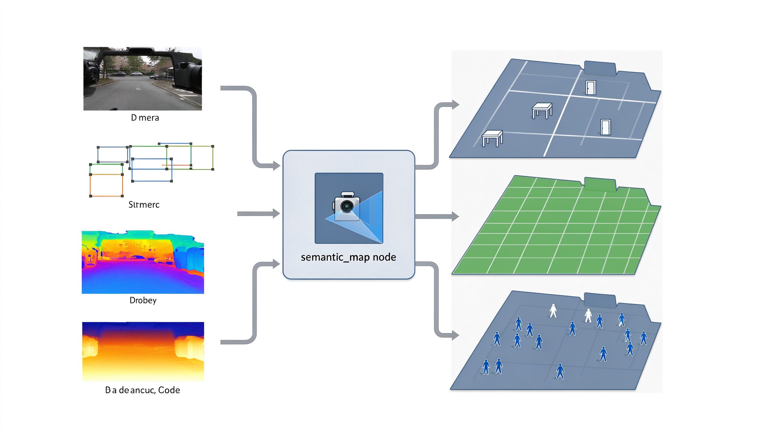
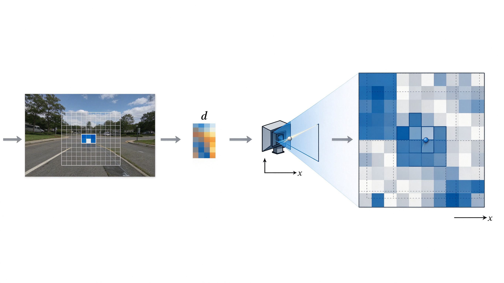
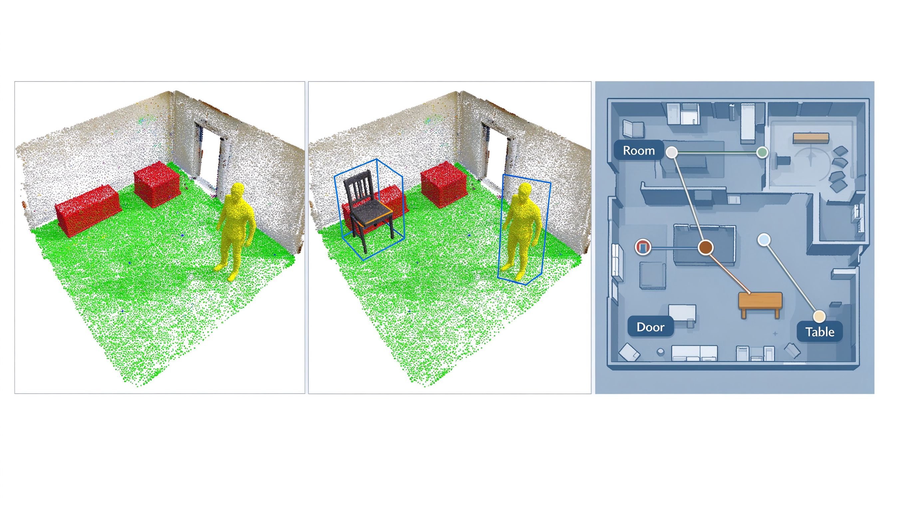
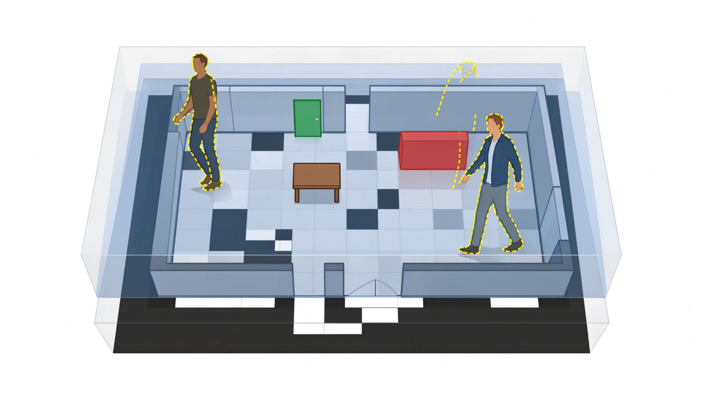

# 5.4 Semantic Mapping: From Geometric Space to Scene Understanding

> **Hardware environment**: reComputer J501 (AGX Orin 32GB), L4T 36.4.4 / JetPack 6.2.1
> **Software stack**: ROS 2 Humble, OpenCV 4.10 (CUDA), PCL / Open3D, TensorRT 10.x, RViz2

From the previous lessons we can obtain a geometric map: where is occupied, where is traversable, where are the obstacles. But the robot still cannot understand the world — it does not know "whether that blob of obstacle is a chair or a door", let alone "where the meeting room is". This lesson connects M4's object detection and semantic segmentation into the 3D map, producing a semantic map with object categories and spatial positions: the robot not only knows that something is here, but also knows what it is, whether it can be traversed, and whether it is worth remembering.

## 1. What You Will Be Able to Do After This Lesson

- Explain the difference between a geometric map and a semantic map, and why the semantic layer is overlaid on the geometric layer rather than replacing it;
- Project 2D semantic labels (detection boxes, segmentation masks) combined with depth data into 3D map coordinates;
- Distinguish the three granularities of semantic maps: semantic point clouds, object-level maps and spatial semantic landmarks, and the downstream tasks each one serves;
- Express static objects, dynamic objects and drivable areas in three separate layers, keeping dynamic targets from polluting the long-term map;
- Deliver a semantic map that fuses AI perception with the 3D map, and overlay it in RViz2.

## 2. Hardware and Software Checklist

**Hardware:** J501 (MAXN mode), RGB-D depth camera (Orbbec Gemini 2, connected and D2C-aligned in M2.2/5.2/5.3), LiDAR (M3.1), mobile chassis.

**Software:**

- M4 outputs (three channels): `/perception/detections` (YOLO, `vision_msgs/Detection2DArray`), `/perception/tracks` (ByteTrack, with `id`), `/perception/semantic_mask` (19 classes, uint8) + `/perception/drivable_mask` (0/255 candidate-drivable);
- 3D map: the Nvblox 3D geometric map from 5.3 (Mesh / ESDF / occupancy grid);
- Projection tools: Open3D / PCL, `tf2`, `cv_bridge`;
- The working directory follows `/home/seeed/workspace/ros2_bev`, and the semantic node lives in `ros2_ws/src/semantic_map/`.

## 3. Prerequisites

- M4.1: the object detection pipeline works, `/perception/detections` is published continuously;
- M4.2: multi-object tracking works, `/perception/tracks` is published continuously, each box has a stable `id`;
- M4.3: both semantic segmentation outputs run — `/perception/semantic_mask` (Cityscapes 19 classes, uint8, 0–18) and `/perception/drivable_mask` (a candidate-drivable mask derived from `drivable_class_ids`);
- M2.2: the depth camera and the color image are D2C-aligned (registration); the depth image and the color image have the same resolution and consistent `camera_info`; the 16UC1 depth is read in millimeters and must be divided by 1000;
- M3.3: the camera→LiDAR→chassis extrinsics are known;
- 5.3: the Nvblox 3D geometric map runs, and the TF tree (map→odom→base_link→camera_link) is continuous.

---

## 4. Read First: How a Geometric Map Differs from a Semantic Map

### 4.1 The Geometric Map Answers "Can I Go Through It?", the Semantic Map Answers "What Is It?"

| Dimension | Geometric map (5.3) | Semantic map (this lesson) |
|-|-|-|
| Data | Grid occupancy probabilities, point cloud coordinates | Coordinates + category labels + confidence + (object) ID |
| Typical question | "Can I pass through here?" | "Is that a door or a wall? Where is the table?" |
| Downstream | Path planning, cost maps | Object retrieval, spatial position queries |
| Update frequency | Long-term static layer, slow changes | Static layer changes slowly + dynamic layer in real time |

Key insight: **a semantic map is not another map, but a semantic layer overlaid on the geometric map.** The geometric layer governs traversability, the semantic layer governs "what it is", and both layers share the same coordinate frame, aligned through TF.

### 4.2 How 2D Semantic Labels Land in 3D Space

AI perception gives you things in the image coordinate frame: YOLO gives pixel boxes, segmentation gives pixel masks. To enter the map, a three-step projection is required:

1. **Get the depth**: for each pixel (u, v) inside the mask/box, read the distance d of that point from the depth image;
2. **Back-project to the camera coordinate frame**: use the camera intrinsics to recover the pixel as a 3D point: $X_c = (u - c_x) \cdot d / f_x$, and similarly for Y and Z;
3. **Transform to map via TF**: transform the point along `camera_link → base_link → odom → map` into the map coordinate frame, landing on the corresponding grid/point cloud.

The full back-projection needs four intrinsics (from `camera_info`, already given by the M2.2 calibration): `fx, fy, cx, cy`. For every valid pixel `(u, v)` on the depth image with depth value `d` (in meters):

$$\begin{bmatrix} x_c \\ y_c \\ z_c \end{bmatrix} = \begin{bmatrix} (u - c_x)\,d / f_x \\ (v - c_y)\,d / f_y \\ d \end{bmatrix}$$

Then use TF to transform the camera-frame point into the map: $p_{map} = T_{map}^{camera} \cdot [x_c,\, y_c,\, z_c,\, 1]^\top$, where `T` is queried online with `tf2`. Three practical points:

- The depth `d` is a 16UC1 reading in millimeters and must first be converted with `d / 1000.0` to meters, otherwise the points collapse near the camera;
- Pixels with `d <= 0` or beyond the camera range are skipped directly (Gemini 2 official range 0.15–10 m, ideal range 0.2–5 m; a conservative 0.4–10 m window is commonly used indoors);
- The mask and the depth image must have the same resolution and principal point; if not, use `cv_bridge` + `image_proc` to align them first.

What most often goes wrong in this pipeline is not the math but **alignment**: whether the mask resolution and the depth image have the same size, whether the timestamps come from the same frame, and whether the camera extrinsics are fresh. A misalignment at any step shifts the labels as a whole — see Troubleshooting.

### 4.3 Three Semantic Granularities for Three Downstream Tasks

| Granularity | What it is | Who it serves |
|-|-|-|
| **Semantic point cloud** | Every point carries a category label (ground green, obstacles red, people yellow) | Visualization, drivable area analysis |
| **Object-level map** | Every object is one record: ID, category, 3D position/bounding box, confidence | Object retrieval, grasp localization |
| **Spatial semantic landmarks** | Persistent objects (doors, tables, appliances) registered as named landmarks | Querying positions by name or category, supporting high-level task commands |

### 4.4 Static, Dynamic and Drivable Areas in Three Layers

- **Static objects** (walls, doors, tables, chairs, appliances): appear stably over many frames and are written into the long-term semantic map;
- **Dynamic objects** (pedestrians, moving carts): a real-time layer, **never written into the static map** — otherwise the map gets "polluted" by people and the next mapping run is full of ghosting;
- **Drivable areas**: directly consume M4.3's `/perception/drivable_mask` (candidate-drivable, by default only the road class) and project it to the map's navigable layer. Note that it is "candidate drivable", **not collision-free** — only after it is overlaid with the geometric obstacle layer from 5.3 is it truly traversable.

**One-sentence takeaway:** the geometric layer governs "can I go", the semantic layer governs "what is it"; dynamic targets always live in the real-time layer, and the static map only holds persistent objects.

---

## 5. Hands-on: From Perception to a Semantic Map
Coming...

## References

1. [ROS 2 TF2 coordinate transform documentation](https://index.ros.org/p/tf2/)
2. [ROS 2 cv_bridge: image and OpenCV conversion](https://index.ros.org/p/cv_bridge/)
3. [ROS 2 message_filters: time synchronization (ApproximateTimeSynchronizer)](https://index.ros.org/p/message_filters/)
4. [vision_msgs: Detection2DArray and other message definitions](https://index.ros.org/p/vision_msgs/)
5. [Orbbec ROS 2 Driver (Gemini 2 driver and topics)](https://github.com/orbbec/OrbbecSDK_ROS2)
6. [Cityscapes dataset: semantic segmentation 19-class label definitions](https://www.cityscapes-dataset.com/)
7. [PCL point cloud library](https://pointclouds.org/) / [Open3D](https://www.open3d.org/)
8. [NVIDIA Isaac ROS Nvblox: the upstream 3D geometric map from 5.3](https://nvidia-isaac-ros.github.io/v/release-3.2/repositories_and_packages/isaac_ros_nvblox/index.html)
