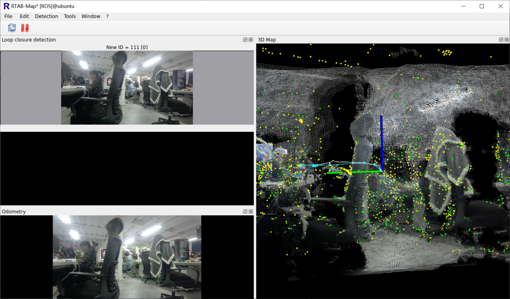
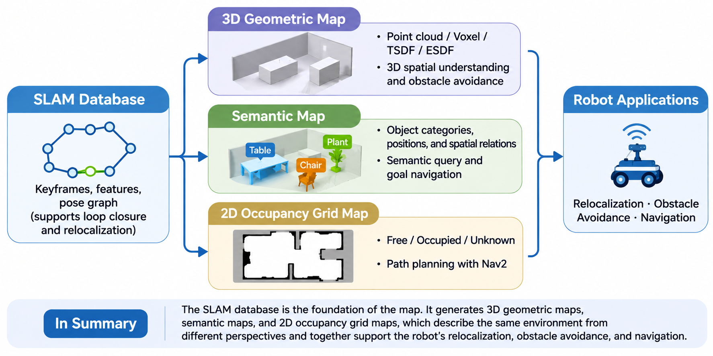
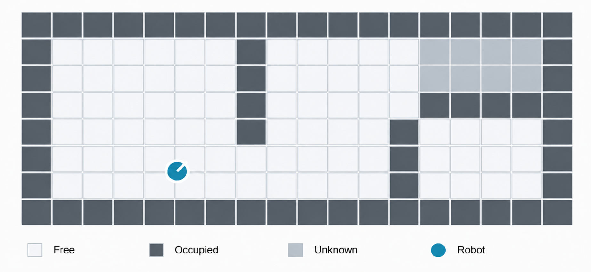
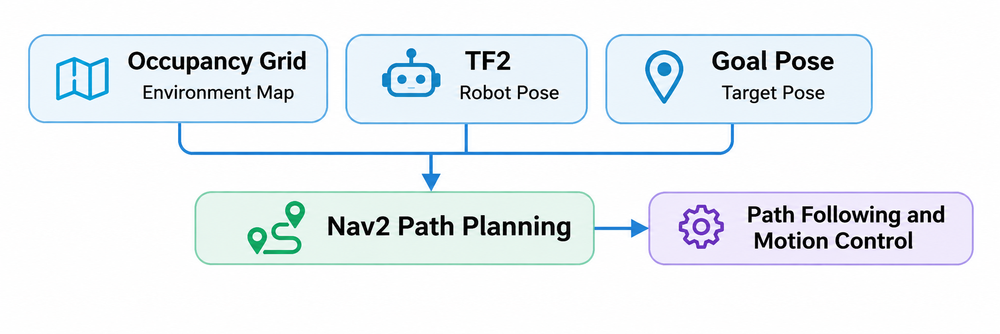
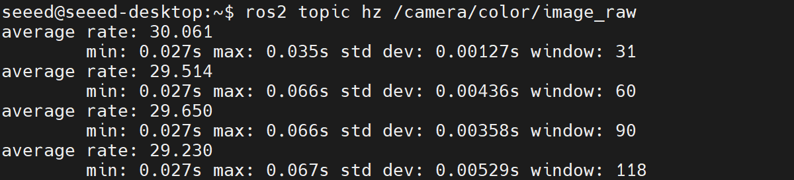
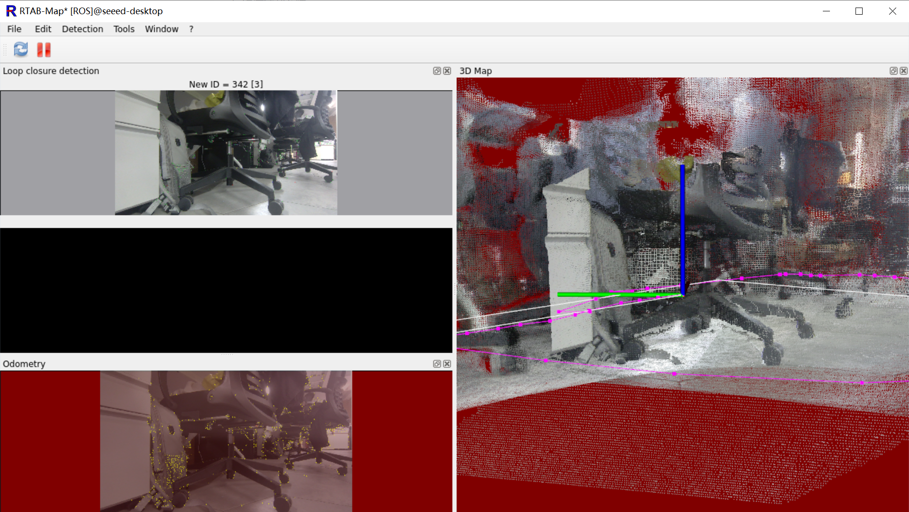
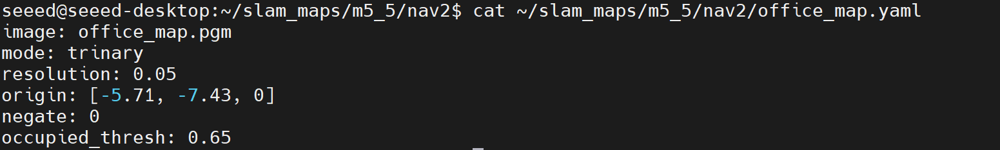
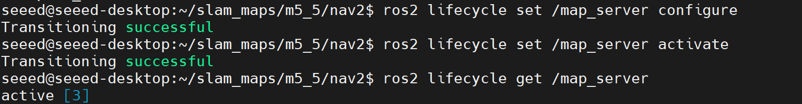

# 5.5 Map Management, Relocalization and Navigation Map Interfaces

In the previous lessons, we used RTAB-Map to implement RGB-D SLAM, built 3D geometric maps with Nvblox, and further learned how to combine AI perception to construct spatial semantic maps. But in real robot applications, mapping usually only needs to be done once, while the robot has to repeatedly use the existing map. For example, after the robot restarts, how does it know where it is on the map? How do we save the SLAM map and make it available to the navigation system?



This lesson focuses on map saving, loading, relocalization and navigation interfaces. Using RTAB-Map and ROS 2 Nav2, we complete the full pipeline on the Jetson from SLAM mapping to navigation-map preparation.

---

## 1. From Map Building to Map Use

The previous lessons mainly focused on how the robot acquires environmental information, while this lesson addresses how that information is stored long-term and reused.

A real mobile robot typically runs in two stages:

- **Mapping**: the robot explores the environment, estimates its own motion, and builds and optimizes the map.
- **Localization**: the robot loads an existing map and uses real-time sensor data to determine its position on that map.

The core difference is that mapping must continuously expand and update the map, while localization mainly uses the existing map to compute the current pose.

In ROS 2, different maps solve different problems:

| Map type | Main content | Typical use |
| - | - | - |
| SLAM database | Keyframes, features, pose graph, constraints | Loop closure and relocalization |
| 3D geometric map | Point clouds, Voxels, TSDF, ESDF | 3D scene understanding and obstacle avoidance |
| Semantic map | Object categories, positions and spatial relations | Semantic queries and target navigation |
| 2D occupancy grid | Free, occupied, unknown regions | Nav2 path planning |



These maps are not mutually exclusive. For example, the RTAB-Map database is used for visual relocalization, while the 2D occupancy grid tells Nav2 which regions are traversable.

---

## 2. From a SLAM Map to a Navigation System

In the previous lessons, we used RTAB-Map to build an environmental map. But having a map does not by itself enable autonomous navigation.

For example, to move from an office entrance to a meeting room, the robot needs two pieces of information:

- **Environmental map**: where can it go through, and where are the obstacles?
- **Robot position**: where is it currently located on the map?

The navigation system must combine these two pieces of information to plan a motion path.

### 2.1 The 2D Occupancy Grid Map

The SLAM maps introduced earlier contain motion trajectories, keyframes and 3D spatial information. But for a robot moving on flat ground, path planning usually only needs 2D environmental information. Therefore, ROS 2 navigation systems typically use an Occupancy Grid to represent the environment. The Occupancy Grid divides the environment into regular cells, each representing the occupancy state of the corresponding region.



In ROS 2, the Occupancy Grid uses the `nav_msgs/msg/OccupancyGrid` message type. The main occupancy states are: `0` = free, `100` = occupied, `-1` = unknown.

The map also includes resolution, dimensions and origin. For example, with a resolution of `0.05 m/cell`, each cell corresponds to a 5 cm × 5 cm area in the real world. RTAB-Map can convert its mapping result into a 2D Occupancy Grid for later Nav2 navigation. The Occupancy Grid solves "where can I walk?", but the robot still needs to know where it is on the map.

### 2.2 Map Frame, Odometry Frame and Robot Frame

The navigation system must associate the robot's real-time position with the map. ROS 2 uses TF2 to manage transforms between different coordinate frames.

In a navigation system, the three most important frames are:

- `map`: the global map frame, representing the robot's position on the built map.
- `odom`: the local odometry frame, providing continuous motion estimation that may gradually drift.
- `base_link`: the robot body frame, usually defined on the chassis.

The robot's pose on the map can be obtained through the following transform:

$$T_{\mathrm{map}}^{\mathrm{base}} = T_{\mathrm{map}}^{\mathrm{odom}} \, T_{\mathrm{odom}}^{\mathrm{base}}$$

Where:

- $T_{\mathrm{map}}^{\mathrm{odom}}$ is provided by global localization and corrects accumulated odometry drift.
- $T_{\mathrm{odom}}^{\mathrm{base}}$ is provided by the odometry system and reflects continuous robot motion.

After the robot restarts, it can load an existing RTAB-Map database and match the current camera image against historical keyframes to recover its position on the map. This process is called **relocalization**.

### 2.3 How Do the Map and Localization Serve Nav2?

With the Occupancy Grid and the robot's pose on the map, Nav2 can combine a target position to plan a path.



At this point the relationship between map and localization is established: the Occupancy Grid tells the robot "where it can walk", TF2 and relocalization tell it "where it is", and Nav2 plans "how to walk".

Next, we will load the previously saved RTAB-Map database on the Jetson, verify relocalization, and export the map as a 2D navigation map supported by Nav2.

---

## 3. Hands-on on the Jetson: Map Loading and Relocalization

In M5.2, we already used the Orbbec Gemini 2 and RTAB-Map to complete RGB-D SLAM and saved the mapping result as a database.

This lesson continues from the existing map and completes three tasks:

1. **Load the map**: recover the environmental information built earlier.
2. **Relocalize**: use real-time camera images to recover the robot's position on the map.
3. **Export the navigation map**: convert the SLAM map into a 2D format supported by Nav2.

### 3.1 Preparation

This experiment reuses the software and hardware environment of M5.2. Install the map-management components on top of the M5.2 base environment:

```bash
sudo apt update
sudo apt install -y ros-humble-nav2-map-server ros-humble-rviz2
```

Check the database saved in M5.2:

```bash
ls -lh ~/slam_maps/m5_2_gemini2.db
```

To preserve the original data, create an experiment copy:

```bash
mkdir -p ~/slam_maps/m5_5
cp ~/slam_maps/m5_2_gemini2.db ~/slam_maps/m5_5/localization.db
```

### 3.2 Start the RGB-D Camera

Terminal 1, start the Gemini 2:

```bash
source /opt/ros/humble/setup.bash
source ~/ros2_ws/install/setup.bash

ros2 launch orbbec_camera gemini2.launch.py \
  enable_color:=true \
  enable_depth:=true \
  depth_registration:=true \
  align_mode:=HW \
  enable_frame_sync:=true \
  depth_colorizer_mode:=none \
  enable_point_cloud:=false \
  enable_ir:=false
```

Check that the camera is publishing data normally:

```bash
ros2 topic hz /camera/color/image_raw
ros2 topic hz /camera/depth/image_raw
```



### 3.3 Load the Map and Start Relocalization

Terminal 2, start RTAB-Map in localization mode:

```bash
source /opt/ros/humble/setup.bash
source ~/ros2_ws/install/setup.bash

ros2 launch rtabmap_launch rtabmap.launch.py \
  localization:=true \
  visual_odometry:=true \
  depth:=true \
  frame_id:=camera_link \
  vo_frame_id:=odom \
  odom_topic:=/odom \
  rgb_topic:=/camera/color/image_raw \
  depth_topic:=/camera/depth/image_raw \
  camera_info_topic:=/camera/color/camera_info \
  approx_sync:=true \
  qos:=2 \
  publish_tf_odom:=true \
  publish_tf_map:=true \
  database_path:=$HOME/slam_maps/m5_5/localization.db \
  rtabmap_viz:=true \
  rviz:=false
```

Compared with the mapping command in M5.2, the key change is `localization:=true`. This parameter puts RTAB-Map into localization mode, where it matches against the existing map instead of continuing normal incremental mapping.



### 3.4 Verify Relocalization

After RTAB-Map starts, move the camera to the areas collected in M5.2 and slowly change the viewpoint.

When the current image successfully matches a historical keyframe, RTAB-Map recovers the camera's pose on the map.

In terminal 3, inspect TF:

```bash
ros2 run tf2_ros tf2_echo map camera_link
```

We suggest checking the following points in particular:

- Whether the existing map is loaded successfully.
- Whether the current image can match the historical environment.
- Whether `map → camera_link` can be queried for a valid transform whose position matches the real environment.

> Note: a successful TF query does not guarantee successful relocalization. The matching status and map-alignment result from RTAB-Map must also be inspected. Once the above verification passes, the robot has demonstrated the ability to recover its position using a historical map.

---

## 4. Export a 2D Navigation Map

The RTAB-Map database is suitable for storing keyframes and SLAM information, but Nav2 typically needs a 2D Occupancy Grid as the static navigation map.

The next step is to save the 2D grid map produced by RTAB-Map as a standard file.

### 4.1 Export the Occupancy Grid

Keep RTAB-Map running and check the 2D map topic:

```bash
ros2 topic list -t | grep OccupancyGrid
```

Under the default RTAB-Map configuration in this tutorial, the map topic is usually `/rtabmap/map`; refer to the actual output.

Check the map data:

```bash
ros2 topic echo /rtabmap/map --once --field info
```

Once the map is confirmed to be publishing, run:

```bash
mkdir -p ~/slam_maps/m5_5/nav2

ros2 run nav2_map_server map_saver_cli \
  -t /rtabmap/map \
  -f $HOME/slam_maps/m5_5/nav2/office_map
```

If the actual map topic is `/map`, replace `-t` with `/map`.

### 4.2 Inspect the Export Result

After saving successfully, the directory structure is:

```text
~/slam_maps/m5_5/nav2/
├── office_map.pgm
└── office_map.yaml
```

The two files serve different purposes:

| File | Purpose |
| - | - |
| `office_map.pgm` | Stores the 2D occupancy grid image |
| `office_map.yaml` | Describes map resolution, origin and occupancy thresholds |

View the YAML configuration:

```bash
cat ~/slam_maps/m5_5/nav2/office_map.yaml
```



The most important fields are:

- `resolution`: the real distance represented by each pixel.
- `origin`: the pose of the map origin in the `map` frame.
- `image`: the map image file.

At this point, we have converted the SLAM mapping result into a map file that Nav2 can load.

> If the 2D grid is not generated successfully, check whether RTAB-Map has Occupancy Grid generation enabled and whether the historical database contains the required map data.

---

## 5. Load and Verify the Map with Nav2

With the 2D navigation map obtained, we can load it through the Nav2 Map Server and inspect the result in RViz2.

This lesson only verifies the map interface; it does not start full path planning or chassis control.

### 5.1 Start the Map Server

First stop the RTAB-Map node from the previous section to avoid two nodes publishing `/map` at the same time.

Terminal 1:

```bash
source /opt/ros/humble/setup.bash

ros2 run nav2_map_server map_server \
  --ros-args \
  -p yaml_filename:=$HOME/slam_maps/m5_5/nav2/office_map.yaml
```

The Map Server is a ROS 2 lifecycle node and must be activated after it starts.

In terminal 2, run:

```bash
ros2 lifecycle set /map_server configure
ros2 lifecycle set /map_server activate
```

Check the node state:

```bash
ros2 lifecycle get /map_server
```



Once activated, the Map Server publishes map data on the `/map` topic.

### 5.2 View the Map in RViz2

Start RViz2:

```bash
rviz2
```

Complete the following settings:

1. Set `Fixed Frame` to `map`.
2. Click Add → Map.
3. Set the Topic to `/map`.

If RViz2 can display the map outline, walls and free space, the Map Server has loaded the map successfully.

---

## 6. Summary

This lesson introduced the basic principles of map management and relocalization, and used RTAB-Map and Nav2 to complete map loading, robot relocalization, and 2D navigation-map export and verification. Through M5, we have mastered the complete pipeline from motion estimation, SLAM mapping and 3D scene reconstruction to map saving and reuse. At this point, the robot can both build an environmental map and determine its own position using an existing map.

---

## References

1. [RTAB-Map documentation: Localization mode](https://rtabmap.readthedocs.io/en/latest/localization.html)
2. [ROS 2 nav2_map_server](https://docs.nav2.org/configuration/packages/configuring-map-server.html)
3. [ROS 2 nav_msgs/OccupancyGrid message definition](https://docs.ros.org/en/humble/p/nav_msgs/interfaces/msg/OccupancyGrid.html)
4. [ROS 2 TF2 coordinate transforms](https://docs.ros.org/en/humble/concepts/intermediate/tf2.html)
5. [OrbbecSDK_ROS2 driver](https://github.com/orbbec/OrbbecSDK_ROS2)
6. [Nav2 documentation](https://docs.nav2.org/)
