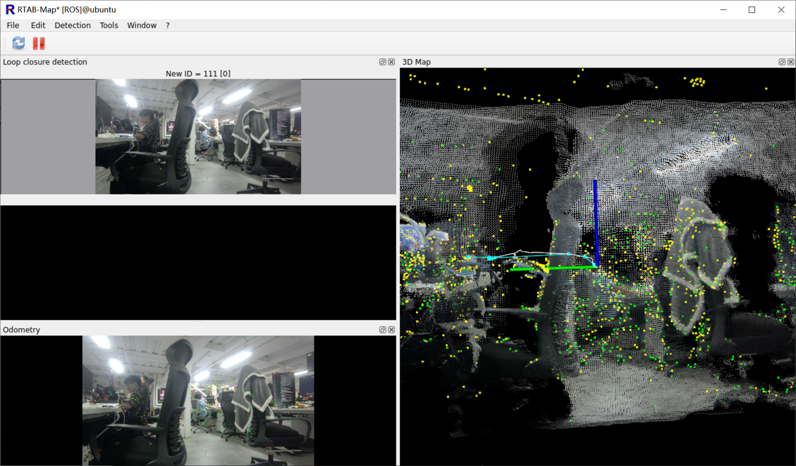
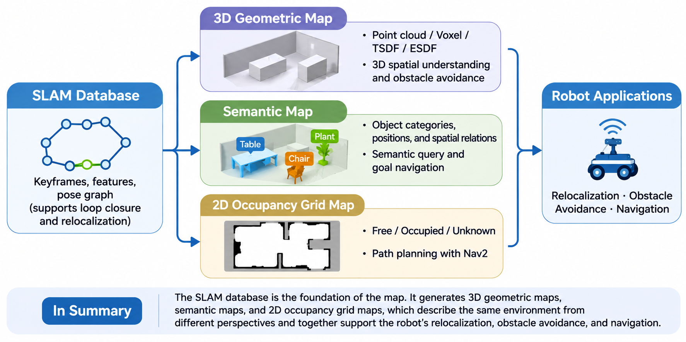
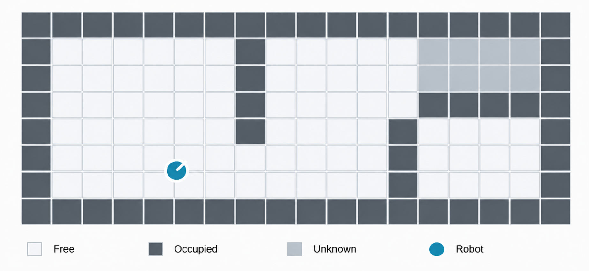
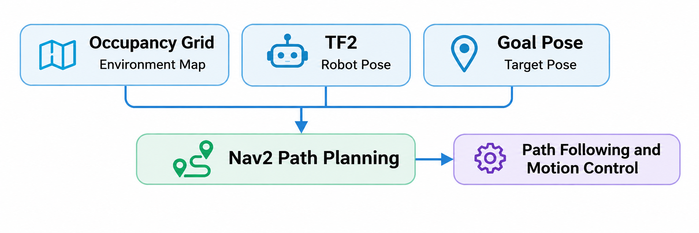
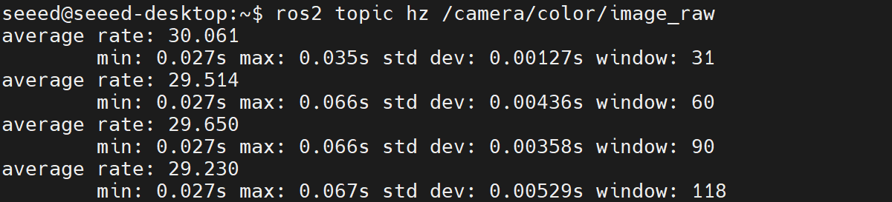
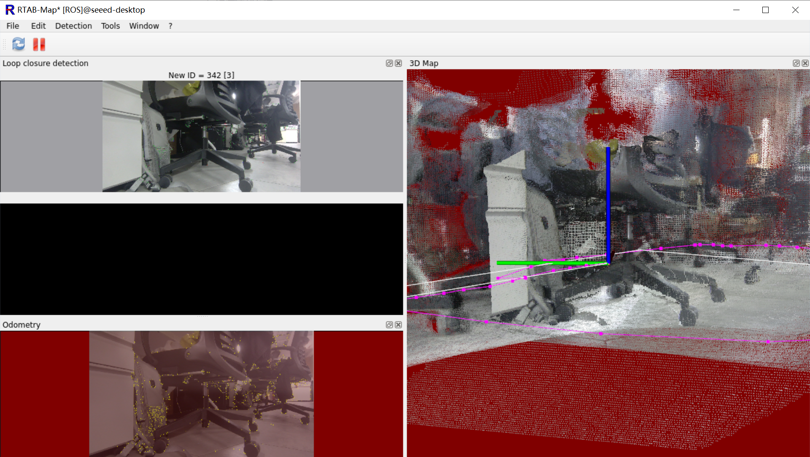
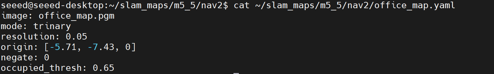
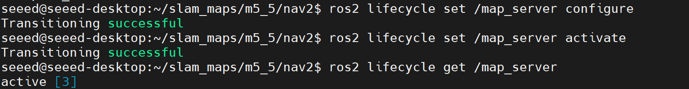

# 5.5 地图管理、重定位与导航地图接口

在前面的课程中，我们使用 RTAB-Map 实现了 RGB-D SLAM，并通过 Nvblox 构建了三维几何地图，进一步学习了如何结合 AI 感知构建空间语义地图。但在实际机器人应用中，建图通常只需要进行一次，机器人却需要反复使用已有地图。例如，机器人重新启动后，如何知道自己在地图中的位置？如何将 SLAM 地图保存下来，并提供给导航系统使用？



本节将围绕地图的保存、加载、重定位以及导航接口展开，使用 RTAB-Map 和 ROS 2 Nav2，在 Jetson 上完成从 SLAM 建图到导航地图准备的完整流程。

---

## 一、从地图构建到地图使用

前面的课程主要关注机器人如何获取环境信息，而本节重点解决这些信息如何被长期保存和重复使用。

一个实际运行的移动机器人通常包含两个阶段：

- **建图阶段（Mapping）**：机器人探索环境，估计自身运动，建立并优化地图。
- **定位阶段（Localization）**：机器人加载已有地图，通过实时传感器数据判断自己在地图中的位置。

两者的核心区别是：建图需要不断扩展和更新地图，定位则主要利用已有地图计算当前位姿。

在 ROS 2 中，不同地图用于解决不同问题：

| 地图类型 | 主要内容 | 典型用途 |
| - | - | - |
| SLAM 数据库 | 关键帧、特征、位姿图、约束关系 | 回环检测与重定位 |
| 三维几何地图 | 点云、Voxel、TSDF、ESDF | 三维空间理解与避障 |
| 语义地图 | 物体类别、位置及空间关系 | 语义查询与目标导航 |
| 二维栅格地图 | 空闲、占用、未知区域 | Nav2 路径规划 |



这些地图并不是相互替代的关系。例如，RTAB-Map 数据库用于视觉重定位，二维栅格地图则供 Nav2 判断哪些区域能够通行。

---

## 二、从 SLAM 地图到导航系统

在前面的课程中，我们使用 RTAB-Map 构建了环境地图。但是，拥有地图并不意味着机器人就能自主导航。

例如，机器人要从办公室入口移动到会议室，需要知道两个信息：

- **环境地图**：哪里可以通行，哪里存在障碍物？
- **机器人位置**：自己当前位于地图中的什么位置？

导航系统需要将这两类信息结合起来，才能规划运动路径。

### 2.1 二维 Occupancy Grid 地图

前面介绍的 SLAM 地图包含运动轨迹、关键帧和三维空间信息。但对于在平坦地面上移动的机器人，路径规划通常只需要二维环境信息。因此，ROS 2 导航系统通常使用 Occupancy Grid（占据栅格地图）表示环境。Occupancy Grid 将环境划分为规则网格，每个网格表示对应区域的占用状态。



在 ROS 2 中，Occupancy Grid 使用 `nav_msgs/msg/OccupancyGrid` 消息类型，主要包含以下占用状态：`0` 为空闲区域、`100` 为占用区域、`-1` 为未知区域。

地图还包含分辨率、尺寸和原点位置等信息。例如，分辨率为 `0.05 m/cell` 时，每个栅格对应实际环境中 5 cm × 5 cm 的区域。RTAB-Map 可以将建图结果转换为二维 Occupancy Grid，供后续 Nav2 导航使用。Occupancy Grid 解决了"哪里可以走"的问题，但机器人还需要知道自己在地图中的位置。

### 2.2 地图坐标系、里程计坐标系与机器人坐标系

导航系统需要将机器人的实时位置与地图关联起来。ROS 2 使用 TF2 管理不同坐标系之间的变换。

在导航系统中，最重要的是三个坐标系：

- `map`：全局地图坐标系，表示机器人在已建立地图中的位置。
- `odom`：局部里程计坐标系，提供连续的运动估计，但可能逐渐产生漂移。
- `base_link`：机器人本体坐标系，通常定义在机器人底盘上。

机器人在地图中的位姿可以通过以下变换得到：

$$T_{\mathrm{map}}^{\mathrm{base}} = T_{\mathrm{map}}^{\mathrm{odom}} \, T_{\mathrm{odom}}^{\mathrm{base}}$$

其中：

- $T_{\mathrm{map}}^{\mathrm{odom}}$ 由全局定位系统提供，用于修正里程计累计漂移。
- $T_{\mathrm{odom}}^{\mathrm{base}}$ 由里程计系统提供，反映机器人连续运动。

机器人重新启动后，可以加载已有 RTAB-Map 数据库，将当前相机图像与历史关键帧进行匹配，从而恢复机器人在地图中的位置。这个过程称为**重定位（Relocalization）**。

### 2.3 地图与定位如何服务于 Nav2？

有了 Occupancy Grid 和机器人在地图中的位姿，Nav2 就可以结合目标位置进行路径规划。



至此，地图与定位之间的关系就建立起来了：Occupancy Grid 告诉机器人"哪里可以走"，TF2 和重定位告诉机器人"自己在哪里"，Nav2 则负责规划"应该怎么走"。

接下来，我们将在 Jetson 上加载此前保存的 RTAB-Map 数据库，验证重定位功能，并将地图导出为 Nav2 支持的二维导航地图。

---

## 三、Jetson 实践：地图加载与重定位

在 M5.2 中，我们已经使用 Orbbec Gemini 2 和 RTAB-Map 完成了 RGB-D SLAM，并将建图结果保存为数据库。

本节继续使用已有地图，完成三个任务：

1. **加载地图**：恢复之前建立的环境信息。
2. **重定位**：利用实时相机图像恢复机器人在地图中的位置。
3. **导出导航地图**：将 SLAM 地图转换为 Nav2 支持的二维格式。

### 3.1 实验准备

本次实验沿用 M5.2 的软硬件环境。需要在 M5.2 的基础环境中安装地图管理组件：

```bash
sudo apt update
sudo apt install -y ros-humble-nav2-map-server ros-humble-rviz2
```

检查 M5.2 保存的数据库：

```bash
ls -lh ~/slam_maps/m5_2_gemini2.db
```

为了保留原始数据，创建实验副本：

```bash
mkdir -p ~/slam_maps/m5_5
cp ~/slam_maps/m5_2_gemini2.db ~/slam_maps/m5_5/localization.db
```

### 3.2 启动 RGB-D 相机

终端 1，启动 Gemini 2：

```bash
source /opt/ros/humble/setup.bash
source ~/ros2_ws/install/setup.bash

ros2 launch orbbec_camera gemini2.launch.py \
  enable_color:=true \
  enable_depth:=true \
  depth_registration:=true \
  align_mode:=HW \
  enable_frame_sync:=true \
  depth_colorizer_mode:=none \
  enable_point_cloud:=false \
  enable_ir:=false
```

检查相机是否正常发布数据：

```bash
ros2 topic hz /camera/color/image_raw
ros2 topic hz /camera/depth/image_raw
```



### 3.3 加载地图并启动重定位

终端 2，使用定位模式启动 RTAB-Map：

```bash
source /opt/ros/humble/setup.bash
source ~/ros2_ws/install/setup.bash

ros2 launch rtabmap_launch rtabmap.launch.py \
  localization:=true \
  visual_odometry:=true \
  depth:=true \
  frame_id:=camera_link \
  vo_frame_id:=odom \
  odom_topic:=/odom \
  rgb_topic:=/camera/color/image_raw \
  depth_topic:=/camera/depth/image_raw \
  camera_info_topic:=/camera/color/camera_info \
  approx_sync:=true \
  qos:=2 \
  publish_tf_odom:=true \
  publish_tf_map:=true \
  database_path:=$HOME/slam_maps/m5_5/localization.db \
  rtabmap_viz:=true \
  rviz:=false
```

与 M5.2 的建图命令相比，核心变化是：`localization:=true`。这一参数使 RTAB-Map 进入定位模式，利用已有地图进行匹配，而不是继续正常的增量建图。



### 3.4 验证重定位

RTAB-Map 启动后，将相机移动到 M5.2 曾经采集过的区域，缓慢改变视角。

当当前图像与历史关键帧成功匹配时，RTAB-Map 就可以恢复相机在地图中的位姿。

在终端 3 查看 TF：

```bash
ros2 run tf2_ros tf2_echo map camera_link
```

建议重点检查以下内容：

- 已有地图是否成功加载。
- 当前图像是否能够匹配历史环境。
- `map → camera_link` 是否能够查询到有效变换，且位置与实际环境一致。

> 注意：TF 能够查询成功，不代表重定位一定成功。还需要结合 RTAB-Map 的匹配状态和地图对齐结果判断。完成上述验证，说明机器人已经具备利用历史地图恢复自身位置的能力。

---

## 四、导出二维导航地图

RTAB-Map 数据库适合保存关键帧和 SLAM 信息，但 Nav2 通常需要二维 Occupancy Grid 作为静态导航地图。

因此，下一步需要将 RTAB-Map 生成的二维栅格地图保存为标准文件。

### 4.1 导出 Occupancy Grid

保持 RTAB-Map 运行，检查二维地图话题：

```bash
ros2 topic list -t | grep OccupancyGrid
```

在本教程的默认 RTAB-Map 配置下，地图话题通常是 `/rtabmap/map`；以实际输出为准。

检查地图数据：

```bash
ros2 topic echo /rtabmap/map --once --field info
```

确认地图正常发布后，执行：

```bash
mkdir -p ~/slam_maps/m5_5/nav2

ros2 run nav2_map_server map_saver_cli \
  -t /rtabmap/map \
  -f $HOME/slam_maps/m5_5/nav2/office_map
```

如果地图话题实际为 `/map`，则将 `-t` 参数替换为 `/map`。

### 4.2 查看导出结果

保存成功后，目录结构如下：

```text
~/slam_maps/m5_5/nav2/
├── office_map.pgm
└── office_map.yaml
```

两个文件分别承担不同作用：

| 文件 | 作用 |
| - | - |
| `office_map.pgm` | 保存二维栅格地图图像 |
| `office_map.yaml` | 描述地图分辨率、原点与占用阈值 |

查看 YAML 配置：

```bash
cat ~/slam_maps/m5_5/nav2/office_map.yaml
```



其中最重要的是：

- `resolution`：每个像素代表的实际距离。
- `origin`：地图原点在 `map` 坐标系中的位姿。
- `image`：地图图像文件。

此时，我们已经将 SLAM 建图结果转换成 Nav2 可以加载的地图文件。

> 如果没有成功生成二维栅格，应检查 RTAB-Map 是否启用了 Occupancy Grid 生成，以及历史数据库中是否包含所需的地图数据。

---

## 五、使用 Nav2 加载与验证地图

获得二维导航地图后，我们可以通过 Nav2 Map Server 加载地图，并使用 RViz2 检查结果。

本节只验证地图接口，不启动完整的路径规划和底盘控制功能。

### 5.1 启动 Map Server

首先关闭上一节的 RTAB-Map 节点，避免两个节点同时发布 `/map`。

终端 1：

```bash
source /opt/ros/humble/setup.bash

ros2 run nav2_map_server map_server \
  --ros-args \
  -p yaml_filename:=$HOME/slam_maps/m5_5/nav2/office_map.yaml
```

Map Server 是 ROS 2 生命周期节点，启动后需要将其激活。

在终端 2 执行：

```bash
ros2 lifecycle set /map_server configure
ros2 lifecycle set /map_server activate
```

检查节点状态：

```bash
ros2 lifecycle get /map_server
```



激活后，Map Server 会通过 `/map` 话题发布地图数据。

### 5.2 使用 RViz2 查看地图

启动 RViz2：

```bash
rviz2
```

完成以下设置：

1. 将 `Fixed Frame` 设置为 `map`。
2. 点击 Add → Map。
3. 将 Topic 设置为 `/map`。

如果 RViz2 能够显示地图轮廓、墙壁和空闲区域，就说明 Map Server 已成功加载地图。

---

## 六、总结

本节介绍了地图管理与重定位的基本原理，并使用 RTAB-Map 和 Nav2 完成了地图加载、机器人重定位以及二维导航地图导出与验证。通过 M5 的学习，我们已经掌握了从运动估计、SLAM 建图、三维空间重建，到地图保存与重复使用的完整流程。至此，机器人已经能够构建环境地图，并利用已有地图确定自身位置。

---

## 参考资料

1. [RTAB-Map 官方文档：Localization mode](https://rtabmap.readthedocs.io/en/latest/localization.html)
2. [ROS 2 nav2_map_server](https://docs.nav2.org/configuration/packages/configuring-map-server.html)
3. [ROS 2 nav_msgs/OccupancyGrid 消息定义](https://docs.ros.org/en/humble/p/nav_msgs/interfaces/msg/OccupancyGrid.html)
4. [ROS 2 TF2 坐标变换](https://docs.ros.org/en/humble/concepts/intermediate/tf2.html)
5. [OrbbecSDK_ROS2 驱动](https://github.com/orbbec/OrbbecSDK_ROS2)
6. [Nav2 官方文档](https://docs.nav2.org/)
