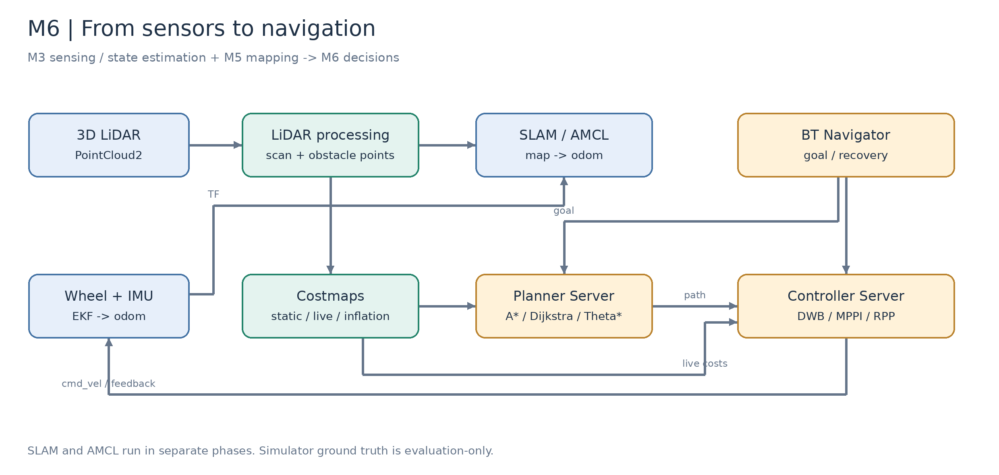
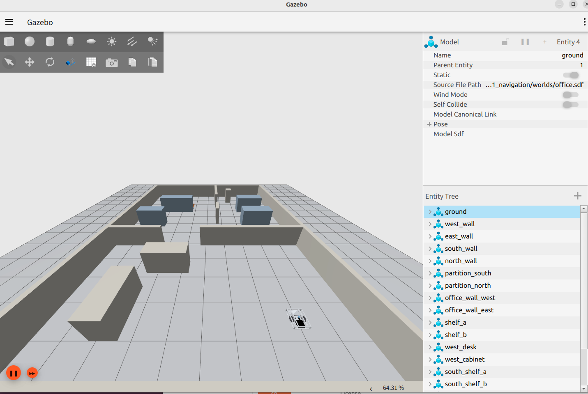
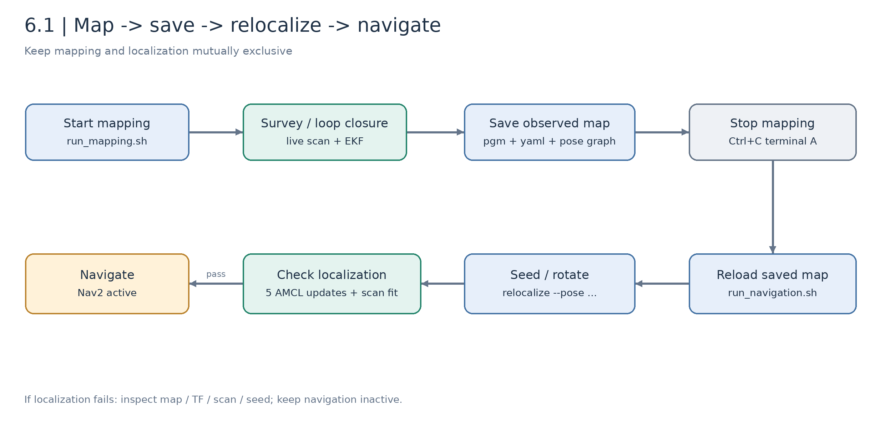
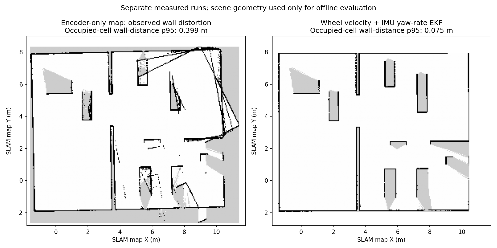
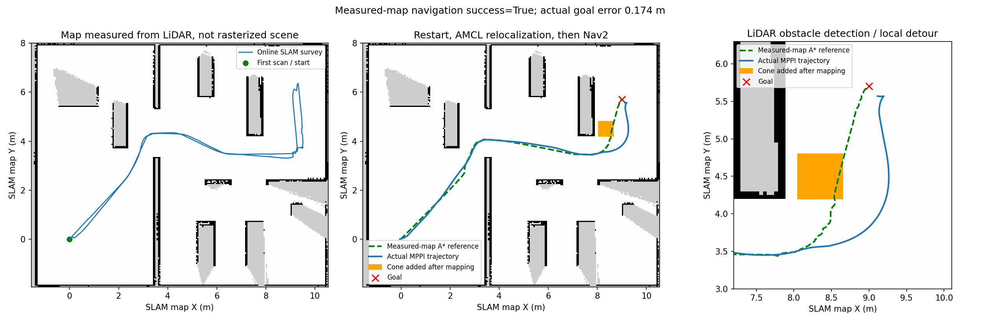

# 6.1 ROS 2 Nav2 Setup and Configuration

[中文](README_zh_CN.md) | [M6 overview](../README.md) | [Next: path planning](../6.2_Global_and_Local_Path_Planning/README_en_US.md)

M3 established sensors, transforms, and continuous odometry; M5 established SLAM. This lesson connects those results to navigation: acquire laser observations, build and save a map, restart, relocalize with AMCL, then let Nav2 plan and control the chassis.

Simulation programs and recorded results are supplied. Physical-robot experiments have not started; their record tables remain explicitly pending.

## Learning Objectives and Prerequisites

- Distinguish SLAM, localization, global planning, and local control.
- Identify the unique publisher of each TF edge and diagnose clock/transform errors.
- Complete mapping, saving, restart, relocalization, and navigation.
- Explain Nav2 lifecycle activation and behavior-tree recovery.
- Keep measured-map and fixture-map target coordinates separate.

| Prerequisite | Reused capability |
| --- | --- |
| [M3.1 LiDAR integration](../../M03-LiDAR-and-Multi-Sensor-Fusion/3.1_LiDAR_Integration_and_Point_Cloud_Preprocessing/README_en_US.md) | Point format, range, extrinsics |
| [M3.4 EKF](../../M03-LiDAR-and-Multi-Sensor-Fusion/3.4_EKF_and_State_Estimation/README_en_US.md) | Wheel/IMU fusion and continuous odometry |
| [M5.1 motion estimation](../../M05-3D-Reconstruction-and-SLAM/5.1_Motion_Estimation_VO_VIO_LIO/README_en_US.md) | VO/VIO/LIO, Fast-LIO2 input requirements, continuous odometry |
| [M5.2 complete SLAM](../../M05-3D-Reconstruction-and-SLAM/5.2_Complete_SLAM_Loop_Closure_and_Optimization/README_en_US.md) | Loop closure, pose graphs, global map optimization |
| [M5.5 map management and navigation interfaces](../../M05-3D-Reconstruction-and-SLAM/5.5_Map_Management_Relocalization_and_Navigation_Interface/README_en_US.md) | Reserved handoff chapter, with lesson text pending; this lesson supplies a runnable 2D workflow |

One prepared class hour covers architecture, a mapping/navigation run, and review. Dependency downloads and repeated tuning belong before class or in follow-up work.

## Part A. State Estimation and Navigation

### 6.1.1 Architecture



*Figure 6.1-1: course architecture. SLAM and AMCL run in separate phases; only one owns `map → odom` at a time.*

| Component | Role | Implementation |
| --- | --- | --- |
| Local estimation | Continuous pose/velocity | `robot_localization` EKF → `/odom` |
| SLAM | Scan and odometry → observed map | SLAM Toolbox, mapping only |
| Map Server | Saved occupancy → `/map` | `.yaml + .pgm` |
| AMCL | Map/scan/odometry → global localization | Publishes `map → odom` |
| Planner Server | Start/goal/global costmap → path | A*, Dijkstra, Theta* |
| Controller Server | Path/state/local costmap → velocity | MPPI default; DWB and RPP available |
| BT Navigator | Organize planning, tracking, recovery | `NavigateToPose` and behavior tree |
| Lifecycle Manager | Configuration/activation/health | Navigation activates after localization checks |

Nav2 is a navigation framework; Gazebo provides physics. Robot description, sensors, and bridges remain separate integration work. J501 is the computing platform, while this course models a particular differential-drive chassis.

### 6.1.2 Frames and Time

```text
map -- SLAM/AMCL --> odom -- EKF --> base_footprint -- URDF --> base_link --> laser_link
```

With ${}^{A}T_B$ denoting a transform from B into A:

```math
{}^{map}T_{base}={}^{map}T_{odom}\,{}^{odom}T_{base}.
```

Odometry remains locally continuous; map localization may correct accumulated drift. SLAM/AMCL adjusts `map → odom` without redefining the short-term odometry frame.

Sensor points require calibrated extrinsics:

```math
{}^{base}\mathbf p={}^{base}R_{laser}\,{}^{laser}\mathbf p+{}^{base}\mathbf t_{laser}.
```

An incorrect transform biases every observation. A timestamp mismatch misaligns scans while moving. Check both before tuning SLAM around distorted walls.

### 6.1.3 Wheel/IMU EKF

For differential drive:

```math
x_{k+1}=x_k+v_k\cos\theta_k\Delta t,\quad
y_{k+1}=y_k+v_k\sin\theta_k\Delta t,\quad
\theta_{k+1}=\theta_k+\omega_k\Delta t.
```

Heading error accumulates into position error. Simulated casters and wheel slip can corrupt encoder-only heading too.

The [EKF configuration](../../../modules/m06_navigation/j501_navigation/config/ekf.yaml) fuses forward wheel velocity, zero lateral velocity, and IMU Z angular velocity. It excludes wheel-integrated position/yaw and absolute IMU orientation, avoiding duplicated source information and simulator-world heading initialization.

```math
P_k^-=F_kP_{k-1}F_k^T+Q_k,\qquad
K_k=P_k^-H_k^T(H_kP_k^-H_k^T+R_k)^{-1}.
```

Default `odometry_source:=ekf` makes EKF the sole `odom → base_footprint` publisher. Raw wheel TF stays on unbridged `/wheel/tf`. `odometry_source:=wheel` is an explicit comparison mode.

### 6.1.4 AMCL Relocalization

AMCL approximates pose probability using particles. Odometry propagates samples; scan/map agreement changes their weights:

```math
\overline{x}_k^{(i)}\sim p(x_k\mid x_{k-1}^{(i)},u_k),\qquad
w_k^{(i)}\propto p(z_k\mid\overline{x}_k^{(i)},m)w_{k-1}^{(i)}.
```

Normalize and resample. **2D Pose Estimate** supplies an approximate seed, not proof of localization success.

The course monitor requires position standard deviation below 0.20 m, yaw standard deviation below 0.30 rad, at least 55% scan-endpoint agreement with occupied cells, fresh observations, and five distinct passing AMCL updates. TF is queried at scan acquisition time. Only then is navigation activated.

These teaching thresholds cannot exclude a wrong low-covariance solution in a symmetric environment. Verify distinctive geometry and observations rather than bypassing checks.

### 6.1.5 Behavior Tree and Lifecycle

Behavior-tree nodes return `SUCCESS`, `FAILURE`, or `RUNNING`. Sequences advance through children; fallbacks select alternatives; recovery nodes organize retries.

The [course tree](../../../modules/m06_navigation/j501_navigation/behavior_trees/navigate.xml) selects planner/controller, periodically computes a path, and follows it. Its `RateController hz="0.5"` limits global replanning to 0.5 Hz, distinct from the 15 Hz controller. Launch replaces the XML template's default controller with the requested one. Recovery includes clearing costmaps, waiting, rotating, and backing up; recovery availability does not guarantee success.

Lifecycle states include `unconfigured`, `inactive`, and `active`. Mapping starts no Nav2 navigation nodes. In navigation mode, unconfigured nodes may be deliberately waiting for relocalization.

## Part B. Simulation Platform

### 6.1.6 Environment and Sensor Boundaries

| Item | Baseline |
| --- | --- |
| OS / ROS | Ubuntu 22.04 / ROS 2 Humble |
| Simulator / navigation | Fortress 6.16.0 / Nav2 1.1.20 in recorded runs |
| Chassis | STEP-derived differential drive; conservative footprint about 0.49 × 0.49 m |
| LiDAR | Fortress `gpu_lidar`, 720 × 32 regular rays, 10 Hz |
| Field of view | 360° horizontal, −7° to 52° vertical |
| Range | Sensor 12 m maximum; processing ROI 10 m |
| Mapping | 3D cloud height slice → LaserScan → SLAM Toolbox |



*Figure 6.1-2: walls, doorways, and shelves require a detour between start and goal.*

Keep this Gazebo interface open to observe physical chassis motion, alongside scans, maps, and paths in RViz2. Use the entity tree to identify walls and shelves. During mapping, watch the map expand as the chassis passes through doorways; during navigation, check that it follows the planned passages. Keep the simulation running because pausing Gazebo stops simulation time.

This is not the full MID-360 simulator. The supplied [Livox plugin](https://github.com/Livox-SDK/livox_laser_simulation/tree/main) targets ROS Melodic / Gazebo 9 and cannot directly load in Fortress. The course approximates its field of view, without native non-repetitive scanning, per-point timing, deskewing, or realistic noise. `/livox/lidar` is `PointCloud2`, not `CustomMsg`.

This lesson reuses the odometry and timing concepts from M5.1 and the mapping and loop-closure principles from M5.2, implementing the runnable 2D route with SLAM Toolbox in Fortress. Migrating M5.1 Fast-LIO2 additionally needs verified point types/timing, IMU synchronization, and extrinsics.

### 6.1.7 Files and Phases

`modules/m06_navigation/` contains build/setup helpers, mapping/navigation launch helpers, the chassis description, and the navigation package. That package keeps configuration, algorithm clients, behavior trees, visualization, and validation records.



*Figure 6.1-3: saving a map does not change the running launch mode. Stop mapping before localization.*

## Part C. Executable Workflow

### 6.1.8 Build and Start Mapping

Stop previous same-domain simulations. Terminal A:

```bash
cd /home/darklee/mobile-robot-full-stack-course
./modules/m06_navigation/build.sh
./modules/m06_navigation/run_mapping.sh
```

Missing dependencies are downloaded/extracted into `build/m06_nav2_deps/` without changing system installation. Initial downloads require network access. Add `headless:=true rviz:=false` for server-only execution.

The mapping world omits the cone; navigation restores it as an obstacle absent from the saved map.

Terminal B:

```bash
cd /home/darklee/mobile-robot-full-stack-course
source modules/m06_navigation/setup.bash
ros2 topic info /livox/lidar
ros2 topic info /wheel/odometry
ros2 topic info /imu/data
ros2 topic info /odom
ros2 topic info /scan
ros2 run tf2_ros tf2_echo odom base_footprint
```

Stop the continuous `tf2_echo` command with Ctrl+C after checking it. Source the workspace in every command terminal.

### 6.1.9 Survey and Loop Closure

```bash
ros2 run j501_navigation survey --output build/m06_results/survey.json
```

The manually chosen 14-waypoint route crosses the doorway, covers the goal region, and returns toward the start. Control uses online SLAM pose and live scans, not a prebuilt map or simulator truth. It is a teaching survey, not autonomous exploration.

Inspect map growth, wall continuity, and loop closure. Unknown gray regions may be occluded or inside objects; do not fill them as free space for appearance. Diagnose IMU, odometry, TF, and acquisition time before changing matching parameters.

### 6.1.10 Save Occupancy and Pose Graph

Keep A running and stop the robot. In B:

```bash
ros2 run j501_navigation save_map --output build/m06_maps/office
```

| Output | Purpose |
| --- | --- |
| `office.pgm`, `office.yaml` | Observed occupancy for Map Server, AMCL, Nav2 |
| `office_posegraph.posegraph`, `.data` | Serialized SLAM state |
| `office.metadata.json` | Simulation frame relationship, evaluation only |

The tool saves live `/map` and requests SLAM serialization; it does not rasterize scene YAML as a substitute for mapping. Copy `build/m06_maps/` outputs to a chosen persistent directory when sharing. Save before stopping SLAM.

### 6.1.11 Restart and Relocalize

Ctrl+C terminal A, then:

```bash
./modules/m06_navigation/run_navigation.sh
```

The default reads `build/m06_maps/office.yaml`; it does not silently replace a missing map. To use another existing measured map:

```bash
./modules/m06_navigation/run_navigation.sh map:="$PWD/build/m06_maps/ekf/office.yaml"
```

That path exists only on machines where the EKF map was saved. A fresh clone should perform this lesson's mapping workflow.

In B:

```bash
ros2 run j501_navigation relocalize --pose 0 0 0 \
  --output build/m06_results/relocalization.json
```

Wait for `"succeeded": true`. RViz **2D Pose Estimate** plus slow rotation is an alternative. `relocalize --global` requests global initialization but does not guarantee convergence.

```bash
ros2 topic echo /localization/metrics --once
ros2 topic echo /localization_ready --once
ros2 lifecycle get /bt_navigator
```

Navigation should become `active`. Do not activate it manually to bypass failed localization.

### 6.1.12 Navigate and Export a Figure

```bash
ros2 run j501_navigation global_plan --planner astar --goal 9 5.7 0
ros2 run j501_navigation navigate --planner astar --controller MPPI \
  --goal 9 5.7 0 --output build/m06_results/mapped_navigation.json
```

The first-scan map goal is approximately `(9,5.7)`, versus `(4.5,2.7)` in the fixture. Their relationship is:

```math
\mathbf p_{world}=R(\theta_0)\mathbf p_{map}+\mathbf t_0.
```

The survey starts near world translation `(-4.5,-3)`. Changed first-scan pose or orientation requires selecting goals again in RViz.

The default algorithm view shows green initial reference, blue localized trajectory, and LiDAR points/boxes. After navigation, keep A running:

```bash
ros2 service call /algorithm_view/save std_srvs/srv/Trigger '{}'
```

Outputs are `build/m06_results/algorithm_view.png` and `.json`. The trace is estimated localization; points/boxes are one timestamped detection frame.

## Part D. Results and Troubleshooting

### 6.1.13 Read the Evidence



*Figure 6.1-4: separate measured runs. EKF improved the turn prior and reduced slanted/duplicated walls.*

The [EKF mapping record](../../../modules/m06_navigation/j501_navigation/validation/ekf_mapping/environment.json) reports p95 occupied-cell distance to known scene surfaces decreasing from about 0.400 m to 0.075 m. This offline, one-way metric does not measure unknown-area completeness or full-time pose accuracy. Scene geometry never feeds SLAM or EKF.



*Figure 6.1-5: an earlier recorded pipeline run. Different map/configuration versions must retain their own measurements.*

The [EKF relocalization](../../../modules/m06_navigation/j501_navigation/validation/ekf_mapping/relocalization.json) and [navigation](../../../modules/m06_navigation/j501_navigation/validation/ekf_mapping/navigation.json) records provide status, errors, and sampled clearance. Zero contact samples are not a continuous safety proof or hardware acceptance.

### 6.1.14 Troubleshooting

| Symptom | First check | Response |
| --- | --- | --- |
| No navigator, SLAM present | Still in mapping mode? | Save, stop mapping, start navigation |
| Navigator unconfigured | AMCL seed/checks | Relocalize and inspect metrics |
| `actual_trajectory_map: null` | Evaluation metadata/mode | Not evidence of valid localization |
| Slanted or duplicated walls | IMU, odometry, TF, timestamps | Restore EKF baseline and remap |
| Goal outside map | Fixture/measured coordinates mixed | Select goal in current map |
| New map not loaded | Absolute map path and save time | Restart with explicit `map:=` |
| Blue trace absent | New launch/localization/motion | Inspect `/lab/estimated_path` |

### 6.1.15 Exercises and Pending Hardware

Draw the TF tree with unique publishers; inspect planner state before localization; save your own map/configuration; compare two seeds; test three reachable goals and record measured outcomes or “not tested.” Explain each error metric's frame and limits.

| Hardware record | Status |
| --- | --- |
| Chassis driver, LiDAR, extrinsics | Pending calibration |
| Wheel/IMU covariance and EKF | Pending acquisition |
| Site map and relocalization | Pending mapping |
| Trajectory, stopping, endpoint error | Pending low-speed tests |
| Photos, video, and failures | Add after experiments |

On hardware, disable simulation time, reuse M3 inputs, avoid duplicate TF, and calibrate footprint, speed, braking distance, and command timeout before navigation.

## References

- [Nav2 concepts](https://docs.nav2.org/rolling/getting_started/navigation_concepts/): check Humble compatibility.
- [Nav2 Humble bringup](https://github.com/ros-navigation/navigation2/tree/humble/nav2_bringup)
- [SLAM Toolbox](https://github.com/SteveMacenski/slam_toolbox)
- [robot_localization](https://docs.ros.org/en/humble/p/robot_localization/)
- [Livox simulation requirements](https://github.com/Livox-SDK/livox_laser_simulation/tree/main)
