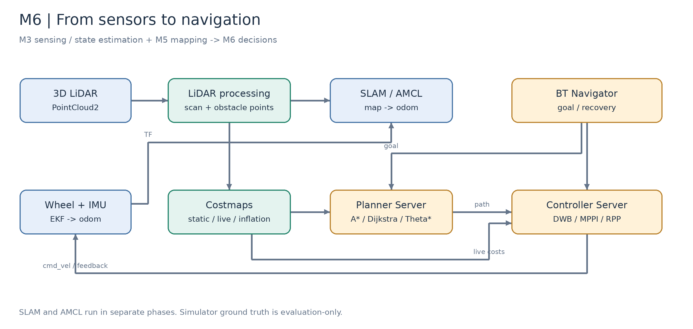
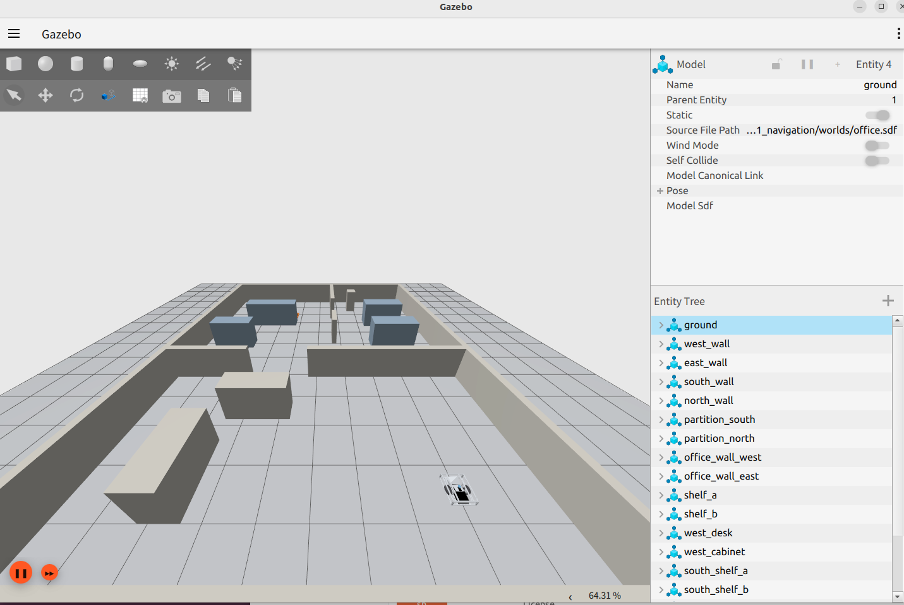
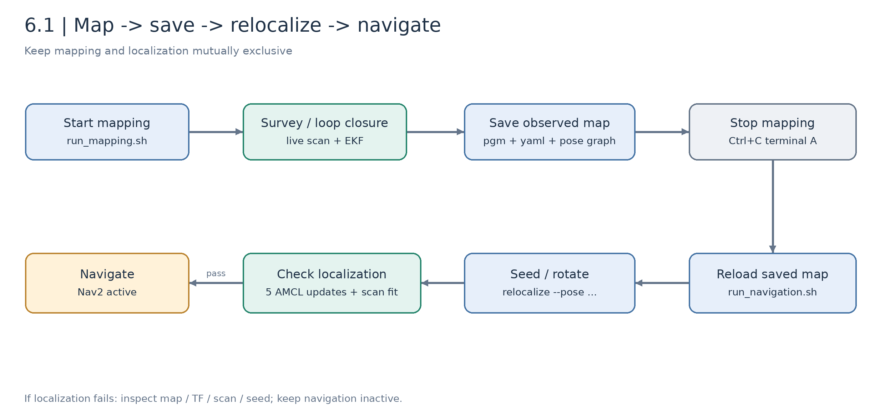
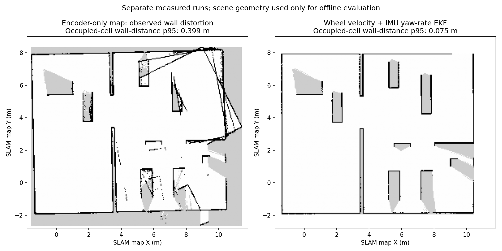
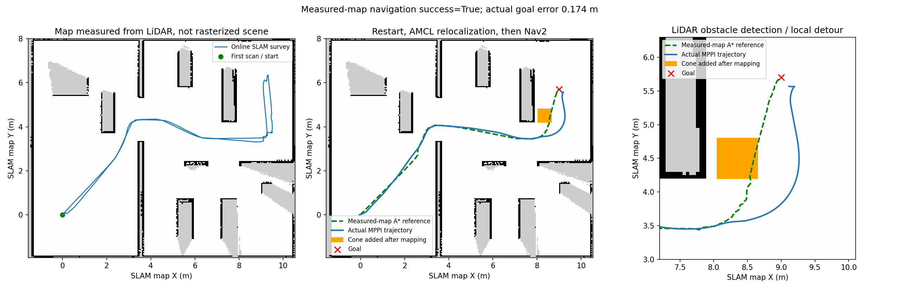

# 6.1 ROS 2 Nav2 框架搭建与配置

[English](README_en_US.md) | [M6 模块首页](../README_zh_CN.md) | [下一课：全局与局部规划](../6.2_Global_and_Local_Path_Planning/README_zh_CN.md)

M3 解决了“传感器如何接入、里程计如何连续”，M5 解决了“机器人如何边运动边建立地图”。本课在这些结果之上建立导航闭环：先采集激光建立地图，保存后重新启动，再通过 AMCL 判断自己位于地图的什么位置，最后让 Nav2 生成路线并控制底盘到达目标。

本课的仿真程序、配置与记录已经提供。实车尚未开展，文末单独保留实验记录位置。

## 学习目标与前置条件

完成本课后，你应能够：

- 解释 SLAM、定位、全局规划、局部控制之间的关系；
- 确认每条 TF 的发布者，并排查重复发布与时间不同步；
- 在 J501 底盘仿真中完成建图、保存、重启、重定位与导航；
- 理解 Nav2 的生命周期与行为树，读懂“节点存在但没有激活”的原因；
- 区分实时观测地图、预制算法地图以及不同地图中的目标坐标。

| 前置章节 | 本课复用的内容 |
| --- | --- |
| [M3.1 雷达接入与点云预处理](../../M03-LiDAR-and-Multi-Sensor-Fusion/3.1_LiDAR_Integration_and_Point_Cloud_Preprocessing/README_zh_CN.md) | 点云格式、有效距离、雷达外参 |
| [M3.4 EKF 与状态估计](../../M03-LiDAR-and-Multi-Sensor-Fusion/3.4_EKF_and_State_Estimation/README_zh_CN.md) | 轮速与 IMU 融合，连续的局部里程计 |
| [M5.1 机器人运动估计](../../M05-3D-Reconstruction-and-SLAM/5.1_Motion_Estimation_VO_VIO_LIO/README_zh_CN.md) | VO / VIO / LIO、Fast-LIO2 输入要求与连续里程计 |
| [M5.2 完整 SLAM 系统](../../M05-3D-Reconstruction-and-SLAM/5.2_Complete_SLAM_Loop_Closure_and_Optimization/README_zh_CN.md) | 回环检测、位姿图与全局地图优化 |
| [M5.5 地图管理与导航接口](../../M05-3D-Reconstruction-and-SLAM/5.5_Map_Management_Relocalization_and_Navigation_Interface/README_zh_CN.md) | 地图、重定位与导航的衔接位置；该节正文待补，本课提供可运行的二维流程 |

课堂安排为 1 课时：约 15 分钟解释架构和坐标系，25 分钟完成预装环境中的建图与导航，剩余时间观察结果和讨论。依赖下载、完整调参和重复验收可安排在课前或课后。

## Part A. 从状态估计到导航闭环

### 6.1.1 导航系统由哪些节点组成



*图 6.1-1：本课程导航架构。图中 SLAM 与 AMCL 分阶段运行；`map → odom` 在同一时刻只能由其中一个节点发布。*

| 组件 | 输入与输出 | 本课程实现 |
| --- | --- | --- |
| 本地状态估计 | 轮速、IMU → 连续位姿与速度 | `robot_localization` EKF，输出 `/odom` |
| SLAM | 扫描、里程计 → 地图与校正位姿 | SLAM Toolbox，仅建图阶段运行 |
| Map Server | 已保存地图 → `/map` | 导航阶段加载 `.yaml + .pgm` |
| AMCL | 地图、扫描、里程计 → 地图中位姿 | 导航阶段发布 `map → odom` |
| Planner Server | 起点、目标、全局代价地图 → 路径 | A*、Dijkstra、Theta* |
| Controller Server | 路径、当前位置、局部代价地图 → 速度 | 默认 MPPI，也提供 DWB、RPP |
| BT Navigator | 导航目标 → 规划、跟踪、恢复的组织 | `NavigateToPose` Action 与行为树 |
| Lifecycle Manager | 启动与健康状态 → 节点状态转换 | 定位通过检查后再激活导航 |

Nav2 是 ROS 2 导航框架，Gazebo 才是物理仿真器；底盘描述和传感器桥接也不由 Nav2 自动完成。本课程使用 STEP 转换的 J501 底盘模型，而非将 J501 本身当作一种底盘运动学。

### 6.1.2 TF 为什么分为 map 和 odom

采用以下坐标树：

```text
map ── SLAM / AMCL ──> odom ── EKF ──> base_footprint ── URDF ──> base_link ──> laser_link
```

记 ${}^{A}T_B$ 为从坐标系 $B$ 到 $A$ 的齐次变换，则：

```math
{}^{map}T_{base}={}^{map}T_{odom}\,{}^{odom}T_{base}
```

`odom` 强调短时连续，即使存在累积漂移，也适合局部控制；`map` 强调与全局地图一致，定位更新和回环可以修正位姿。SLAM 或 AMCL 通过调整 `map → odom` 修正全局误差，同时保留局部里程计的连续性。

传感器点进入底盘坐标系需要：

```math
{}^{base}\mathbf p={}^{base}R_{laser}\,{}^{laser}\mathbf p+{}^{base}\mathbf t_{laser}
```

外参错误会让所有观测带着相同偏差；时间错误会在运动时让扫描和位姿错开。遇到墙体倾斜或重影，应先核对时间和 TF，再调 SLAM 参数。

### 6.1.3 为什么本课使用轮速与 IMU EKF

差速底盘的平面模型为：

```math
\begin{aligned}
x_{k+1}&=x_k+v_k\cos\theta_k\Delta t,\\
y_{k+1}&=y_k+v_k\sin\theta_k\Delta t,\\
\theta_{k+1}&=\theta_k+\omega_k\Delta t.
\end{aligned}
```

纯轮速推算中的航向误差会随路程转化为位置误差。仿真的脚轮转向和轮胎滑移也会造成这种现象，不能认为仿真编码器天然等于真实位姿。

当前 [EKF 配置](../../../modules/m06_navigation/j501_navigation/config/ekf.yaml) 融合轮速前向速度、差速底盘零侧向速度约束和 IMU 的 Z 轴角速度。它不融合轮速累计位置、轮速累计航向或 IMU 绝对朝向。这样既保留独立的角速度观测，也避免同源测量重复计权。

EKF 的预测协方差和观测更新沿用 M3.4：

```math
P_k^-=F_kP_{k-1}F_k^T+Q_k,\qquad
K_k=P_k^-H_k^T(H_kP_k^-H_k^T+R_k)^{-1}.
```

默认 `odometry_source:=ekf` 时，EKF 是 `odom → base_footprint` 的唯一发布者；轮速原始 TF 留在未桥接的 `/wheel/tf`。`odometry_source:=wheel` 仅保留为对照实验。

### 6.1.4 AMCL 如何完成重定位

AMCL 使用粒子集合近似机器人位姿的概率分布。运动更新依据里程计传播粒子，观测更新依据激光与地图的匹配程度调整权重：

```math
\overline{x}_k^{(i)}\sim p(x_k\mid x_{k-1}^{(i)},u_k),\qquad
w_k^{(i)}\propto p(z_k\mid\overline{x}_k^{(i)},m)w_{k-1}^{(i)}.
```

这里 $u_k$ 是运动增量，$`z_k`$ 是扫描，$`m`$ 是地图。归一化并重采样后，粒子逐步集中到较可能的位置。RViz 的 **2D Pose Estimate** 提供近似初值，不等于直接宣布定位成功；之后仍需扫描与运动观测使估计收敛。

本课程的定位检查同时考虑：位置标准差小于 0.20 m、航向标准差小于 0.30 rad、至少 55% 的有效扫描端点靠近占用地图、数据没有过期，以及连续 5 次不同的 AMCL 更新通过检查。扫描匹配是在扫描采集时刻查询 TF。

这些是教学场景阈值，不是通用定位正确性证明。对称走廊可能出现低协方差的错误位置；应结合可辨识结构与真实观测判断。检查通过后，程序才调用导航 Lifecycle Manager 激活规划器和控制器。

### 6.1.5 Behavior Tree 与生命周期

行为树节点每次执行返回 `SUCCESS`、`FAILURE` 或 `RUNNING`。Sequence 按顺序推进，Fallback 在失败时尝试替代行为，Recovery 节点在规定次数内组织恢复。它适合表达可以组合与复用的导航任务，不能简单理解成一个固定顺序的状态机。

本课 [行为树](../../../modules/m06_navigation/j501_navigation/behavior_trees/navigate.xml) 的核心是：

```xml
<PipelineSequence name="NavigationWithReplanning">
  <PlannerSelector selected_planner="{selected_planner}" default_planner="AStar" topic_name="planner_selector"/>
  <ControllerSelector selected_controller="{selected_controller}" default_controller="DWB" topic_name="controller_selector"/>
  <RateController hz="0.5">
    <ComputePathToPose goal="{goal}" path="{path}" planner_id="{selected_planner}"/>
  </RateController>
  <FollowPath path="{path}" controller_id="{selected_controller}"/>
</PipelineSequence>
```

这里全局重规划的限频为 **0.5 Hz**，不是控制器的 15 Hz。XML 模板中的默认控制器会由 launch 按 `controller:=MPPI` 等参数替换。恢复分支依次尝试清代价地图、等待、旋转和短距离后退；存在恢复行为不代表该次任务一定成功。

生命周期节点从 `unconfigured` 经配置进入 `inactive`，再激活为 `active`。建图模式没有启动导航节点；导航模式中的未激活节点则可能在等待重定位，两者需要分开排查。

## Part B. 仿真平台与传感器边界

### 6.1.6 本课使用的环境

| 项目 | 配置 |
| --- | --- |
| 操作系统与 ROS | Ubuntu 22.04、ROS 2 Humble |
| 仿真与导航 | Gazebo Fortress 6.16.0、Nav2 1.1.20（已有验证环境） |
| 底盘 | 课程 STEP 模型转换的差速底盘，保守足迹约 0.49 × 0.49 m |
| 雷达 | Fortress 原生 `gpu_lidar`，720 × 32 规则射线、10 Hz |
| 视场与量程 | 水平 360°，垂直 −7°～52°，传感器最大量程 12 m；处理 ROI 为 10 m |
| 建图 | 三维点云高度切片 → 二维 LaserScan → SLAM Toolbox |
| 真实硬件 | J501、底盘、雷达与必要的深度相机；本课实车待开展 |



*图 6.1-2：课程实际 Gazebo 场景。墙、门洞和货架让起点到终点的直线不可通行，需要后续全局规划绕行。*

实操时保留这个 Gazebo 界面观察底盘的物理运动，并在 RViz2 中对照扫描、地图与路径。右侧实体树可以核对墙体和货架；建图阶段看地图是否随底盘经过门洞而扩展，导航阶段看底盘是否沿规划通道绕行。暂停 Gazebo 会停止仿真时间，执行建图与导航时应保持运行。

这里没有加载完整 Livox MID-360 仿真插件。用户提供的 [livox_laser_simulation](https://github.com/Livox-SDK/livox_laser_simulation/tree/main) 主分支要求 ROS Melodic / Gazebo 9，不能直接加载到 Fortress。本课程近似其视场，但没有实现 Livox 非重复扫描、逐点时刻、去畸变或真实噪声。话题 `/livox/lidar` 使用 `PointCloud2`，不等于驱动的 `CustomMsg`。

因此本课复用 M5.1 的里程计与时间同步概念、M5.2 的建图与回环原理，在 Fortress 中使用 SLAM Toolbox 构建可执行的二维管线。M5.1 中的 Fast-LIO2 迁移还需验证点类型、逐点时间、IMU 同步与外参，不能仅重命名话题后宣称兼容。

### 6.1.7 课程目录与启动阶段

```text
modules/m06_navigation/
├── build.sh / setup.bash
├── run_mapping.sh / run_navigation.sh
├── j501_chassis_description/    # URDF、雷达、IMU、仿真桥接
└── j501_navigation/
    ├── config/                 # EKF、SLAM、Nav2、检测参数
    ├── launch/                 # 分阶段启动
    ├── j501_navigation/        # 算法、ROS 客户端、可视化
    ├── behavior_trees/         # 导航与恢复行为树
    └── validation/             # 历次实验记录与失败案例
```



*图 6.1-3：保存地图不会自动切换模式。必须先结束建图，再加载已保存地图进行重定位。*

## Part C. 实操：从实时激光到自主导航

### 6.1.8 编译与启动建图

先结束其他同域仿真。在仓库根目录打开终端 A：

```bash
cd /home/darklee/mobile-robot-full-stack-course
./modules/m06_navigation/build.sh
./modules/m06_navigation/run_mapping.sh
```

构建脚本优先使用现有依赖，缺失依赖时解包至仓库 `build/m06_nav2_deps/`，不修改系统安装。首次下载需要网络。仿真会打开 Gazebo 和 RViz；无窗口运行可加 `headless:=true rviz:=false`。

建图世界没有锥桶。这样导航时新加入的锥桶才是地图中未知的物体，而不是已经记住的静态障碍。

终端 B 加载同一工作空间并检查输入：

```bash
cd /home/darklee/mobile-robot-full-stack-course
source modules/m06_navigation/setup.bash
ros2 topic info /livox/lidar
ros2 topic info /wheel/odometry
ros2 topic info /imu/data
ros2 topic info /odom
ros2 topic info /scan
ros2 run tf2_ros tf2_echo odom base_footprint
```

`tf2_echo` 为持续输出命令，确认坐标更新后 Ctrl+C 退出。每个后续命令终端都需要加载 `setup.bash`。

### 6.1.9 巡航建图与回环

在 B 中启动：

```bash
ros2 run j501_navigation survey --output build/m06_results/survey.json
```

`survey` 沿人工指定的 14 个路点往返：穿过门洞、覆盖终点区域，再回到起点附近形成回环。控制输入来自在线 SLAM 位姿和实时扫描；它不读取预制地图或仿真真值，也不是自主探索算法。

观察地图是否随移动扩展，墙体是否连续。灰色区域可能是物体内部或被遮挡的未知区，不应为了“看起来完整”手工填成空闲。若出现斜墙、双墙，先检查 `/odom`、IMU、扫描时间和 TF，再考虑匹配参数。

### 6.1.10 保存占用地图与位姿图

机器人停车后，保持 A 运行，在 B 中执行：

```bash
ros2 run j501_navigation save_map --output build/m06_maps/office
```

| 输出 | 作用 |
| --- | --- |
| `office.pgm` 与 `office.yaml` | 实际观测的二维占用地图，供 Map Server / AMCL / Nav2 使用 |
| `office_posegraph.posegraph` 与 `.data` | SLAM Toolbox 状态，供继续建图等实验使用 |
| `office.metadata.json` | 本仿真首帧与世界坐标关系，仅用于独立评估 |

保存工具从实时 `/map` 获取地图，并请求 SLAM 序列化。它不会把场景 YAML 重新栅格化冒充建图结果。地图存放在仓库 `build/m06_maps/`，需要长期共享时可复制到自选目录；不要在保存前停止 SLAM。

### 6.1.11 重启地图并重定位

在 A 中按 Ctrl+C 完整结束建图，随后启动：

```bash
./modules/m06_navigation/run_navigation.sh
```

默认加载刚保存的 `build/m06_maps/office.yaml`。地图不存在时会给出提示，不自动退回预制地图。加载其他地图要显式指定绝对路径：

```bash
./modules/m06_navigation/run_navigation.sh map:="$PWD/build/m06_maps/ekf/office.yaml"
```

上条命令只适用于本机已经保存了该 EKF 地图的情况。新克隆仓库应先完成本课建图，不能依赖其他机器的 `build/` 文件。

在 B 中提供近似初值并低速转动采集观测：

```bash
ros2 run j501_navigation relocalize --pose 0 0 0 \
  --output build/m06_results/relocalization.json
```

等待返回 `"succeeded": true`。也可通过 RViz **2D Pose Estimate** 给初值，再低速转动。完全未知位置可选 `relocalize --global`，但不保证在对称场景中收敛。

检查：

```bash
ros2 topic echo /localization/metrics --once
ros2 topic echo /localization_ready --once
ros2 lifecycle get /bt_navigator
```

最后应看到定位检查通过和 `active`。不要手动激活节点来绕过失败的定位检查。

### 6.1.12 发送目标并保存效果图

在 B 中执行：

```bash
ros2 run j501_navigation global_plan --planner astar --goal 9 5.7 0
ros2 run j501_navigation navigate --planner astar --controller MPPI \
  --goal 9 5.7 0 --output build/m06_results/mapped_navigation.json
```

首帧 SLAM 地图中的目标约为 `(9,5.7)`；预制地图中的同一场景位置约为 `(4.5,2.7)`。地图坐标关系为：

```math
\mathbf p_{world}=R(\theta_0)\mathbf p_{map}+\mathbf t_0.
```

本场景建图起点的世界平移约为 $(-4.5,-3)$，因此两组坐标相差约 $(4.5,3)$。实际建图首帧或朝向改变后，应在 RViz 重新选点，不能机械套用目标数字。

新版导航 launch 默认启动算法视图。绿色表示初始全局参考，蓝色表示 AMCL + EKF 定位轨迹，橙色点和彩色框表示激光检测。导航结束后保持 A 运行，可导出：

```bash
ros2 service call /algorithm_view/save std_srvs/srv/Trigger '{}'
```

输出 `build/m06_results/algorithm_view.png` 与 `.json`。图中的轨迹是定位估计；点云与检测框来自标明时间的一帧，不能理解为全程障碍物地图。

## Part D. 结果分析与常见问题

### 6.1.13 如何阅读已有结果



*图 6.1-4：分别采集的纯轮速地图与 EKF 地图。旧实验出现明显斜墙；新实验改善了转弯时的状态先验。两图不是同一运行中的实时切换。*

[对应记录](../../../modules/m06_navigation/j501_navigation/validation/ekf_mapping/environment.json) 中，占用栅格到场景表面的距离 95% 分位从约 0.400 m 降到 0.075 m。这是使用场景几何作离线评估的单向距离，不代表未知区域完整度或所有时刻的定位精度；场景几何没有进入 SLAM 或 EKF。



*图 6.1-5：此前一组已记录的激光建图、重定位与导航流程。不同实验版本的地图、参数与终点误差应按各自记录读取，不能拼接成一次实验结果。*

本次 EKF 地图上的 [重定位记录](../../../modules/m06_navigation/j501_navigation/validation/ekf_mapping/relocalization.json) 和 [导航记录](../../../modules/m06_navigation/j501_navigation/validation/ekf_mapping/navigation.json) 分别保存成功状态、误差与离散足迹净空。零接触样本不等于连续时间安全证明，仿真通过也不代表实车已验收。

### 6.1.14 排错顺序

| 现象 | 先检查什么 | 处理方向 |
| --- | --- | --- |
| `bt_navigator` 不存在，发现 `slam_toolbox` | 是否仍运行 `run_mapping.sh` | 保存地图，结束建图，改启动导航 |
| `bt_navigator` 为 `unconfigured` | AMCL 是否已给初值、检查是否通过 | 运行 `relocalize`，查看定位指标 |
| `actual_trajectory_map: null` | 是否收到导航阶段评估元数据 | 不能据此宣称定位成功；先核对模式 |
| 斜墙、重影或地图缓慢旋转 | IMU、轮速方向、TF 发布者、采集时间 | 恢复 EKF 基线后重新采集地图 |
| 扫描正确但目标落在图外 | 是否混用自建地图和预制地图坐标 | 在当前地图中重新选目标 |
| 新图未加载 | `map:=` 路径和保存时间 | 显式指定地图并重启 Map Server |
| RViz 蓝线不出现 | 是否使用新版 launch、定位通过、机器人运动 | 检查 `/lab/estimated_path`，不要重复启动可视化节点 |

### 6.1.15 练习与验收

1. 画出当前 TF 树，写出每条边的唯一发布者。
2. 在未重定位时检查规划器状态，解释为什么不应发送导航目标。
3. 保存自己的地图与参数，记录两次不同近似初值下的重定位结果。
4. 比较纯轮速与 EKF 的地图；记录误差指标的坐标系、计算口径与局限。
5. 选取三个可通行目标分别测试，记录成功、失败、终点误差和恢复行为；尚未执行的目标填“未测”。

### 6.1.16 实车实验记录（待开展）

| 待补项目 | 当前记录 |
| --- | --- |
| 底盘驱动、雷达型号与安装外参 | 待实车标定 |
| 轮速 / IMU 协方差与 EKF 参数 | 待静态与动态采集 |
| 场地地图与重定位初值范围 | 待首次实车建图 |
| 导航轨迹、停车与终点误差 | 待低速测试 |
| 效果图片、视频与失败原因 | 待实验后补充 |

实车复用 M3 的输入接口，关闭仿真时间，确认驱动和 EKF 不重复发布 TF，再标定足迹、最大速度、制动距离与命令超时停车。这里保留实验位置，不填写尚未测量的数据。

## 参考资料

- [Nav2 概念与架构](https://docs.nav2.org/rolling/getting_started/navigation_concepts/)：阅读当前文档时核对 Humble 兼容性。
- [Nav2 Humble 启动与配置源码](https://github.com/ros-navigation/navigation2/tree/humble/nav2_bringup)
- [SLAM Toolbox](https://github.com/SteveMacenski/slam_toolbox)
- [robot_localization 文档](https://docs.ros.org/en/humble/p/robot_localization/)
- [Livox 仿真插件及版本要求](https://github.com/Livox-SDK/livox_laser_simulation/tree/main)
