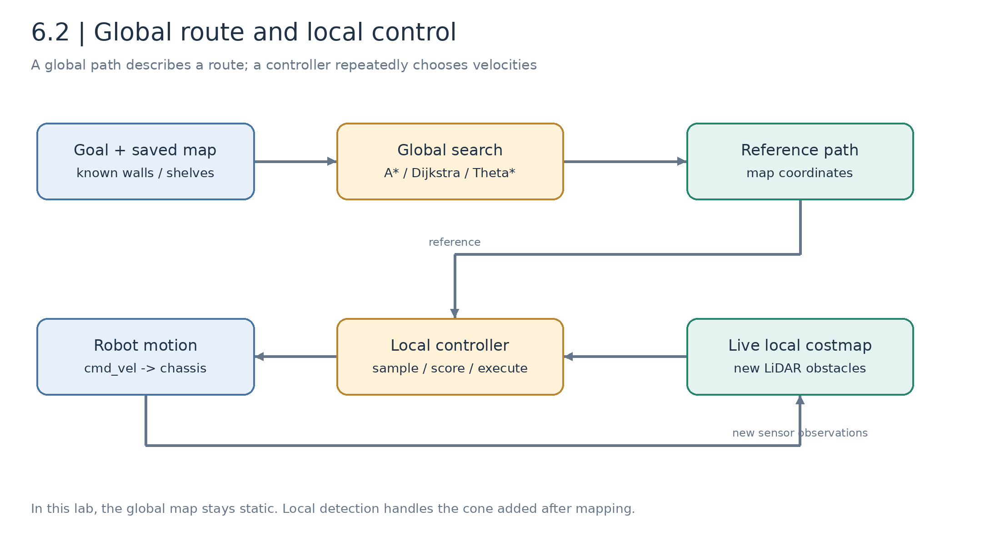
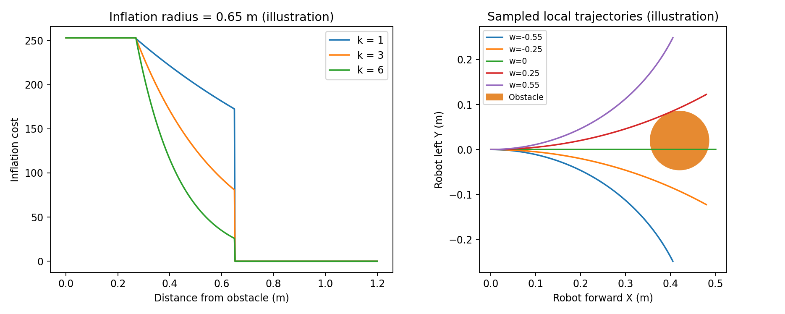
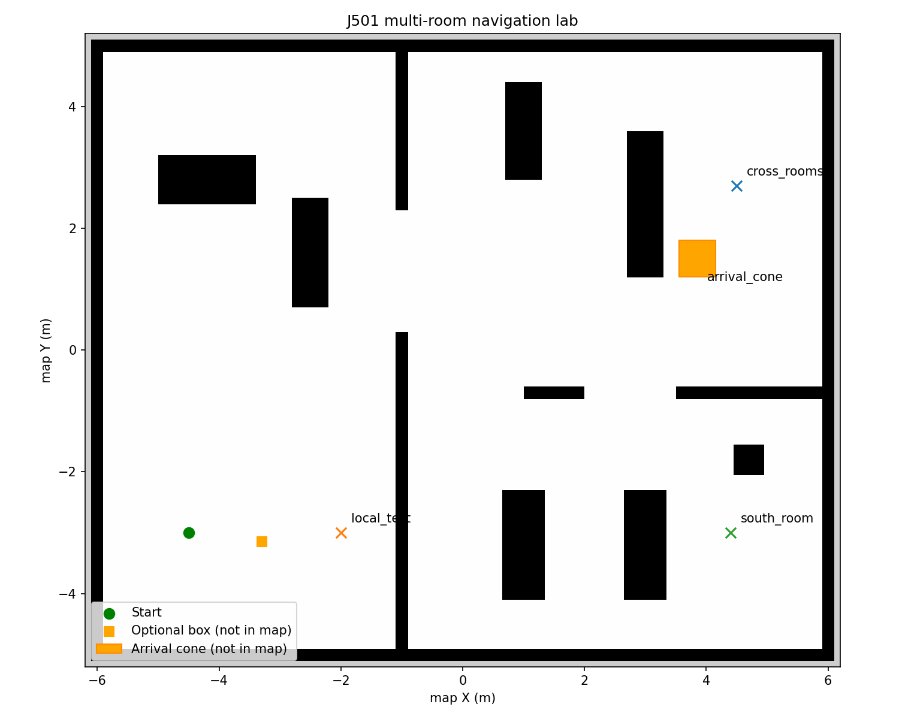
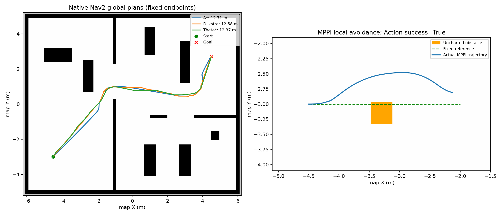

# 6.2 Global and Local Path Planning Algorithms

[中文](README_zh_CN.md) | [Previous: Nav2 setup](../6.1_Nav2_Setup_and_Configuration/README_en_US.md) | [Next: LiDAR obstacles](../6.3_Dynamic_Obstacle_Avoidance_and_Pedestrian_Prediction/README_en_US.md)

Global planning chooses corridors through a known map. Local control repeatedly selects executable velocities using current state, reference path, and nearby observations. This lesson isolates both with a multi-room map and uncharted obstacles.

## Objectives and Experiment Frames

Understand Dijkstra/A*/Theta*, DWA/DWB/MPPI/RPP, costmap tuning, and reproducible evaluation. Complete 6.1 first. One prepared class hour covers one global comparison and one local-avoidance task; repeated parameter sweeps are follow-up work.

| Route | Purpose | Coordinates |
| --- | --- | --- |
| Measured map + AMCL | Full course workflow | Goal approximately `(9,5.7,0)` |
| Explicit prebuilt fixture | Reproduce fixed-map algorithm records | `(-4.5,-3)` → `(4.5,2.7)` |

Part B uses the fixture deliberately. It does not replace mapping/relocalization acceptance.

## Part A. Principles and Implementations

### 6.2.1 Route, Prediction, and Executed Trace



*Figure 6.2-1: a route describes space; a controller predicts short-term motion and repeatedly executes velocities.*

A path is usually a sequence:

```math
\mathcal P=\{(x_0,y_0,\theta_0),\ldots,(x_N,y_N,\theta_N)\}.
```

It is not automatically time-parameterized. Control seeks a finite-horizon velocity sequence and executes its first step before reobserving.

The course global costmap has static/inflation layers; the local costmap also receives current obstacles. Other systems may update the global map with observations; this separation is an experiment configuration.

### 6.2.2 Dijkstra

Represent traversable cells as a graph with nonnegative edge costs. Relax neighbors:

```math
g_{new}(v)=\min\{g(v),g(u)+c(u,v)\}.
```

Expanding minimum accumulated cost yields a shortest graph-cost path under the standard assumptions, but may explore irrelevant regions. Cost can combine geometry and occupancy penalties:

```math
c(u,v)=\ell(u,v)+\lambda_c C(v).
```

Changing the cost model changes the optimization problem; “shortest” need not mean minimum geometric length.

### 6.2.3 A*

```math
f(n)=g(n)+h(n),\qquad h(n)=\sqrt{(x_n-x_g)^2+(y_n-y_g)^2}.
```

An admissible heuristic with appropriate search conditions preserves optimality; consistency helps avoid unnecessary re-expansion. Heuristic units/scaling must match the edge model.

Nav2 Navfn uses potential propagation and path extraction. `use_astar` changes the propagation strategy; differences in extraction can produce slightly different A*/Dijkstra lengths. It is not identical to the independent teaching priority-queue implementation.

### 6.2.4 Theta*

When a successor has collision-free line of sight to the current node's parent, try:

```math
g(s')\leftarrow g(parent(s))+\|parent(s)-s'\|.
```

This reduces grid-direction restrictions and supports any-angle paths, without guaranteeing the exact continuous shortest path. Visibility must check cells along the segment and blocked corners, not just endpoints.

The [teaching implementation](../../../modules/m06_navigation/j501_navigation/j501_navigation/grid_search.py) includes all three searches, inflation, and diagonal-corner checks. Real navigation uses native Nav2 C++ plugins.

### 6.2.5 Hybrid A* Extension

Vehicles with turning-radius constraints may need state `(x,y,theta)` and kinematically feasible expansions, such as:

```math
\dot x=v\cos\theta,\quad\dot y=v\sin\theta,\quad\dot\theta=\frac{v}{L}\tan\delta.
```

Hybrid A* is a Smac extension exercise here, not one of the three validated planners. Differential and omnidirectional chassis require appropriate motion models.

### 6.2.6 DWA and Nav2 DWB

A conceptual dynamic window around current velocity is:

```math
V_d=[v_k-a_v\Delta t,v_k+a_v\Delta t]\times
[\omega_k-a_\omega\Delta t,\omega_k+a_\omega\Delta t].
```

Intersect it with speed and stopping constraints, simulate candidates, reject collisions, and score:

```math
x_{k+1}=x_k+v\cos\theta_k\Delta t,\quad
y_{k+1}=y_k+v\sin\theta_k\Delta t,\quad
\theta_{k+1}=\theta_k+\omega\Delta t,\qquad J=\sum_jw_jJ_j.
```

DWB modularizes trajectory generation and critics. Its exact reachability/braking behavior depends on configured components; not every DWB configuration guarantees the same dynamic-window properties.

This course uses `ObstacleFootprint` and Rotation Shim for initial heading alignment. DWB and the general Goal Checker both use 0.18 m position tolerance to avoid inconsistent completion conditions.

### 6.2.7 MPPI

Perturb a control sequence, simulate each sample, compute cost, and form weighted updates:

```math
\tilde w_i=\exp[-(S_i-S_{min})/\lambda],\qquad
u_k^{new}=u_k+\frac{\sum_i\tilde w_i\epsilon_k^{(i)}}{\sum_i\tilde w_i}.
```

This captures the core intuition; full MPPI includes sampling-distribution/control-cost details and constraints. Execute the first control and roll the horizon forward.

The baseline uses 80 steps at approximately 0.0667 s, about 5.33 s horizon, 1,000 samples, and two iterations. Longer horizons/more samples increase work and may help avoidance; they do not remove local minima. Keep model step and controller frequency consistent.

### 6.2.8 RPP and TEB

Pure pursuit uses a lookahead point in robot coordinates:

```math
\kappa=2y_L/L_d^2,\qquad\omega=v\kappa.
```

RPP regulates speed using curvature, obstacle cost, and collision prediction. It may stop rather than search for a lateral detour, requiring waiting or an updated global route.

TEB jointly optimizes path poses and time intervals under smoothness, obstacle, timing, and kinematic objectives. It remains a theory/port-validation exercise; no verified Nav2 TEB port is supplied here.

### 6.2.9 Inflation

An illustrative decay outside the inscribed region is:

```math
C(d)\approx252\exp[-k(d-r_{inscribed})],\quad
r_{inscribed}<d\le r_{inflation}.
```

Lethal/inscribed/unknown cells have separate rules. `inflation_radius` sets influence range; increasing `cost_scaling_factor` makes costs decay faster, not automatically farther from obstacles.



*Figure 6.2-2: formula-based illustrations, not controller measurements. Sample curves omit complete footprint feasibility checks.*

## Part B. Executable Comparisons

### 6.2.10 Start the Fixture

Stop the previous simulation. Terminal A:

```bash
cd /home/darklee/mobile-robot-full-stack-course
./modules/m06_navigation/build.sh
./modules/m06_navigation/run_navigation.sh \
  demo_map:=true lidar:=2d odometry_source:=wheel
```

This explicitly loads the prebuilt map and seeded localization. Terminal B:

```bash
cd /home/darklee/mobile-robot-full-stack-course
source modules/m06_navigation/setup.bash
```



*Figure 6.2-3: approximately 12.4 × 10.4 m, 0.05 m cells. Orange annotations illustrate unmapped experimental obstacles, not occupied fixture cells.*

### 6.2.11 Native Global Planners

```bash
ros2 run j501_navigation global_plan --planner astar \
  --start -4.5 -3 0 --goal 4.5 2.7 0 --output build/m06_results/astar.json
ros2 run j501_navigation global_plan --planner dijkstra \
  --start -4.5 -3 0 --goal 4.5 2.7 0 --output build/m06_results/dijkstra.json
ros2 run j501_navigation global_plan --planner theta_star \
  --start -4.5 -3 0 --goal 4.5 2.7 0 --output build/m06_results/theta_star.json
ros2 run j501_navigation benchmark --trials 3
```

`ComputePathToPose` does not move the chassis. Inspect `/plan`, points, length, and server-reported duration; simulation-clock timing is not a CPU benchmark.

| Planner | Humble implementation |
| --- | --- |
| A* | `nav2_navfn_planner/NavfnPlanner`, `use_astar=true` |
| Dijkstra | Same plugin, `use_astar=false` |
| Theta* | `nav2_theta_star_planner/ThetaStarPlanner` |

[Historical records](../../../modules/m06_navigation/j501_navigation/validation/nav2_global_planners.json), three trials each, have lengths about 12.709 m, 12.584 m, and 12.373 m respectively. They do not establish universal algorithm rankings.

### 6.2.12 Standalone Teaching Search

After building and sourcing, no running ROS nodes or Gazebo are needed:

```bash
ros2 run j501_navigation grid_plan --algorithm astar --output build/m06_results/grid_astar.json
ros2 run j501_navigation grid_plan --algorithm dijkstra --output build/m06_results/grid_dijkstra.json
ros2 run j501_navigation grid_plan --algorithm theta_star --output build/m06_results/grid_theta.json
```

Study coordinate-to-cell conversion, inflation, neighbor generation, visibility, priority queue, and extraction. Its costs/extraction differ from native plugins; compare results separately.

### 6.2.13 Combined Navigation

```bash
ros2 run j501_navigation navigate --planner astar --controller MPPI \
  --goal 4.5 2.7 0 --output build/m06_results/fixture_navigation.json
```

`NavigateToPose` selects algorithms and runs the tree. Repeat independently with DWB/RPP after restoring the same spawn. Plugin loading alone does not establish task success; DWB has recorded corner-stagnation cases.

On a measured map, use the 6.1 relocalization workflow and that map's goal near `(9,5.7)` instead.

### 6.2.14 Isolated Local Avoidance

Restart the fixture at its initial pose. Save a straight reference, then add an unmapped box:

```bash
ros2 run j501_navigation global_plan --planner astar \
  --goal -2 -3 0 --output build/m06_results/local_path.json
ros2 run j501_navigation obstacle
ros2 run j501_navigation local_follow --controller MPPI \
  --path build/m06_results/local_path.json \
  --obstacle -3.3 -3.15 0.35 0.35 --timeout 90 \
  --output build/m06_results/local_mppi.json
ros2 run j501_navigation obstacle --remove
```

`FollowPath` uses a fixed reference without global replanning. `--obstacle` supplies geometry only to independent evaluation; sensing/control uses LiDAR.



*Figure 6.2-4: different tasks, not a controller-speed comparison.*

The [local record](../../../modules/m06_navigation/j501_navigation/validation/local_mppi_obstacle.json) succeeded with about 2.596 m actual path and 0.148 m minimum sampled clearance. Local obstacle cost peaked at 99, versus zero at the global point. This is a box task in the starting room, distinct from the arrival-cone task.

## Part C. Tuning and Evaluation

### 6.2.15 Change One Factor

Edit [source parameters](../../../modules/m06_navigation/j501_navigation/config/nav2_params.yaml), then restart; `/tmp` launch-generated parameter files are not persistent configuration.

| Factor | Observe | Tradeoff |
| --- | --- | --- |
| Footprint/padding | Passage and corner feasibility | Too small misses collisions; too large blocks routes |
| DWB speed/horizon | Stopping, turns, oscillation | Longer/faster does not always improve traversal |
| MPPI horizon/samples | Detour success and cycle time | Increased compute |
| Path alignment weight | Deviation around blockage | Excess weight can trap control near a blocked route |
| Inflation radius/decay | Clearance and route shape | May change corridor choice |
| Goal tolerances | Completion behavior | Mismatch can cause rotation/timeouts |

### 6.2.16 Metrics

```math
L=\sum_i\|\mathbf p_i-\mathbf p_{i-1}\|,\qquad
S=\sum_i|\operatorname{wrap}(\psi_{i+1}-\psi_i)|.
```

Compare angular smoothness after common-distance resampling. Clearance uses full footprint polygons:

```math
d_{min}=\min_{k,j}\operatorname{dist}(\mathcal F(x_k,y_k,\theta_k),\mathcal O_j).
```

Also report completion, duration, position/yaw error, recoveries, and cycle time. Zero discrete contacts are not continuous collision proof.

### 6.2.17 Failures Are Results

- [MPPI symmetric-blockage stagnation](../../../modules/m06_navigation/j501_navigation/validation/failures/mppi_initial_symmetric.json): local minima/horizon/sampling.
- [DWB tolerance mismatch](../../../modules/m06_navigation/j501_navigation/validation/failures/dwb_tolerance_timeout.json): inconsistent arrival checks.
- [DWB corner stagnation before the cone](../../../modules/m06_navigation/j501_navigation/validation/failures/dwb_arrival_cone_stagnation.json): failure before reaching the cone, not evidence of cone-detection failure.

Choose a case and document trigger, observations, hypothesis, and a one-factor test instead of an untestable algorithm judgment.

### 6.2.18 Deliverables and Pending Hardware

Submit three same-scene global JSON records, one local-control task, parameter settings, and costmap/trajectory imagery. Physical footprint/braking calibration, narrow-passage tests, dynamic obstacles, final settings, and videos remain pending. Do not fill unmeasured hardware results.

## References

- [Navfn](https://github.com/ros-navigation/navigation2/tree/humble/nav2_navfn_planner)
- [Theta*](https://github.com/ros-navigation/navigation2/tree/humble/nav2_theta_star_planner)
- [DWB](https://github.com/ros-navigation/navigation2/tree/humble/nav2_dwb_controller)
- [MPPI](https://github.com/ros-navigation/navigation2/tree/humble/nav2_mppi_controller)
- [RPP](https://github.com/ros-navigation/navigation2/tree/humble/nav2_regulated_pure_pursuit_controller)
- [Nav2 tuning](https://docs.nav2.org/rolling/configuration_and_development/tuning_guide/): use actual Humble configuration as the parameter authority.
