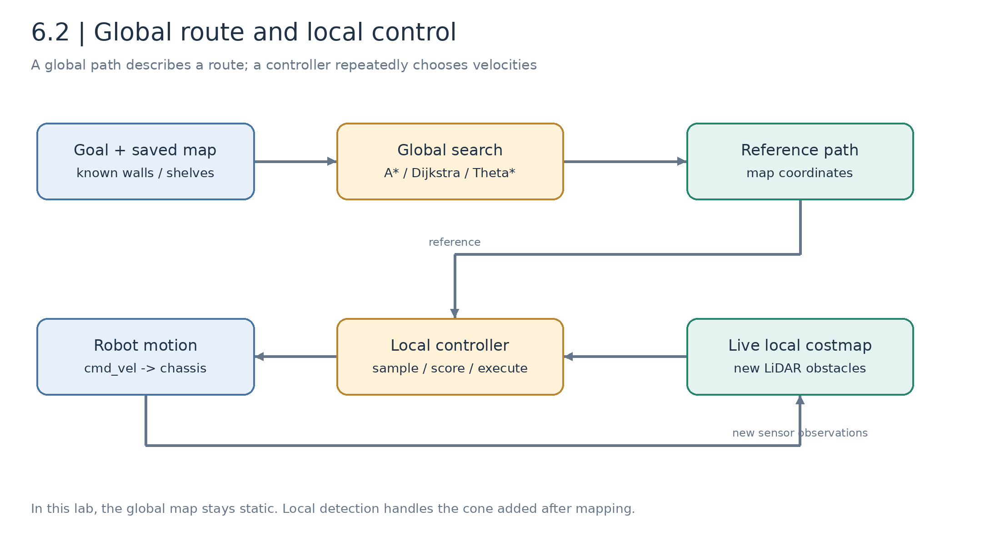
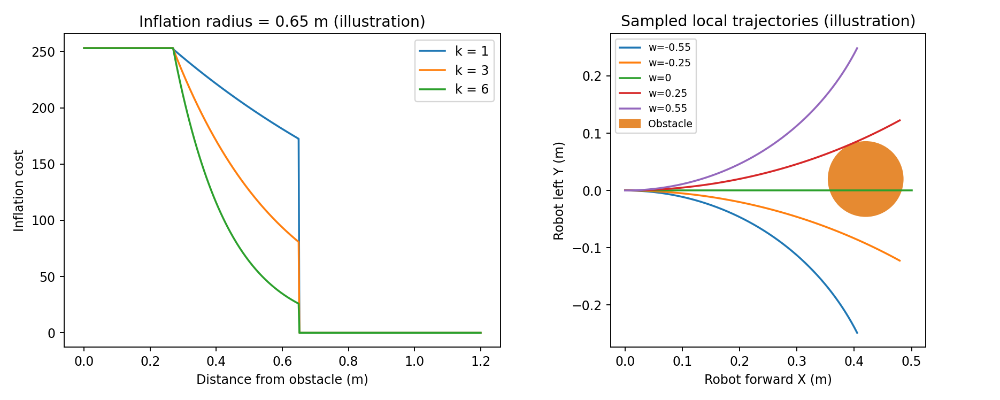
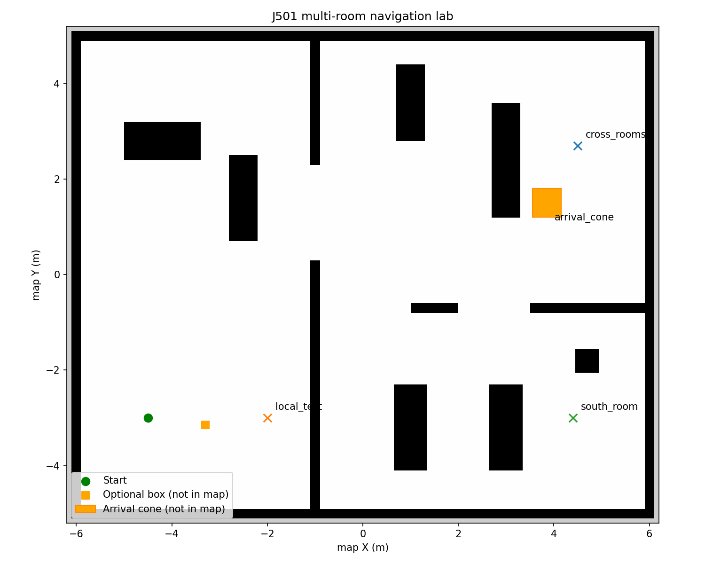
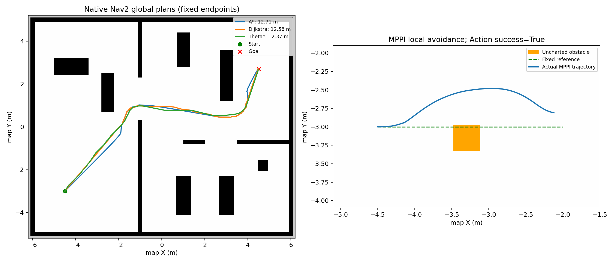

# 6.2 全局与局部路径规划算法

[English](README_en_US.md) | [上一课：Nav2 搭建](../6.1_Nav2_Setup_and_Configuration/README_zh_CN.md) | [下一课：激光障碍检测](../6.3_Dynamic_Obstacle_Avoidance_and_Pedestrian_Prediction/README_zh_CN.md)

机器人知道自己在哪里之后，还需要决定怎样到达目标。全局规划选择经过哪些通道，局部控制则结合当前速度与附近观测，反复计算下一时刻可以执行的速度。本课通过多房间地图和地图中没有的障碍，分别观察这两个环节。

## 学习目标与实验约定

- 理解 Dijkstra、A\*、Theta\* 的搜索规则和代价差异；
- 理解 DWA 思想、Nav2 DWB、MPPI 与 RPP 的不同控制方式；
- 根据足迹、通道、速度和代价地图调整参数；
- 用固定起终点、独立记录和明确指标比较结果，保留失败案例。

前置为 [6.1](../6.1_Nav2_Setup_and_Configuration/README_zh_CN.md) 已完成的建图、重定位和导航闭环。课堂约 1 课时，重点执行一组全局比较与一组局部避障，其余参数扫描作为课后实验。

本节有两种实验入口，**目标坐标不能混用**：

| 入口 | 用途 | 目标坐标 |
| --- | --- | --- |
| 6.1 自建地图 + AMCL | 完整课程导航主线 | 本场景首帧地图中约 `(9,5.7,0)` |
| 显式预制地图基准 | 固定场景比较算法，复验历史记录 | `(-4.5,-3)` → `(4.5,2.7)` |

Part B 的算法对照明确使用第二种入口，不替代建图与重定位验收。

## Part A. 原理与实现

### 6.2.1 全局路径、局部预测和实际轨迹



*图 6.2-1：全局规划给出空间路线，控制器每个周期根据新观测重新计算速度。实际轨迹是运动结果，需要另行记录。*

全局路径通常是地图坐标系中的位姿序列：

```math
\mathcal P=\{(x_0,y_0,\theta_0),\ldots,(x_N,y_N,\theta_N)\}.
```

局部控制寻找有限时域的控制序列 $U=\lbrace(v_k,\omega_k)\rbrace$，每周期只执行当前控制，再用新观测更新。路径通常没有完整的时间参数，不能把全局路径点直接当作底盘速度命令。

本实验的全局代价地图使用静态层和膨胀层，局部代价地图再加入实时障碍。工程中也可以把实时观测加入全局地图；这里的配置是为了清楚隔离全局路线与局部避障。

### 6.2.2 Dijkstra：按已付出的代价扩展

将可通行栅格看成图 $G=(V,E)$。从起点到节点 $n$ 的累计代价为 $g(n)$，松弛相邻边：

```math
g_{new}(v)=\min\{g(v),g(u)+c(u,v)\}.
```

Dijkstra 每次扩展当前 $g$ 最小的节点。在边权非负等条件下，它可求得图上的最短代价路径，但可能搜索很多与目标方向无关的区域。

“最短代价”不一定是几何距离最短。边代价可包含长度与障碍附近的栅格代价：

```math
c(u,v)=\ell(u,v)+\lambda_c C(v).
```

只要代价定义改变，算法偏好的路线也会改变；不能将不同代价模型的输出直接当作同一优化问题比较。

### 6.2.3 A\*：加入到目标的启发式

A\* 使用：

```math
f(n)=g(n)+h(n).
```

二维距离可以作为启发式：

```math
h(n)=\sqrt{(x_n-x_g)^2+(y_n-y_g)^2}.
```

当启发式可采纳并满足相应搜索实现条件时，可以保持最优性；一致启发式还有利于避免不必要的重复扩展。若边代价的尺度发生变化，启发式也必须与该代价保持一致，不能任意增大 $h$ 后继续宣称最优。

Nav2 的 Navfn 插件使用势场传播与路径回溯；`use_astar` 切换传播策略。它不是把教程中一个 Python 优先队列替换成另一个那么简单。Navfn 的路径回溯可能导致 A\* 与 Dijkstra 输出长度略有差别。

### 6.2.4 Theta\*：减少栅格方向限制

普通栅格 A\* 的节点连接受邻域限制。Theta\* 扩展后继 $s'$ 时，如果当前节点的父节点 $parent(s)$ 与 $s'$ 有无遮挡视线，就尝试：

```math
g(s')\leftarrow g(parent(s))+\|parent(s)-s'\|.
```

这使路径可以采用任意角方向，减少沿栅格折线行进的情况，但基本 Theta\* 不保证获得连续空间的精确最短路径。视线检测必须检查沿途栅格与角点，防止从对角接触的障碍之间穿过去。

课程 [独立搜索源码](../../../modules/m06_navigation/j501_navigation/j501_navigation/grid_search.py) 包含 Dijkstra、A\*、Theta\*、障碍膨胀及禁止对角穿角的检查；真实导航则调用 Nav2 的 C++ 插件。

### 6.2.5 Hybrid A\* 与运动学约束

对于不能原地旋转的车辆，仅搜索 $(x,y)$ 可能产生底盘无法跟踪的路线。Hybrid A\* 将航向纳入状态 $(x,y,\theta)$，通过满足运动模型的短轨迹扩展，例如自行车模型：

```math
\dot x=v\cos\theta,\qquad\dot y=v\sin\theta,\qquad
\dot\theta=\frac{v}{L}\tan\delta.
```

$L$ 为轴距，$\delta$ 为转角。它适合讨论转弯半径和倒车约束，本课保留为 Nav2 Smac 扩展，没有把它列入已运行的三个全局规划器。差速与麦克纳姆底盘应选择符合自身运动学的模型。

### 6.2.6 DWA 思想与 Nav2 DWB

DWA 在速度空间中选择当前可达的 $(v,\omega)$。示意动态窗口为：

```math
V_d=[v_k-a_v\Delta t,v_k+a_v\Delta t]\times
[\omega_k-a_\omega\Delta t,\omega_k+a_\omega\Delta t].
```

它还要与底盘速度上限、制动可行范围相交。对候选速度前向模拟：

```math
x_{k+1}=x_k+v\cos\theta_k\Delta t,\quad
y_{k+1}=y_k+v\sin\theta_k\Delta t,\quad
\theta_{k+1}=\theta_k+\omega\Delta t.
```

先检查碰撞和运动约束，再按路径、目标、障碍和振荡等代价评分：

```math
J=\sum_j w_jJ_j.
```

Nav2 DWB 将轨迹生成器和 Critic 评分模块化，属于 DWA 思想在 Nav2 中的常用实现路线，但实际动态窗口与制动判定取决于所选生成器和 Critic，不能假定所有 DWB 配置自动具备相同保证。

本配置使用 `ObstacleFootprint` 检查完整足迹，外层 Rotation Shim 先对齐路径朝向。`xy_goal_tolerance` 与 Goal Checker 均为 0.18 m，避免内部判断已经到达、外部 Action 却始终不完成。

### 6.2.7 MPPI：批量采样控制序列

MPPI 维护控制序列，为它加入扰动 $\epsilon^{(i)}$，模拟并计算各条轨迹代价 $S_i$。其核心加权更新可示意为：

```math
\tilde w_i=\exp\!\left[-\frac{S_i-S_{min}}{\lambda}\right],\qquad
u_k^{new}=u_k+\frac{\sum_i\tilde w_i\epsilon_k^{(i)}}{\sum_i\tilde w_i}.
```

这里写的是帮助理解的核心形式，完整 MPPI 还包含采样分布、控制代价与约束等细节。优化后执行第一步，并向前滚动时域。

当前基线 `time_steps=80`、`model_dt≈0.0667 s`，预测时域约 5.33 s；`batch_size=1000`、`iteration_count=2`。增大采样数或时域可能提高绕行机会，也增加计算量。参数之间要协调，特别是 `model_dt` 与控制频率。

对称挡路物、参考路径权重过高或时域不足时，MPPI 也可能停滞在局部极小。出现停车应记录实际 Action 状态，不能只凭可视化轨迹宣称绕行成功。

### 6.2.8 RPP 与 TEB

纯追踪在机器人坐标系中选择前视点 $(x_L,y_L)$，以圆弧曲率近似跟踪：

```math
\kappa=\frac{2y_L}{L_d^2},\qquad\omega=v\kappa.
```

RPP 根据曲率、障碍代价和碰撞预测调整速度。它擅长跟踪已有路线，但不会搜索任意侧向绕行路线；前方被堵时可能减速或停车，需要等待或新的参考路径。

TEB 将路径位姿与相邻时间间隔一起优化，在平滑、时间、障碍和运动学约束之间折中。它适合作为弹性带理论的扩展，但本仓库未提供已验证的 Nav2 TEB 移植配置；不能复制 ROS 1 插件名后当作 Humble 中可直接运行的程序。

### 6.2.9 膨胀层如何影响路线

对障碍外距离 $d$，膨胀代价的常见指数衰减形式可示意为：

```math
C(d)\approx252\exp[-k(d-r_{inscribed})],\qquad
r_{inscribed}<d\le r_{inflation}.
```

致命格、内切区域和未知格有独立规则，上式只描述衰减区。`inflation_radius` 决定影响范围，`cost_scaling_factor` 对应衰减强度：越大衰减越快，并非越大就离障碍越远。



*图 6.2-2：按公式绘制的原理示意。右侧候选曲线未包含完整足迹碰撞检测，不能当作真实控制器的可行轨迹结果。*

## Part B. 可复制的算法对照实验

### 6.2.10 启动固定地图基准

先结束 6.1 的仿真。终端 A：

```bash
cd /home/darklee/mobile-robot-full-stack-course
./modules/m06_navigation/build.sh
./modules/m06_navigation/run_navigation.sh \
  demo_map:=true lidar:=2d odometry_source:=wheel
```

该模式显式加载预制地图并提供初始定位，用于复验旧算法记录。它不代表重新完成建图或未知位置重定位。终端 B：

```bash
cd /home/darklee/mobile-robot-full-stack-course
source modules/m06_navigation/setup.bash
```



*图 6.2-3：约 12.4 × 10.4 m、分辨率 0.05 m 的场景。橙色标记只是帮助说明未写入地图的实验障碍，不是占用地图已知格。*

### 6.2.11 比较真实 Nav2 全局规划器

```bash
ros2 run j501_navigation global_plan --planner astar \
  --start -4.5 -3 0 --goal 4.5 2.7 0 --output build/m06_results/astar.json
ros2 run j501_navigation global_plan --planner dijkstra \
  --start -4.5 -3 0 --goal 4.5 2.7 0 --output build/m06_results/dijkstra.json
ros2 run j501_navigation global_plan --planner theta_star \
  --start -4.5 -3 0 --goal 4.5 2.7 0 --output build/m06_results/theta_star.json
ros2 run j501_navigation benchmark --trials 3
```

这些命令调用 `ComputePathToPose`，只规划而不驱动底盘。查看 RViz `/plan` 与 JSON 路径点、长度、规划时间。服务器报告的时间受仿真时钟和调度影响，不等同于 CPU 性能基准。

| 规划器 | Humble 插件与配置 |
| --- | --- |
| A\* | `nav2_navfn_planner/NavfnPlanner`，`use_astar=true` |
| Dijkstra | 同上，`use_astar=false` |
| Theta\* | `nav2_theta_star_planner/ThetaStarPlanner` |

[历史记录](../../../modules/m06_navigation/j501_navigation/validation/nav2_global_planners.json) 中各规划器运行 3 次，路径长度约为 A\* 12.709 m、Dijkstra 12.584 m、Theta\* 12.373 m。这个结论只适用于该地图和代价设置，不能推成算法在所有场景中的排名。

### 6.2.12 阅读并运行独立教学实现

已构建并 source 后，不启动 Gazebo 或其他 ROS 节点也可执行：

```bash
ros2 run j501_navigation grid_plan --algorithm astar --output build/m06_results/grid_astar.json
ros2 run j501_navigation grid_plan --algorithm dijkstra --output build/m06_results/grid_dijkstra.json
ros2 run j501_navigation grid_plan --algorithm theta_star --output build/m06_results/grid_theta.json
```

教学程序使用自己的栅格代价、邻接与路径回溯，输出扩展节点数等指标。它与 Navfn / Nav2 Theta\* 不是相同实现，长度和时间应分别比较。推荐阅读顺序：坐标转栅格、膨胀、邻居生成、视线检测、优先队列、回溯。

### 6.2.13 执行全局规划与控制闭环

在基准模式中：

```bash
ros2 run j501_navigation navigate --planner astar --controller MPPI \
  --goal 4.5 2.7 0 --output build/m06_results/fixture_navigation.json
```

客户端通过 `NavigateToPose` 选择算法并执行行为树。可将 `--controller` 改为 `DWB` 或 `RPP` 进行独立实验；每次对照前重启到相同出生点，并记录实际结果。新场景中的 DWB 曾在转角停滞，不能假定每个已加载插件都能完成当前任务。

如果使用 6.1 的自建地图，应先按该节重定位，再将目标改为当前地图中的 `(9,5.7)` 附近。

### 6.2.14 固定参考路径，单独观察局部避障

重新启动基准场景至初始位姿，在 B 中先计算房间内直线路径，再添加未建图障碍：

```bash
ros2 run j501_navigation global_plan --planner astar \
  --goal -2 -3 0 --output build/m06_results/local_path.json
ros2 run j501_navigation obstacle
ros2 run j501_navigation local_follow --controller MPPI \
  --path build/m06_results/local_path.json \
  --obstacle -3.3 -3.15 0.35 0.35 --timeout 90 \
  --output build/m06_results/local_mppi.json
ros2 run j501_navigation obstacle --remove
```

`FollowPath` 直接跟踪固定参考，不调用全局重规划。`--obstacle` 只给独立评估器提供几何信息，检测与控制仍依靠雷达。观察局部代价地图增加障碍、全局地图保持静态、实际轨迹偏离原参考后回到目标。



*图 6.2-4：真实 Nav2 全局规划结果与另一次固定路径局部避障实验。左右图不是同一个任务，不能比较控制器速度。*

[该局部实验记录](../../../modules/m06_navigation/j501_navigation/validation/local_mppi_obstacle.json) 中，Action 成功，实际路径约 2.596 m，最小采样足迹净空约 0.148 m。障碍位置的局部代价峰值为 99，全局对应点为 0。该处没有建图后新增的锥桶，不应与终点锥桶实验混写。

## Part C. 调参与结果分析

### 6.2.15 一次只改一类因素

实际参数位于 [nav2_params.yaml](../../../modules/m06_navigation/j501_navigation/config/nav2_params.yaml)。修改源码配置后重新启动；由 launch 生成的 `/tmp` 参数文件是运行产物，不应把它当作永久配置编辑。

| 变量 | 建议观察 | 可能的代价 |
| --- | --- | --- |
| 足迹与 `footprint_padding` | 通过性、拐角碰撞 | 配小会漏判碰撞，配大可能无法通过 |
| DWB `max_vel_x`、`sim_time` | 刹停、转角、振荡 | 加速或加长预测不一定改善通过性 |
| MPPI `time_steps`、`batch_size` | 绕行成功、周期耗时 | 时域和采样数增大占用更多算力 |
| 路径对齐权重 | 绕障偏离参考的幅度 | 权重过高可能坚持被挡住的路线 |
| 膨胀半径与衰减系数 | 路线贴障距离 | 通道代价变化可能导致路线切换 |
| Goal Checker 与控制器容差 | 终点是否能完成 Action | 不一致可能无限旋转或超时 |

### 6.2.16 评价指标

折线路径长度：

```math
L=\sum_{i=1}^{N}\|\mathbf p_i-\mathbf p_{i-1}\|.
```

在统一重采样后可用累计方向变化作为平滑度指标：

```math
S=\sum_i\left|\operatorname{wrap}(\psi_{i+1}-\psi_i)\right|.
```

足迹净空应考虑完整机器人多边形 $\mathcal F$，不能只计算中心点距离：

```math
d_{min}=\min_{k,j}\operatorname{dist}\bigl(\mathcal F(x_k,y_k,\theta_k),\mathcal O_j\bigr).
```

同时记录完成状态、到达时间、终点位置与朝向误差、恢复次数，以及控制周期耗时。碰撞样本为零只说明离散样本没有接触，不能代替连续验证。

### 6.2.17 失败案例也属于结果

| 已记录案例 | 说明 |
| --- | --- |
| [MPPI 对称障碍前停滞](../../../modules/m06_navigation/j501_navigation/validation/failures/mppi_initial_symmetric.json) | 局部极小与采样 / 时域有关，停车不等于绕行 |
| [DWB 终点容差不一致](../../../modules/m06_navigation/j501_navigation/validation/failures/dwb_tolerance_timeout.json) | 内外到达条件不一致导致超时 |
| [DWB 在锥桶场景前段转角停滞](../../../modules/m06_navigation/j501_navigation/validation/failures/dwb_arrival_cone_stagnation.json) | 尚未到达锥桶便无法推进，不能把失败归因于锥桶检测 |

练习：选择一个案例，写出触发条件、观测证据、可能原因、只改一个因素的验证方法。不要用“算法不好”替代可检验解释。

### 6.2.18 课堂验收与实车待补

课堂提交包括三种全局规划器的同场景 JSON、一组局部控制记录、至少一张代价地图与轨迹图，以及当前参数。实车部分保留以下空位：

| 实车项目 | 结果 |
| --- | --- |
| 底盘运动学、足迹与制动距离 | 待标定 |
| 狭窄通道与直角转弯 | 待实验 |
| 动态障碍下减速、停车与绕行 | 待实验 |
| 最终参数、轨迹、视频与失败复盘 | 待补充 |

## 参考资料

- [Navfn Humble 源码](https://github.com/ros-navigation/navigation2/tree/humble/nav2_navfn_planner)
- [Theta\* Humble 源码](https://github.com/ros-navigation/navigation2/tree/humble/nav2_theta_star_planner)
- [DWB Humble 源码](https://github.com/ros-navigation/navigation2/tree/humble/nav2_dwb_controller)
- [MPPI Humble 源码](https://github.com/ros-navigation/navigation2/tree/humble/nav2_mppi_controller)
- [RPP Humble 源码](https://github.com/ros-navigation/navigation2/tree/humble/nav2_regulated_pure_pursuit_controller)
- [Nav2 调参指南](https://docs.nav2.org/rolling/configuration_and_development/tuning_guide/)：参数以本仓库实际 Humble 配置为准。
