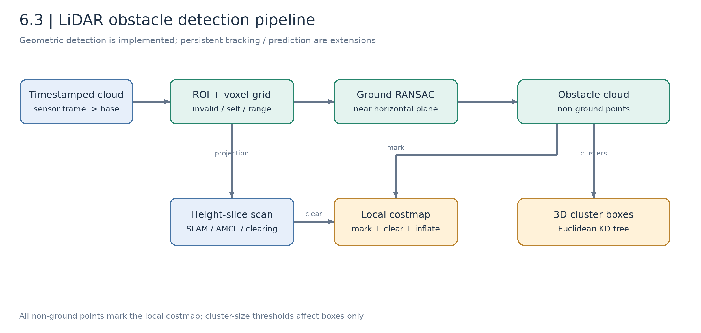
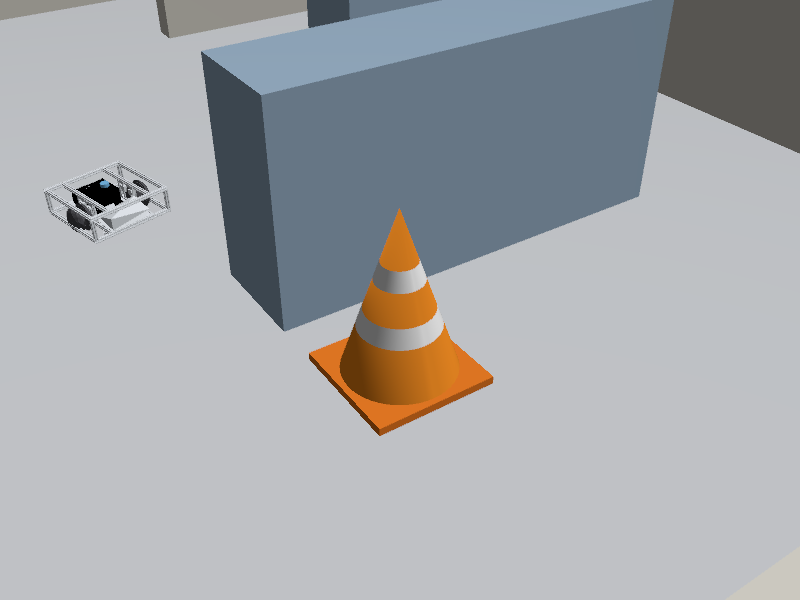
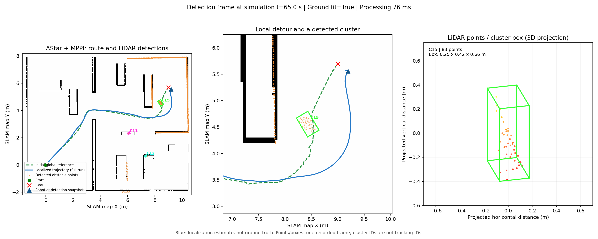
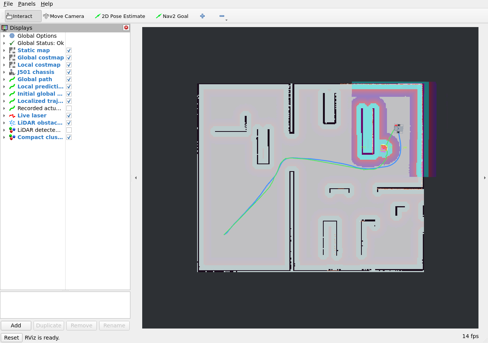
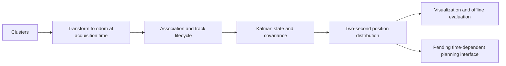

# 6.3 Dynamic Obstacle Avoidance and Pedestrian Prediction

[中文](README_zh_CN.md) | [Previous: planning](../6.2_Global_and_Local_Path_Planning/README_en_US.md) | [Next: multi-robot systems](../6.4_Multi-Robot_Collaboration_and_Formation_Navigation/README_en_US.md)

A map describes the environment during acquisition. New cones, carts, and pedestrians require live sensing. This lesson implements LiDAR geometric detection and then explains the additional association, motion compensation, and uncertainty needed for tracking and prediction.

Ground separation, clustering, boxes, local-costmap integration, and cone avoidance are executable. Persistent IDs, pedestrian prediction, and prediction-aware control remain extensions, not completed experiments.

## Objectives and Preparation

Understand cloud transforms, ROI/voxel filtering, RANSAC, Euclidean clustering, costmap integration, and visualization. Derive basic Kalman/constant-velocity prediction and VO/ORCA concepts. Prerequisites are M3 sensing/time synchronization, M6.1 localization, and M6.2 control; visual fusion additionally uses [M4.2](../../M04-AI-Vision-And-Edge-Acceleration/4.2_Multi-Object_Tracking/README_en_US.md).

One prepared class hour emphasizes detection and one closed-loop detour. Tracking/prediction are derivation and follow-up work.

## Part A. Geometric Obstacle Detection

### 6.3.1 Detection Is Not Tracking

| Stage | Output | Status |
| --- | --- | --- |
| Detection | Current clusters/centers/sizes/timestamps | Implemented |
| Tracking | Persistent ID, velocity, covariance | Extension design |
| Prediction | Future position distribution | Theory/extension |
| Predictive planning | Time-dependent collision cost/constraint | Interface pending |

A cluster can be part of a wall, person, shelf, or cone. One box does not establish semantic class or motion. Labels such as `C15` are frame-local.



*Figure 6.3-1: projected scans support SLAM/AMCL/clearing; non-ground points mark obstacles; clustering exposes object candidates.*

### 6.3.2 Transform and ROI

Transform sensor points at acquisition time:

```math
\mathbf p_B(t)=R_{BL}(t)\mathbf p_L(t)+\mathbf t_{BL}(t).
```

Wait for valid TF rather than using an incorrect timestamp. Remove NaN/Inf, near-self returns, and points outside the ROI: approximately 0.35–10 m planar range and −0.15–1.5 m height. Processing bounds are not the sensor's physical limits.

### 6.3.3 Voxel Reduction

```math
\mathbf v_i=\lfloor\mathbf p_i/l\rfloor,\qquad
\overline{\mathbf p}_{v}=\frac{1}{N_v}\sum_{i\in v}\mathbf p_i.
```

The baseline uses 0.06 m voxels. Smaller preserves detail with more work; larger may merge or erase small objects. Choose against target size and return density.

### 6.3.4 Constrained Ground RANSAC

```math
\mathbf n^T\mathbf p+d=0,\quad\|\mathbf n\|=1,\qquad
|\mathbf n^T\mathbf p_i+d|<\tau.
```

Sample three noncollinear points, fit candidates, and count inliers. The course constrains normals within 15° of vertical and ground height near the calibrated base plane, using 0.04 m inlier tolerance. Low candidate points reduce tabletop selection.

For independent sampling with inlier ratio $w$, an ideal iteration estimate is:

```math
N\ge\frac{\log(1-p)}{\log(1-w^3)}.
```

The implementation uses at most 45 constrained candidates; it does not dynamically guarantee this success probability. Sparse ground returns explicitly report `ground_fitted=false` and use a calibrated horizontal fallback. The level-ground assumption does not cover slopes, stairs, or pits.

### 6.3.5 Euclidean Clusters and Boxes

Connect points within radius:

```math
\|\mathbf p_i-\mathbf p_j\|_2\le r_c.
```

KD-tree radius queries and connected expansion produce clusters. Baseline tolerance is 0.18 m, with five points required for a detection box. Compute:

```math
\mathbf c=(\mathbf p_{max}+\mathbf p_{min})/2,\qquad
\mathbf s=\mathbf p_{max}-\mathbf p_{min}.
```

Boxes align with `base_footprint` axes, so they may be rotated when displayed in `map`. Connected walls may merge; occlusion/sparse rays may split objects. The minimum cluster size affects boxes only: all accepted non-ground points still participate in obstacle marking.

See [algorithms](../../../modules/m06_navigation/j501_navigation/j501_navigation/lidar_algorithms.py) and [ROS node](../../../modules/m06_navigation/j501_navigation/j501_navigation/perception.py).

### 6.3.6 Control Interfaces

| Topic | Content | Consumer |
| --- | --- | --- |
| `/livox/lidar` | Raw `PointCloud2` | MID-360-FOV approximation input |
| `/scan` | Height slice 0.12–0.42 m | SLAM, AMCL, clearing |
| `/perception/ground` | Ground cloud | Fit inspection |
| `/perception/obstacles` | Non-ground cloud | Local obstacle marking |
| `/perception/boxes` | All cluster markers | Raw visualization |
| `/perception/detections` | JSON geometry/counts/timing | Recording and tuning |
| `/lab/algorithm_markers` | Compact boxes/labels | Classroom display, not control input |

In 3D mode, clouds mark with `marking=true, clearing=false`; scans clear with `clearing=true, marking=false`, followed by inflation. Controllers consume costmaps, not RViz boxes.

Projection takes nearest points per ray and uses Inf for empty bins. Real non-repetitive Livox scans must distinguish unscanned directions from observed no-return directions before reusing clearing rules. Occlusion, height differences, and latency can leave remnants.

## Part B. Executable Detection and Avoidance

### 6.3.7 Start and Relocalize

First complete [6.1](../6.1_Nav2_Setup_and_Configuration/README_en_US.md). On a machine with an existing EKF map, terminal A:

```bash
cd /home/darklee/mobile-robot-full-stack-course
./modules/m06_navigation/build.sh
./modules/m06_navigation/run_navigation.sh \
  map:="$PWD/build/m06_maps/ekf/office.yaml" algorithm_view:=true
```

A fresh clone does not include that generated `build/` map. Use the default helper after saving your own 6.1 map.

Terminal B:

```bash
cd /home/darklee/mobile-robot-full-stack-course
source modules/m06_navigation/setup.bash
ros2 run j501_navigation relocalize --pose 0 0 0
```

Wait for success. The launch already starts perception and the algorithm view; do not duplicate them.

### 6.3.8 Inspect Output

```bash
ros2 topic info /perception/obstacles --verbose
ros2 topic echo /perception/detections --once
ros2 topic hz /perception/obstacles
```

Stop continuous frequency measurement with Ctrl+C. Processing is limited to about 5 Hz in simulation time; measure actual rate/latency. `processing_ms` is node work time, not end-to-end sensing-to-control latency.

Only with an independently running compatible driver, start the detector alone:

```bash
ros2 run j501_navigation lidar_perception --ros-args \
  --params-file modules/m06_navigation/j501_navigation/config/lidar_perception.yaml
```

Match topic/frame parameters. Unadapted Livox `CustomMsg` is unsupported.

### 6.3.9 Navigate Past the New Cone

```bash
ros2 run j501_navigation navigate --planner astar --controller MPPI \
  --goal 9 5.7 0 --output build/m06_results/lidar_avoidance.json
```

Mapping omitted the cone; navigation restores it. “Unmapped” does not mean moving.



*Figure 6.3-2: visible surfaces and collision geometry produce actual laser returns.*

Follow the causal chain: returns → non-ground points → boxes → local costs/inflation → changed velocity/route. Global mapping still reflects the earlier free space.

### 6.3.10 Read and Export the Algorithm View



*Figure 6.3-3: recorded simulation output. Full estimated trace, local detour, and one timestamped cluster frame with 3D box projection.*

- Green dashed: initial global reference; live `/plan` can change.
- Blue: AMCL/EKF localized trace, not simulator truth.
- Orange: non-ground points from the selected frame.
- Colored boxes: compact geometric candidates; no semantic class or tracking ID.

Enable `LiDAR detected boxes` for all raw clusters, including large wall groups. Display filtering does not change collision observations.



*Figure 6.3-4: the trace persists after navigation.*

Keep terminal A running and export:

```bash
ros2 service call /algorithm_view/save std_srvs/srv/Trigger '{}'
```

Outputs: `build/m06_results/algorithm_view.png` and `.json`. Replot the supplied record offline:

```bash
/usr/bin/python3 modules/m06_navigation/j501_navigation/j501_navigation/plot_algorithm_view.py \
  modules/m06_navigation/j501_navigation/validation/algorithm_view/snapshot.json \
  --output build/m06_results/replot.png
```

See [snapshot](../../../modules/m06_navigation/j501_navigation/validation/algorithm_view/snapshot.json) and [navigation outcome](../../../modules/m06_navigation/j501_navigation/validation/algorithm_view/navigation.json). A full-run trace overlaid with one frame is not a cumulative detection map.

### 6.3.11 Optional Moving-Object Observation

In another sourced terminal while the same world runs:

```bash
ros2 run j501_navigation obstacle --name crossing_box \
  --x 4.0 --y 1.0 --size 0.35 0.35 --crossing --duration 20
```

The service positions use Gazebo world coordinates, not the first-scan SLAM frame. Verify placement visually. This bounded tool updates poses discretely; it is not pedestrian dynamics. The model remains at its final pose afterward:

```bash
ros2 run j501_navigation obstacle --name crossing_box --remove
```

Inspect detection, clearing, and remnants before simultaneous robot-motion tests. Tool functionality is not acceptance of every dynamic-avoidance scenario; record stops, stagnation, and failures.

## Part C. Tracking and Prediction Extensions

### 6.3.12 Ego-Motion Compensation

Stationary walls move in robot coordinates during turns. Transform observations at acquisition time into continuous odometry before associating or estimating speed:

```math
\mathbf p_{O,k}=R_{OB}(t_k)\mathbf p_{B,k}+\mathbf t_{OB}(t_k).
```

AMCL map corrections can jump; continuous local tracking and later map conversion avoid mistaking corrections for object motion.

### 6.3.13 Constant-Velocity Kalman Model

```math
\mathbf x=[p_x,p_y,v_x,v_y]^T,\quad
F=\begin{bmatrix}1&0&\Delta t&0\\0&1&0&\Delta t\\0&0&1&0\\0&0&0&1\end{bmatrix},\quad
H=\begin{bmatrix}1&0&0&0\\0&1&0&0\end{bmatrix}.
```

```math
\hat{\mathbf x}_k^-=F\hat{\mathbf x}_{k-1},\quad P_k^-=FP_{k-1}F^T+Q,
```

```math
K_k=P_k^-H^T(HP_k^-H^T+R)^{-1},\quad
\hat{\mathbf x}_k=\hat{\mathbf x}_k^-+K_k(\mathbf z_k-H\hat{\mathbf x}_k^-).
```

Association comes first: distance/Mahalanobis gating and one-to-one assignment, plus track confirmation, missed-detection lifetime, and deletion. Frame-local cluster numbers are insufficient.

### 6.3.14 Two-Second Prediction

```math
\hat{\mathbf p}(t+\tau)=\hat{\mathbf p}(t)+\hat{\mathbf v}(t)\tau,\quad\tau=2\ s,
```

```math
P(t+\tau)=F(\tau)P(t)F(\tau)^T+Q(\tau).
```

Turns, acceleration, and occlusion invalidate constant velocity; expand uncertainty or expire predictions. Visualization and planning integration require separate acceptance. Standard obstacle layers do not automatically use a future-point topic.



### 6.3.15 VO and ORCA

Let $\mathbf p=\mathbf p_o-\mathbf p_r$ be the obstacle position relative to the robot, with combined radius $R$. Express candidate robot velocity $\mathbf v_r$ and obstacle velocity $\mathbf v_o$ in the same frame. For horizon $T>0$:

```math
\operatorname{VO}_{T}=
\left\{
\mathbf{v}_{r}\in\mathbb{R}^{2}
\;\middle|\;
\exists t\in(0,T],\quad
\left\lVert\mathbf{p}-(\mathbf{v}_{r}-\mathbf{v}_{o})t\right\rVert_{2}<R
\right\}.
```

VO excludes candidate collision velocities. ORCA shares avoidance correction under reciprocal-cooperation assumptions and constructs allowed velocity half-planes. Pedestrians need not cooperate; differential-drive robots cannot instantly execute arbitrary planar velocity. Acceleration, tracking, and kinematics still matter.

No VO/ORCA controller is integrated here; this is theory, not a parameter switch.

## Part D. Evaluation and Pending Hardware

| Symptom | Investigate |
| --- | --- |
| Floor marked as obstacle | Extrinsic height, ground model, `ground_fitted` |
| No box but slowing | Too few points for box; inspect non-ground cloud |
| Huge cluster box | Connected walls/shelves and tolerance |
| Moving-object remnants | Clearing rays, occlusion, height, latency |
| Jumping boxes | TF time, localization correction, changing cluster membership |
| Export missing data | Need route, motion, and a nearby compact detection |

Submit detector parameters, a timestamped JSON frame, the visualization, local-costmap evidence, and task outcome. Vary voxel size, clustering radius, and ground threshold separately. Track false/missed detections, merged/split clusters, and timing.

Tracking extensions separately evaluate ID continuity, velocity, occlusion behavior, and two-second error. Truth is independent evaluation only. Matched detection-frame counts are not whole-scene accuracy without defined labels/matching/statistics.

Hardware extrinsics, point format, terrain samples, throughput/latency, cart/pedestrian crossings, photos, and videos remain pending. Tracking, prediction, and predictive control require their own implementation and acceptance.

## References

- [PCL Euclidean clustering](https://pointclouds.org/documentation/tutorials/cluster_extraction.html)
- [PCL plane segmentation](https://pointclouds.org/documentation/tutorials/planar_segmentation.html)
- [Nav2 obstacle layer](https://docs.nav2.org/rolling/configuration_and_development/configuration_guide/core_servers/costmap_2d/costmap_plugins/obstacle/): the online page targets Rolling; use this repository’s Humble configuration and source for parameter names and types.
- [ORCA](https://gamma-web.iacs.umd.edu/ORCA/)
- [Detector configuration](../../../modules/m06_navigation/j501_navigation/config/lidar_perception.yaml)
