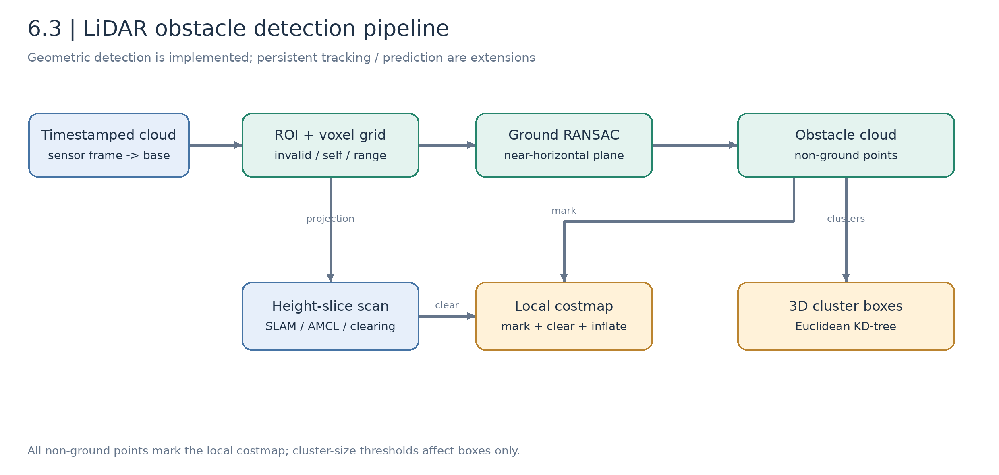
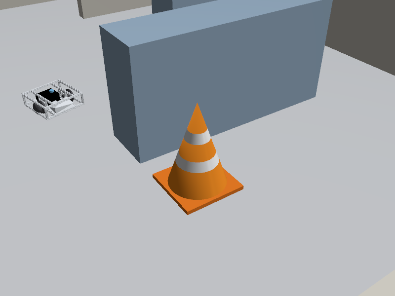
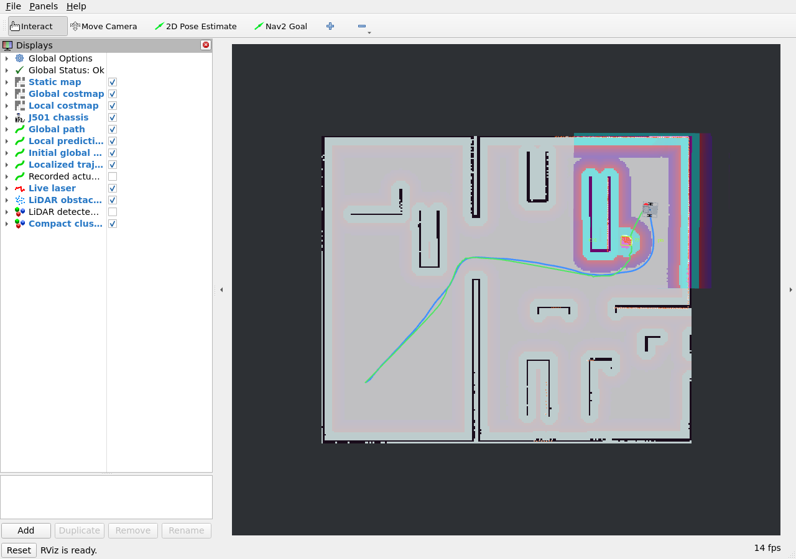
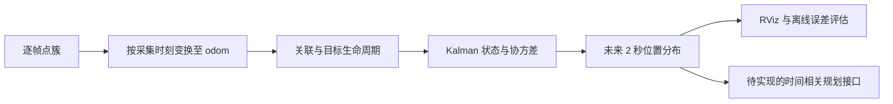

# 6.3 动态避障与行人预测

[English](README_en_US.md) | [上一课：全局与局部规划](../6.2_Global_and_Local_Path_Planning/README_zh_CN.md) | [下一课：多机协同](../6.4_Multi-Robot_Collaboration_and_Formation_Navigation/README_zh_CN.md)

地图记录的是建图时的环境，导航时可能出现新的锥桶、推车或行人。本课首先建立可以运行的激光障碍检测链路，再解释从单帧几何检测走向多帧跟踪和短期预测还需要哪些条件。

本仓库已提供地面分割、欧式聚类、包围框、局部代价地图接入与锥桶绕行。持续目标 ID、行人运动预测与预测参与规划仍是扩展设计，没有将它们计为已完成实验。

## 学习目标与准备

- 解释点云坐标变换、ROI、体素滤波、RANSAC 与欧式聚类；
- 确认检测结果实际进入局部代价地图并影响速度输出；
- 在同一效果图中区分初始全局路径、定位轨迹与检测帧；
- 理解目标跟踪、运动补偿、常速度预测、VO / ORCA 的基本公式；
- 设计对遮挡、过期输入和预测失效的处理方式。

前置为 M3 的点云与时间同步、M6.1 的建图和重定位，以及 M6.2 的局部控制。视觉融合扩展再参考 [M4.2 多目标跟踪](../../M04-AI-Vision-And-Edge-Acceleration/4.2_Multi-Object_Tracking/README_zh_CN.md)。课堂 1 课时以激光检测和一次闭环绕行为必做，跟踪与预测作为推导和课后任务。

## Part A. 从原始点云到几何障碍物

### 6.3.1 检测、跟踪与预测分别输出什么

| 环节 | 典型输出 | 当前进度 |
| --- | --- | --- |
| 检测 | 当前点簇、中心、尺寸、采集时刻 | 已实现 |
| 跟踪 | 跨帧 ID、位置、速度、协方差 | 设计与扩展任务 |
| 预测 | 将来若干时刻的位置与不确定性 | 原理与扩展任务 |
| 预测参与规划 | 时间相关碰撞代价或约束 | 待实现接口 |

一个点簇只是几何候选。它可能是墙的一部分，也可能是行人、货架或锥桶；仅凭一个包围框不能判断类别，更不能判断它是否在运动。可视化中的 `C15` 等编号只在当前帧有效。



*图 6.3-1：实际检测管线。切片扫描服务于 SLAM / AMCL 和空间清除，非地面点云服务于障碍标记，聚类则提供可观察的物体候选。*

### 6.3.2 时间戳、坐标变换与 ROI

雷达点 $\mathbf p_L$ 应按采集时刻 $t$ 转到 `base_footprint`：

$$
\mathbf p_B(t)=R_{BL}(t)\mathbf p_L(t)+\mathbf t_{BL}(t).
$$

虽然刚性安装的外参通常固定，TF 查询仍要与消息时间一致；不能为消除查找失败而随意使用错误时刻的机器人位姿。节点拿不到对应 TF 时等待后续有效输入。

随后移除 NaN / Inf、自车近距离点和超出距离 / 高度范围的点。当前处理 ROI 为平面半径 0.35～10 m、高度约 −0.15～1.5 m。这个范围是算法设置，不是雷达物理探测能力。

### 6.3.3 体素滤波

体素大小为 $l$，点所属网格为：

$$
\mathbf v_i=\left\lfloor\frac{\mathbf p_i}{l}\right\rfloor.
$$

对同一体素内的点使用均值代表：

$$
\overline{\mathbf p}_{v}=\frac{1}{N_v}\sum_{i\in v}\mathbf p_i.
$$

当前 $l=0.06$ m。过小会保留更多细节并增加计算，过大可能合并小物体或丢失轮廓。应结合目标尺寸、点密度和处理频率选择，而不是固定追求最密点云。

### 6.3.4 用约束 RANSAC 分离地面

平面模型为：

$$
\mathbf n^T\mathbf p+d=0,\qquad\|\mathbf n\|=1.
$$

随机选取不共线的三点拟合候选平面，统计距离小于阈值 $\tau$ 的内点：

$$
\left|\mathbf n^T\mathbf p_i+d\right|<\tau.
$$

本实现还要求平面接近底盘标定地面，且法向量与竖直方向夹角不超过 15°，以减少把桌面或墙面当成地面的风险；当前内点阈值为 0.04 m。

理想独立采样条件下，为获得至少一次全内点三点样本，可用下式估算迭代次数：

$$
N\ge\frac{\log(1-p)}{\log(1-w^3)}.
$$

$p$ 是期望成功概率，$w$ 是内点比例。这是理论估算，当前程序固定最多 45 次候选采样并约束候选点区域，没有动态保证上述成功概率。

地面回波太少时，程序输出 `ground_fitted=false`，退回标定水平地面。回退必须可见，不能写成 RANSAC 检测成功。近平地假设不适用于大坡道、台阶和坑洞。

### 6.3.5 欧式聚类与三维包围框

非地面点之间如果欧氏距离小于 $r_c$，则建立邻接关系：

$$
\|\mathbf p_i-\mathbf p_j\|_2\le r_c.
$$

通过 KD-tree 查询半径邻居，并连通扩张得到点簇。当前 $r_c=0.18$ m，至少 5 点才输出一个检测框。轴对齐包围框由各坐标的最小值和最大值计算：

$$
\mathbf c=\frac{\mathbf p_{max}+\mathbf p_{min}}{2},\qquad
\mathbf s=\mathbf p_{max}-\mathbf p_{min}.
$$

这里的“轴对齐”相对于检测坐标系 `base_footprint`。显示到 `map` 中后，框可以随机器人航向旋转，不应误认为地图坐标轴固定框。

墙体相互连接时可能成为一个大簇；遮挡或远处稀疏回波会将同一物体拆为多个簇。最少点数阈值只影响检测框，**不会将小点簇从碰撞观测中删除**：所有满足高度条件的非地面点仍进入局部障碍层。

实际实现见 [纯算法](../../../modules/m06_navigation/j501_navigation/j501_navigation/lidar_algorithms.py) 与 [ROS 节点](../../../modules/m06_navigation/j501_navigation/j501_navigation/perception.py)。

### 6.3.6 从检测到局部控制的接口

| 话题 | 消息与内容 | 用途 |
| --- | --- | --- |
| `/livox/lidar` | `PointCloud2`，原始三维点 | 传感器输入；当前为 MID-360 视场近似仿真 |
| `/scan` | `LaserScan`，0.12～0.42 m 高度切片 | SLAM、AMCL、局部空间清除 |
| `/perception/ground` | `PointCloud2`，地面点 | 检查地面拟合 |
| `/perception/obstacles` | `PointCloud2`，非地面点 | 局部代价地图障碍标记 |
| `/perception/boxes` | `MarkerArray`，全部点簇框 | 原始几何检测可视化 |
| `/perception/detections` | JSON String，中心、尺寸、点数、耗时 | 记录与调参 |
| `/lab/algorithm_markers` | `MarkerArray`，紧凑点簇框和标签 | 更清楚的课堂效果展示，不改变控制输入 |

三维模式下，点云障碍源 `marking=true, clearing=false`，扫描源 `clearing=true, marking=false`，然后叠加膨胀层。实际控制消费的是代价地图，不是 RViz 的框或文字。

扫描投影每个角度取最近点，空角度设为 Inf。这个规则适用于当前规则射线仿真；真实 Livox 非重复扫描必须区分“没有扫描到这个方向”与“扫描后没有回波”，验证覆盖和清除策略。遮挡、不同高度观测及清除延迟也可能留下障碍残影，动态实验需要专门观察。

## Part B. 实操：显示检测并验证绕行

### 6.3.7 启动完整流程

新环境先完成 [6.1 的建图、保存与重定位](../6.1_Nav2_Setup_and_Configuration/README_zh_CN.md)。如果本机已有已保存的 EKF 地图，可在终端 A 直接使用：

```bash
cd /home/darklee/mobile-robot-full-stack-course
./modules/m06_navigation/build.sh
./modules/m06_navigation/run_navigation.sh \
  map:="$PWD/build/m06_maps/ekf/office.yaml" algorithm_view:=true
```

该 `build/` 路径不是新克隆仓库必有的文件。使用自己在 6.1 保存的地图时，执行 `run_navigation.sh` 默认入口即可。

终端 B：

```bash
cd /home/darklee/mobile-robot-full-stack-course
source modules/m06_navigation/setup.bash
ros2 run j501_navigation relocalize --pose 0 0 0
```

必须等待重定位成功。新版 launch 已自动启动 `lidar_perception` 和 `algorithm_view`，不要重复运行同名节点。

### 6.3.8 检查检测输出

```bash
ros2 topic info /perception/obstacles --verbose
ros2 topic echo /perception/detections --once
ros2 topic hz /perception/obstacles
```

`topic hz` 是持续命令，观察后 Ctrl+C。检测节点按仿真时间限制在约 5 Hz，实际频率和延迟应以本机测量为准。JSON 包含 `ground_fitted`、`ground_points`、`obstacle_points`、`boxes` 和 `processing_ms`；处理耗时不等于完整传感器到控制端延迟。

单独接入其他已运行驱动时才需要：

```bash
ros2 run j501_navigation lidar_perception --ros-args \
  --params-file modules/m06_navigation/j501_navigation/config/lidar_perception.yaml
```

参数文件的 `input_topic` 和 `base_frame` 必须与真实输入一致。它不支持未经适配的 Livox `CustomMsg`。

### 6.3.9 导航到终点前的未知障碍

```bash
ros2 run j501_navigation navigate --planner astar --controller MPPI \
  --goal 9 5.7 0 --output build/m06_results/lidar_avoidance.json
```

建图世界没有锥桶，导航世界会在终点前重新加入它。这里“未知障碍”指建图时没有，并不意味着它一定在运动。



*图 6.3-2：锥桶有实际碰撞几何和雷达可见表面，不是只用于显示的标记。*

观察顺序：雷达出现物体表面点 → 非地面点云保留该物体 → 聚类输出框 → 局部代价地图形成障碍与膨胀区 → MPPI 改变速度和实际路线。全局地图仍保留建图时的空闲区，这正是局部感知的作用。

### 6.3.10 阅读并导出算法效果图


*图 6.3-3：真实仿真输出。左图为全程定位轨迹，中图放大绕行，右图为某一采集帧的激光点与三维框正交投影。没有将示意图当作算法检测结果。*

- 绿色虚线：初始全局参考路径；运行中的 `/plan` 可能继续更新。
- 蓝色线：AMCL + EKF 定位轨迹，不是仿真真值轨迹。
- 橙色点：该采集帧的非地面障碍点。
- 彩色框与 `C编号`：当前帧的紧凑点簇候选，没有语义类别或跟踪 ID。

RViz 的 `LiDAR detected boxes` 可显示全部原始点簇；默认紧凑框展示会过滤视觉上过大的墙体框，但不改变局部控制使用的障碍点。



*图 6.3-4：RViz 实际截图。导航结束后轨迹仍保留，便于复盘。*

导航结束后保持 A 运行，在 B 中导出：

```bash
ros2 service call /algorithm_view/save std_srvs/srv/Trigger '{}'
```

默认输出 `build/m06_results/algorithm_view.png` 和 `.json`。也可离线重绘仓库记录：

```bash
/usr/bin/python3 modules/m06_navigation/j501_navigation/j501_navigation/plot_algorithm_view.py \
  modules/m06_navigation/j501_navigation/validation/algorithm_view/snapshot.json \
  --output build/m06_results/replot.png
```

原始 [可视化记录](../../../modules/m06_navigation/j501_navigation/validation/algorithm_view/snapshot.json) 与 [导航结果](../../../modules/m06_navigation/j501_navigation/validation/algorithm_view/navigation.json) 可分别查看。静态图把全程轨迹和单帧障碍观测放在同一坐标系，已标明采集时间，不代表全程每个时刻都检测到了所有物体。

### 6.3.11 增加移动物体：选做观测实验

保持同一世界运行，另一个已 source 的终端执行：

```bash
ros2 run j501_navigation obstacle --name crossing_box \
  --x 4.0 --y 1.0 --size 0.35 0.35 --crossing --duration 20
```

这里的障碍服务位置采用 Gazebo 世界坐标，不是首帧 SLAM 地图坐标；初始中心应先结合 Gazebo 场景确认。工具在有限时长内离散更新物体位姿，不包含行人动力学。20 秒结束后物体仍留在最后位置，需手动删除：

```bash
ros2 run j501_navigation obstacle --name crossing_box --remove
```

先观察检测、残影和清除，再安排与机器人运动同时发生的实验。程序能移动物体不等于已验证所有动态避障场景；记录停车、停滞和失败结果。

## Part C. 从几何检测走向跟踪与预测

### 6.3.12 先补偿机器人自身运动

机器人转弯时，即使墙不动，墙在 `base_footprint` 中也会移动。直接差分传感器坐标中心，会把自车运动误认为障碍速度。

应按观测时刻变换到连续 `odom` 坐标系：

$$
\mathbf p_{O,k}=R_{OB}(t_k)\mathbf p_{B,k}+\mathbf t_{OB}(t_k).
$$

再进行数据关联与速度估计。AMCL 的 `map` 修正可能发生跳变，跟踪时通常优先使用局部连续坐标，再按需要变换预测结果。

### 6.3.13 常速度 Kalman 跟踪

二维目标状态可定义为：

$$
\mathbf x=[p_x,p_y,v_x,v_y]^T,\qquad
F=\begin{bmatrix}
1&0&\Delta t&0\\0&1&0&\Delta t\\0&0&1&0\\0&0&0&1
\end{bmatrix},\quad
H=\begin{bmatrix}1&0&0&0\\0&1&0&0\end{bmatrix}.
$$

预测与更新：

$$
\hat{\mathbf x}_k^-=F\hat{\mathbf x}_{k-1},\quad
P_k^-=FP_{k-1}F^T+Q,
$$

$$
K_k=P_k^-H^T(HP_k^-H^T+R)^{-1},\quad
\hat{\mathbf x}_k=\hat{\mathbf x}_k^-+K_k(\mathbf z_k-H\hat{\mathbf x}_k^-).
$$

在滤波前还必须解决“这一帧的哪个簇对应上一帧哪个目标”。可用距离或 Mahalanobis 门限过滤，再做一对一匹配；还需设计新目标确认、漏检存活和删除时间。否则簇编号变化会产生虚假的高速运动。

### 6.3.14 两秒预测及不确定性

常速度预测为：

$$
\hat{\mathbf p}(t+\tau)=\hat{\mathbf p}(t)+\hat{\mathbf v}(t)\tau,\qquad \tau=2\ s.
$$

协方差也需要向未来传播，而非只画一个确定点：

$$
P(t+\tau)=F(\tau)P(t)F(\tau)^T+Q(\tau).
$$

对转弯、加减速和遮挡，常速度模型会失配；应扩大不确定性或使预测过期。预测可视化和预测真正参与规划必须分别验收，标准 Nav2 障碍层不会因为发布一个未来位置话题就自动使用它。

可设计的扩展流程为：



### 6.3.15 VO 与 ORCA 的作用边界

设障碍与机器人相对位置为 $\mathbf p$、合并半径为 $R$，候选相对速度为 $\mathbf v_r-\mathbf v_o$。在时域 $T$ 内可能发生碰撞的速度集合可写为：

$$
VO_T=\{\mathbf v_r:\exists t\in(0,T],\ \|\mathbf p-(\mathbf v_r-\mathbf v_o)t\|<R\}.
$$

VO 在速度空间排除碰撞候选；ORCA 在双方合作的假设下分担避让修正，构造允许速度半平面。行人未必遵守互惠假设，差速底盘也不能瞬间执行任意平面速度，因此还需考虑跟踪误差、加速度和运动学约束。

本仓库未接入 VO / ORCA 控制器。这部分用于理解预测避碰方法，不提供“切换一个参数就已启用”的操作。

## Part D. 调参、验收与实车留白

### 6.3.16 常见问题

| 现象 | 可能原因 | 验证方法 |
| --- | --- | --- |
| 地板被当作障碍 | 外参高度、地面模型或阈值错误 | 看 `/perception/ground` 与 `ground_fitted` |
| 锥桶漏框但局部仍减速 | 点数不足 5 或聚类被拆分 | 检查障碍点云，不只检查框 |
| 一个框很大 | 相连墙体 / 货架被合并 | 显示原始点簇，调整半径后比较 |
| 动态物体离开后残影 | 清除射线、遮挡、高度或延迟 | 同时看原始扫描与局部地图 |
| 框在地图里跳动 | TF 时间、定位修正、检测簇变化 | 区分检测跳变与跟踪状态 |
| 导出服务说缺少数据 | 尚未规划、行驶或看到近处紧凑簇 | 完成一次经过障碍的导航，再保存 |

### 6.3.17 提交与评估

必做提交：点云处理参数、一帧带时间的检测 JSON、效果图、局部地图与绕行结果。逐项改变体素大小、聚类半径、地面阈值，记录漏检、误检、簇分裂 / 合并和处理时间。

跟踪扩展需单独报告 ID 连续性、漏检期间状态、速度误差和 2 秒位置误差。仿真真值仅进入独立评估器，不能输入检测、跟踪或预测。不要把成功检测帧数当作全场景准确率，除非已经定义标注、匹配规则和统计范围。

### 6.3.18 实车实验（待开展）

| 项目 | 待补内容 |
| --- | --- |
| 雷达型号、点格式和外参 | 实测后填写 |
| 地面与不同尺寸障碍样本 | 待采集图片和点云 |
| 处理频率、端到端延迟、丢帧 | 待记录 |
| 推车 / 行人低速横穿、停车与绕行 | 待完成前序静态验证后开展 |
| 跟踪、两秒预测与预测控制 | 尚未实现，后续单独验收 |

## 参考资料

- [PCL Euclidean Cluster Extraction](https://pointclouds.org/documentation/tutorials/cluster_extraction.html)
- [PCL Planar Segmentation](https://pointclouds.org/documentation/tutorials/planar_segmentation.html)
- [Nav2 Obstacle Layer](https://docs.nav2.org/rolling/configuration_and_development/configuration_guide/core_servers/costmap_2d/costmap_plugins/obstacle/)：在线文档为 Rolling，参数名称与类型以本仓库 Humble 配置及源码为准。
- [ORCA 项目与论文入口](https://gamma-web.iacs.umd.edu/ORCA/)
- [本课检测参数](../../../modules/m06_navigation/j501_navigation/config/lidar_perception.yaml)
