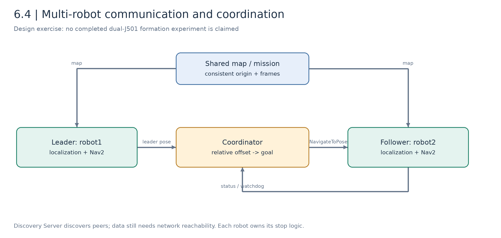
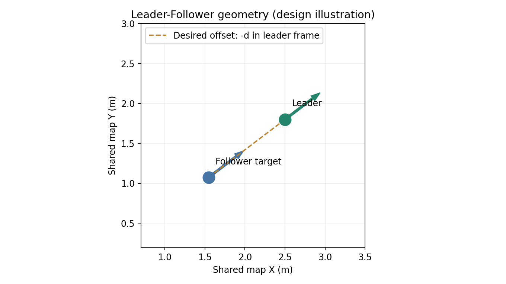
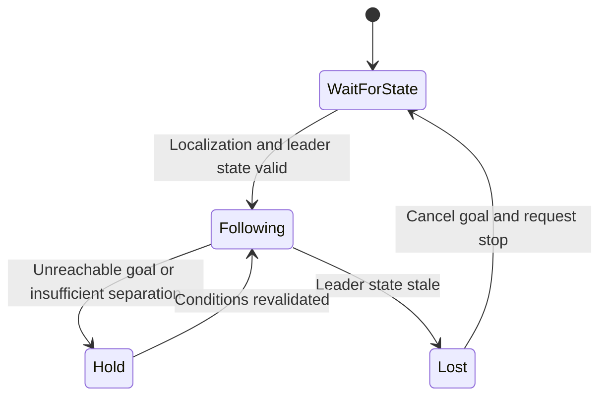

# 6.4 Multi-Robot Collaboration and Formation Navigation

[中文](README_zh_CN.md) | [Previous: obstacle avoidance](../6.3_Dynamic_Obstacle_Avoidance_and_Pedestrian_Prediction/README_en_US.md) | [M6 overview](../README.md)

Multi-robot systems add communication, shared coordinates, task assignment, and local failure handling to single-robot navigation. This lesson uses Leader-Follower geometry to establish those foundations.

Communication instructions and an offline formation-target program are supplied. **No dual-J501/Fortress formation launch, online coordinator, or validated two-robot navigation result is supplied yet.** Integration below is a design plan, not measured evidence.

## Objectives and Preparation

Verify DDS topic communication/QoS; separate namespaces from TF frame IDs; compute follower goals in a shared map; compare formation methods; design stale-state and cancellation behavior.

Prerequisite: 6.1 localization/navigation. Tracking extensions reuse M4.2; local avoidance reuses 6.3. One class hour covers principles, communication, and geometry; dual-robot integration follows later.

Use two computers with compatible ROS 2 environments. Physical testing later adds two J501 systems, chassis, and sensors. Two terminals on one host demonstrate process communication but do not establish cross-machine networking.

## Part A. Communication and Frames

### 6.4.1 Discovery and Data

DDS discovers participants and matches topics/types/QoS. Discovery does not establish that all data paths work: firewalls, isolation, types, and reliability policies can still prevent reception.

| Setting | Meaning | Limitation |
| --- | --- | --- |
| `ROS_DOMAIN_ID` | Discovery-domain partition | Does not align maps or make networks reachable |
| `ROS_LOCALHOST_ONLY` | Host-only restriction | Cross-machine operation requires `0` |
| RMW | ROS/DDS implementation | Discovery Server configuration is implementation-specific |
| Reliability/durability | Delivery/history policies | Same topic name does not guarantee compatibility |
| Namespace | Node/topic/action naming | Does not rewrite message `frame_id` |

Start with multicast in a small network. Fast DDS Discovery Server is optional when multicast is restricted or discovery needs scaling. It does not relay all navigation user data or synchronize clocks.

### 6.4.2 Central Mission, Local Control



*Figure 6.4-1: proposed coordination. Each robot retains localization, Nav2, and local failure handling. This is not a two-robot result screenshot.*

A coordinator assigns goals; each robot retains odometry, sensing, control, and timeout stopping. Sending poses/status is often easier to validate than exchanging full point clouds. Shared clouds need separate bandwidth, time, compression, and loss evaluation.

### 6.4.3 Namespace Does Not Isolate TF

Two `odom → base_footprint` publishers on shared TF topics conflict even if node names use `/robot1` and `/robot2`.

| Approach | Configuration | Coordinator |
| --- | --- | --- |
| Private TF topics | Remap `/tf` and `/tf_static` per robot | Maintain separate buffers |
| Unique frames | Use `robot1/odom`, `robot1/base_footprint`, etc. | Read a shared tree with consistent prefixes |

URDF, AMCL, costmaps, and sensor headers must all agree. Current single-robot simulation uses absolute topics and a fixed model name; adding `namespace:=robot2` is not sufficient.

### 6.4.4 Shared Map

$$
{}^{map}T_{base_1}={}^{map}T_{odom_1}\,{}^{odom_1}T_{base_1},\qquad
{}^{map}T_{base_2}={}^{map}T_{odom_2}\,{}^{odom_2}T_{base_2}.
$$

Each robot relocalizes independently. Verify image, origin, orientation, resolution, and frame. Independent maps require an explicit inter-map transform and uncertainty; two `(0,0)` origins are not automatically the same place.

## Part B. Formation Geometry

### 6.4.5 Formation Methods

| Method | Idea | Tradeoff |
| --- | --- | --- |
| Leader-Follower | Maintain relative pose | Leader-state latency propagates |
| Virtual structure | Treat formation as a rigid body | Geometry may be infeasible in passages |
| Behavior-based | Combine following, separation, avoidance | Weighting, oscillation, and verification |

Only Leader-Follower target geometry is executable here.

### 6.4.6 Transform an Offset

Leader pose is $(x_L,y_L,\theta_L)$ in a shared map. Desired offset $[\Delta x,\Delta y]^T$ is in the leader body frame:

$$
\begin{bmatrix}x_F^*\\y_F^*\end{bmatrix}
=\begin{bmatrix}x_L\\y_L\end{bmatrix}
+\begin{bmatrix}\cos\theta_L&-\sin\theta_L\\\sin\theta_L&\cos\theta_L\end{bmatrix}
\begin{bmatrix}\Delta x\\\Delta y\end{bmatrix}.
$$

Following distance $d$ behind means $\Delta x=-d,\Delta y=0$:

$$
x_F^*=x_L-d\cos\theta_L,\qquad y_F^*=y_L-d\sin\theta_L.
$$

A simple target orientation is $\theta_F^*=\theta_L$. This computation neither controls velocity nor checks whether the target is free.



*Figure 6.4-2: the desired offset rotates with the leader, rather than always subtracting distance along map X.*

### 6.4.7 Error and Delay

$$
\mathbf e=R(\theta_L)^T(\mathbf p_F-\mathbf p_L)-\Delta\mathbf p.
$$

Record longitudinal and lateral errors, not only inter-robot distance. Delay $\tau$ introduces a rough position lag $\|\mathbf v_L\|\tau$, excluding turning and acceleration.

An online coordinator should update goals using displacement/angle/time thresholds, not cancel/reissue at every sensor frame. Define cancellation acknowledgment, unreachable-target handling, and hold behavior.

### 6.4.8 Avoidance Can Deform Formation

The point behind a turning leader can lie in a wall. Goal geometry does not solve multi-robot collision avoidance. Each follower retains sensing/control and may stop or change formation in constrained passages.



This is a pending coordinator design. One zero-velocity message alone cannot guarantee continued stopping while other publishers/controllers remain active; include arbitration, cancellation, and driver timeout.

## Part C. Communication and Geometry Exercises

### 6.4.9 Basic Cross-Machine Topics

Example addresses: A `192.168.10.10`, B `192.168.10.11`. Replace with actual reachable addresses. From B:

```bash
ping -c 3 192.168.10.10
```

ICMP reachability does not establish DDS operation. In each machine's terminal:

```bash
source /opt/ros/humble/setup.bash
export ROS_DOMAIN_ID=42
export ROS_LOCALHOST_ONLY=0
export RMW_IMPLEMENTATION=rmw_fastrtps_cpp
```

Both need `demo_nodes_cpp` and `rmw_fastrtps_cpp`. Check with `ros2 pkg prefix demo_nodes_cpp`; provision matching Humble packages if absent.

A publishes:

```bash
ros2 run demo_nodes_cpp talker --ros-args \
  -r __ns:=/robot1 -r chatter:=status
```

B receives:

```bash
ros2 run demo_nodes_cpp listener --ros-args \
  -r __ns:=/robot2 -r chatter:=/robot1/status
```

B should print A's strings continuously. This tests communication only, not TF/navigation. In another identically configured terminal:

```bash
ros2 topic info /robot1/status --verbose
ros2 node list
```

If CLI graph results remain stale after changing environment variables, stop the local `ros2 daemon` and retry. Distinguish cached graph information from actual reception.

### 6.4.10 Optional Fast DDS Discovery Server

Complete basic discovery first and stop talker/listener. Check `command -v fastdds`; install/configure a compatible CLI before this optional experiment.

On A:

```bash
fastdds discovery -i 0 -l 192.168.10.10 -p 11811
```

In both ROS-node terminals:

```bash
export ROS_DISCOVERY_SERVER=192.168.10.10:11811
```

Repeat talker/listener. Diagnostic terminals require consistent discovery/RMW configuration; complete graph visibility and Super Client settings depend on Fast DDS version.

No two-machine network record is claimed here. Record discovery time, reception continuity, reconnect behavior, and environment.

### 6.4.11 Offline Target Program

[formation_goal.py](code/formation_goal.py) publishes no ROS messages and moves no robot:

```bash
cd /home/darklee/mobile-robot-full-stack-course
/usr/bin/python3 docs/M06-Localization-Navigation-and-Path-Planning/6.4_Multi-Robot_Collaboration_and_Formation_Navigation/code/formation_goal.py \
  --leader 2 3 1.5707963267948966 --offset -1 0
```

For leader `(2,3)` pointing along map +Y, the target is approximately `(2,2)` with yaw `1.5708 rad`. Repeat at yaw `0`, `π/2`, `π`, `−π/2`, then test positive/negative lateral offsets using ROS x-forward/y-left convention.

## Part D. Pending Integration and Acceptance

### 6.4.12 Dual-Robot Simulation Plan

1. Parameterize model names, command/odometry/sensor topics, and bridges.
2. Run independent EKF, AMCL, and Nav2 with a complete TF isolation scheme.
3. Relocalize and test each robot independently in the common map.
4. Send timestamped leader pose/state to a coordinator.
5. Validate follower `NavigateToPose` updates, cancellation, and failures.
6. Add reachability checks, stale-state watchdogs, and local stop arbitration.
7. Only then test straight/turning/passage/obstacle/disconnection cases.

Humble's multi-TurtleBot3 example illustrates namespaces, but its Classic launch is not a Fortress dual-J501 implementation. Do not substitute two fixed-name single-robot launches for this adaptation.

### 6.4.13 Records and Hardware Placeholders

| Item | Evidence | Status |
| --- | --- | --- |
| Offline target geometry | Command and expected values | Program supplied |
| Cross-machine DDS | Environment/IP/reception logs | Instructions; measurement pending |
| TF/common localization | Two TF trees and map/seed checks | Integration pending |
| Formation/turn errors | Two traces, longitudinal/lateral error, delay | Simulation pending |
| Communication loss | Timeout/cancellation/stopping time | Pending |
| Two-J501 images/video | Hardware/site/settings | Not started |

Submit a communication/TF architecture, geometry checks, and communication observations. Keep physical formation results blank until measured; a single-robot cone demo is not two-robot evidence.

## References

- [ROS 2 Humble environment](https://docs.ros.org/en/humble/Tutorials/Beginner-CLI-Tools/Configuring-ROS2-Environment.html)
- [Discovery Server tutorial](https://docs.ros.org/en/humble/Tutorials/Advanced/Discovery-Server/Discovery-Server.html)
- [Humble multi-robot source](https://github.com/ros-navigation/navigation2/blob/humble/nav2_bringup/launch/cloned_multi_tb3_simulation_launch.py)
- [Course chassis package](../../../modules/m06_navigation/j501_chassis_description/README.md)
