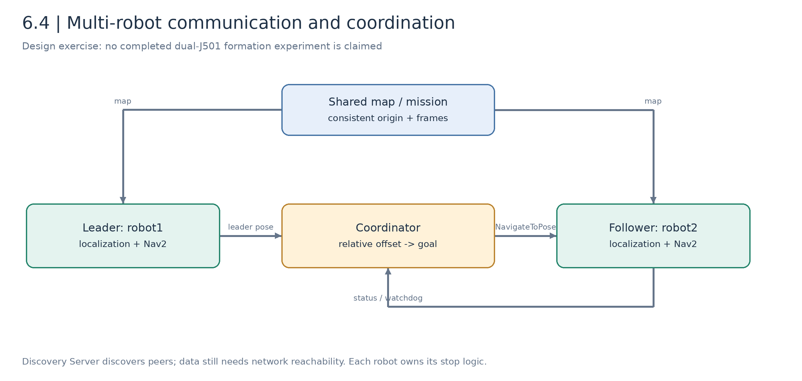
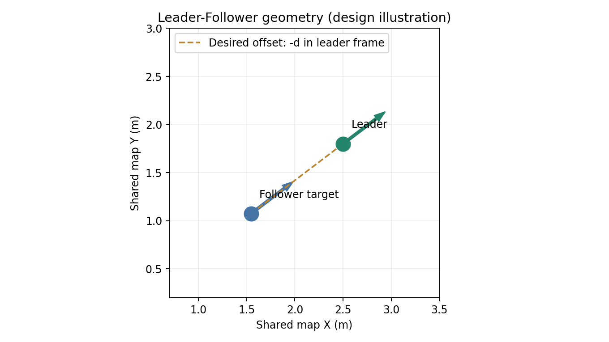
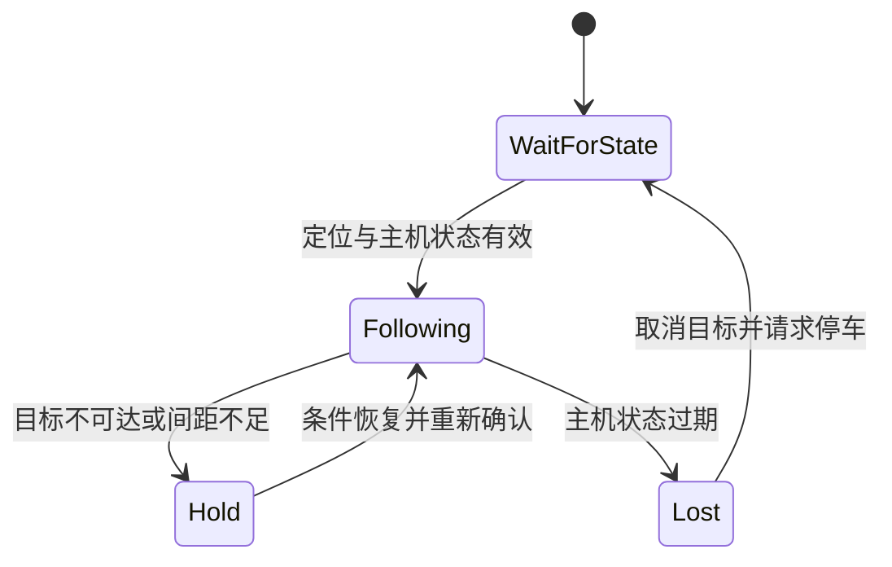

# 6.4 多机协同与编队导航基础

[English](README_en_US.md) | [上一课：动态避障](../6.3_Dynamic_Obstacle_Avoidance_and_Pedestrian_Prediction/README_zh_CN.md) | [M6 模块首页](../README_zh_CN.md)

单机器人导航解决“我怎样到达目标”。多机器人系统还需要回答：机器人之间能否通信、各自坐标是否一致、任务如何分配，以及通信中断时谁负责停止。本课以两机器人 Leader-Follower 为例，从 DDS 通信和相对目标计算建立基础。

本节已提供通信练习、架构说明和可独立运行的编队目标几何程序。**仓库尚未实现双 J501 / Fortress 编队 launch、在线协调器或双车导航效果验证**；后文的双机闭环作为后续集成方案，不填写虚构结果。

## 学习目标与准备

- 验证 ROS 2 跨机发现、话题订阅和 QoS 匹配；
- 区分节点命名空间、话题名与 TF `frame_id`；
- 由主机位姿计算从机在共享地图中的目标；
- 比较 Leader-Follower、虚拟结构法和行为法；
- 为状态过期、不可达目标和断连设计本地处理。

前置为 M6.1 单机定位导航；接入视觉目标时复用 M4.2，局部避障使用 M6.3。理论与通信练习约 1 课时，双机器人集成和实车测试安排在后续实验。

硬件准备为两台能运行相同 ROS 2 发行版的计算机；实车阶段再使用 2 × J501、2 × 底盘及各自传感器。课堂也可在一台开发机开两个终端验证进程通信，但它不能替代跨机网络验收。

## Part A. 多机通信与坐标框架

### 6.4.1 DDS 发现与用户数据

ROS 2 通常通过 DDS 发现参与者，再根据话题类型和 QoS 建立数据通信。发现成功不代表所有数据链路正常，防火墙、网络隔离、消息类型或可靠性配置仍可能阻止接收。

| 配置 | 作用 | 常见误解 |
| --- | --- | --- |
| `ROS_DOMAIN_ID` | 划分发现域 | 同一域不自动对齐坐标或授予网络可达性 |
| `ROS_LOCALHOST_ONLY` | 限制是否仅本机通信 | 跨机测试不能保留 `1` |
| RMW 实现 | 连接 ROS 与 DDS 中间件 | Discovery Server 配置是具体实现方案 |
| Reliability / Durability | 可靠性、历史数据行为 | 同名 Topic 不保证 QoS 兼容 |
| 命名空间 | 隔离节点、话题和 Action 名 | 不自动修改消息内 `frame_id` |

小网络可先测试组播发现；组播受限或机器人增多时，再考虑 Fast DDS Discovery Server。发现服务器负责发现机制，不中转全部导航用户数据，也不替代时钟同步。

### 6.4.2 主控与边缘节点各负责什么



*图 6.4-1：设计架构图。协调节点生成任务目标，每台机器人保留本地定位、Nav2 和失效处理；本图不是已完成的双车实验截图。*

主机可以集中处理任务与目标分配，但不应让从机的全部控制都依赖网络。建议每台机器人独立保留里程计、局部感知、控制周期和超时停车，协调节点只发送低频任务目标或轨迹约束。

通信量应与任务相关：发送位姿和状态通常比持续交换完整点云更容易验证。若确实需要跨机共享点云，应另行评估带宽、时间同步、压缩和丢帧处理。

### 6.4.3 命名空间不等于 TF 隔离

两台机器人都发布 `odom → base_footprint`，而 TF 消息进入同一话题时，会发生同名边冲突。仅将节点放到 `/robot1`、`/robot2` 命名空间，不会改变消息内容中的 frame 名。

可选方案有：

| 方案 | 做法 | 协调节点的工作 |
| --- | --- | --- |
| 机器人内部 TF 话题 | 将 `/tf`、`/tf_static` 分别重映射到各自命名空间 | 为每台机器人维护独立 TF Buffer |
| 唯一 frame 前缀 | 配置 `robot1/odom`、`robot1/base_footprint` 等唯一名字 | 读取共享 TF 树，确认所有传感器和参数使用相同前缀 |

无论选哪种，AMCL、URDF、costmap 和传感器头都要一起适配。当前单机仿真包使用绝对话题和固定模型名，不能通过给现有 launch 简单加 `namespace:=robot2` 得到可靠的第二台机器人。

### 6.4.4 共享地图与坐标对齐

两台机器人可以使用相同地图文件，但仍需各自建立定位：

$$
{}^{map}T_{base_1}={}^{map}T_{odom_1}\,{}^{odom_1}T_{base_1},\qquad
{}^{map}T_{base_2}={}^{map}T_{odom_2}\,{}^{odom_2}T_{base_2}.
$$

相同的分辨率不代表地图相同，还要核对图像、原点、方向和 frame。若地图来自独立建图，必须明确地图间变换和不确定性，不能把两套 `(0,0)` 默认当成同一地点。

## Part B. 编队几何与控制原理

### 6.4.5 三种编队方法

| 方法 | 主要思想 | 适合讨论的问题 |
| --- | --- | --- |
| Leader-Follower | 从机保持相对主机的期望位姿 | 实现简单，但主机状态延迟会传递到从机 |
| 虚拟结构法 | 整个编队是一个虚拟刚性结构 | 形状一致，但通道和障碍会限制结构可行性 |
| 行为法 | 将跟随、避障、分离等行为组合 | 灵活，但权重、振荡和可验证性更复杂 |

本课只对 Leader-Follower 做目标几何练习，另外两种方法作为设计对照。

### 6.4.6 将相对偏移变换为地图目标

主机在共同地图中的位姿为 $(x_L,y_L,\theta_L)$，从机期望在主机体坐标系中保持偏移 $\Delta\mathbf p=[\Delta x,\Delta y]^T$：

$$
\begin{bmatrix}x_F^*\\y_F^*\end{bmatrix}
=
\begin{bmatrix}x_L\\y_L\end{bmatrix}
+
\begin{bmatrix}\cos\theta_L&-\sin\theta_L\\
\sin\theta_L&\cos\theta_L\end{bmatrix}
\begin{bmatrix}\Delta x\\\Delta y\end{bmatrix}.
$$

在主机后方距离 $d$ 处跟随时，取 $\Delta x=-d,\Delta y=0$，因此：

$$
x_F^*=x_L-d\cos\theta_L,\qquad
y_F^*=y_L-d\sin\theta_L.
$$

简单设计令 $\theta_F^*=\theta_L$。这只是目标位姿计算，不是速度控制器，也没有检查目标是否位于障碍物中。



*图 6.4-2：公式生成的编队示意。跟随偏移随主机朝向旋转，不能始终沿地图 X 轴减去一个固定距离。*

### 6.4.7 误差、目标更新和延迟

在主机体坐标系中的编队误差可定义为：

$$
\mathbf e=R(\theta_L)^T(\mathbf p_F-\mathbf p_L)-\Delta\mathbf p.
$$

记录纵向误差和横向误差，而不是只看两车距离。通信延迟 $\tau$ 下，主机运动会使旧目标产生约 $\|\mathbf v_L\|\tau$ 的位置差；这个估算没有包含转向与加速度，应结合时间戳处理。

在线协调器可按位移、角度或时间阈值更新目标，避免每个传感器周期都取消并重发 `NavigateToPose`。实现前要定义：旧目标是否取消、取消何时确认、目标不可达如何处理、主机停止后从机如何保持间距。

### 6.4.8 局部避障允许临时破坏编队

主机后方的几何目标可能落入墙体或落在转角另一侧。编队目标生成不等于多机避碰：从机仍需本地雷达和局部控制，狭窄通道中可以暂停或改变队形。

网络状态过期时，本地看门狗应触发明确的状态转换：



这是待实现的协调状态设计。仅发布一次零速度不能保证底盘持续停止，还要考虑其他速度发布者、速度仲裁、控制器取消和驱动超时。

## Part C. 实操：通信与目标几何

### 6.4.9 两机基础通信

下面地址仅是示例：主机 A 为 `192.168.10.10`，从机 B 为 `192.168.10.11`，两机连接同一可互通局域网。实际实验替换为自己的地址并先验证：

```bash
# 在 B 上验证 A 可达；ICMP 可达不等于 DDS 已正常
ping -c 3 192.168.10.10
```

两机各自的新终端统一设置：

```bash
source /opt/ros/humble/setup.bash
export ROS_DOMAIN_ID=42
export ROS_LOCALHOST_ONLY=0
export RMW_IMPLEMENTATION=rmw_fastrtps_cpp
```

两机需要安装 `demo_nodes_cpp` 与 `rmw_fastrtps_cpp`；可先用 `ros2 pkg prefix demo_nodes_cpp` 检查。缺少时由环境维护者安装对应 Humble 包。

A 上发布：

```bash
ros2 run demo_nodes_cpp talker --ros-args \
  -r __ns:=/robot1 -r chatter:=status
```

B 上接收：

```bash
ros2 run demo_nodes_cpp listener --ros-args \
  -r __ns:=/robot2 -r chatter:=/robot1/status
```

预期 B 连续打印 A 发出的字符串。命名空间不同但通过绝对 Topic 名订阅同一接口；这只验证通信，还没有导航或 TF。需要查看图时，在另一个相同环境终端执行：

```bash
ros2 topic info /robot1/status --verbose
ros2 node list
```

若改变了环境变量而 ROS CLI 仍显示旧图，可停止本机 `ros2 daemon` 后重试查询。不要把 CLI 缓存与机器人节点是否实际通信混淆。

### 6.4.10 可选：Fast DDS Discovery Server

先完成上一项，再停止 talker / listener。环境需要 Fast DDS 的 `fastdds` CLI，可用 `command -v fastdds` 检查；没有该工具时先配置匹配版本，不把服务器模式作为基础通信前置。

在 A 上启动示例发现服务器：

```bash
fastdds discovery -i 0 -l 192.168.10.10 -p 11811
```

两机启动 ROS 节点的终端额外设置：

```bash
export ROS_DISCOVERY_SERVER=192.168.10.10:11811
```

再执行上一节 talker / listener。诊断 CLI 也要使用相同中间件和发现配置；不同 Fast DDS 版本对完整图发现与 Super Client 的配置有差异，应按所安装版本文档核对。

本节提供操作方法，但仓库没有保存双机网络实测记录。需记录发现时间、消息是否连续、重连行为和网络配置，而不是仅截图一个 Topic 名称。

### 6.4.11 运行离线编队目标程序

仓库提供 [formation_goal.py](code/formation_goal.py)，仅计算几何，不发布 ROS 消息或控制机器人：

```bash
cd /home/darklee/mobile-robot-full-stack-course
/usr/bin/python3 docs/M06-Localization-Navigation-and-Path-Planning/6.4_Multi-Robot_Collaboration_and_Formation_Navigation/code/formation_goal.py \
  --leader 2 3 1.5707963267948966 --offset -1 0
```

主机位于 `(2,3)` 且朝地图 Y 正方向，从机目标应约为 `(2,2)`，目标朝向约为 `1.5708 rad`。将主机朝向依次改成 `0`、`π/2`、`π`、`−π/2`，手算并核对输出。

给定相同主机位姿，将横向偏移改为正数和负数，说明两台从机分别位于哪一侧。注意 ROS 的 `x` 前、`y` 左约定。

## Part D. 双机器人集成计划与验收

### 6.4.12 后续双机器人仿真如何接入

需要逐项完成以下工作，再进行整体验收：

1. 将世界中的模型名、底盘命令、里程计、雷达、IMU 和桥接话题参数化。
2. 为每台机器人运行独立 EKF、AMCL、Nav2，选择一种完整 TF 隔离方案。
3. 分别在共同地图中重定位，单独完成点到点导航。
4. 将主机地图位姿、时间戳与状态发给协调器，用前述公式生成从机目标。
5. 在从机命名空间的 `NavigateToPose` Action 上验证目标更新、取消和失败处理。
6. 加入目标可达性检查、状态过期看门狗和本地停车仲裁。
7. 最后才测试直线、转弯、窄通道、障碍与断连。

官方 Humble 多 TurtleBot3 示例可作为命名空间设计参考，但其中 Gazebo Classic 启动方式不能直接作为本课程 Fortress 双 J501 实现。不要将两套固定名称的单机 launch 同时运行来替代上述适配。

### 6.4.13 实验表与实车留白

| 项目 | 应保存的证据 | 当前状态 |
| --- | --- | --- |
| 离线目标几何 | 命令、输入与输出 | 已提供程序，可本机运行 |
| 跨机 DDS Topic | 环境、地址、接收记录 | 教程已提供，待双机记录 |
| 双机器人 TF 与共同定位 | 两套 TF、初值、地图校验 | 待集成 |
| 跟随误差与转弯 | 两条轨迹、纵横误差、延迟 | 待仿真 |
| 失联与停车 | 状态超时、取消结果、停止时间 | 待仿真与实车 |
| 双 J501 实车照片与视频 | 硬件、场地与参数 | 尚未开展，实验后补充 |

课堂提交一张自己的通信 / TF 架构图、一组目标几何核对结果和通信检查记录。实车编队结果保持留白，后续补充，不以单机锥桶视频代替双机证据。

## 参考资料

- [ROS 2 Humble 多机环境与发现](https://docs.ros.org/en/humble/Tutorials/Beginner-CLI-Tools/Configuring-ROS2-Environment.html)
- [Fast DDS Discovery Server 教程](https://docs.ros.org/en/humble/Tutorials/Advanced/Discovery-Server/Discovery-Server.html)
- [Nav2 Humble 多机器人示例源码](https://github.com/ros-navigation/navigation2/blob/humble/nav2_bringup/launch/cloned_multi_tb3_simulation_launch.py)
- [本课程底盘描述包](../../../modules/m06_navigation/j501_chassis_description/README_zh_CN.md)
