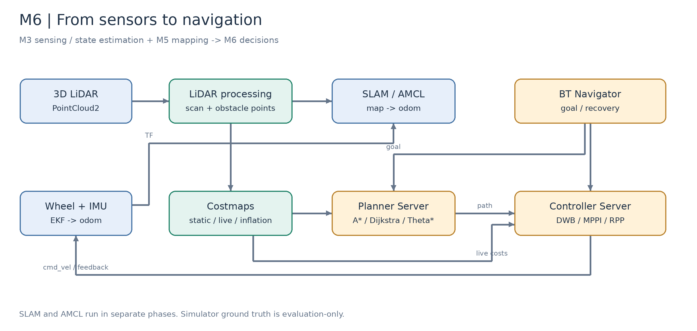
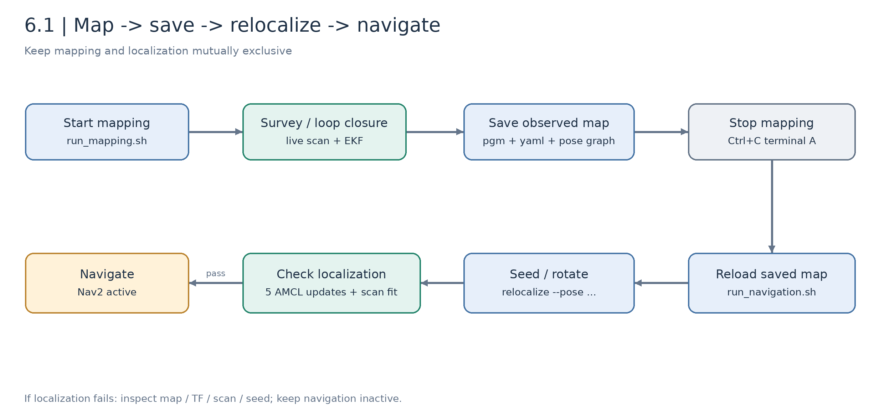

# M6 Decision Layer: Localization, Navigation, and Path Planning (4 Class Hours)

[中文](README_zh_CN.md) | [Course index](../../README.md)

M3 supplies sensors and continuous odometry; M5 establishes maps; M6 uses them for navigation decisions. Follow **LiDAR mapping → saving → relocalization → global planning → obstacle detection/local avoidance → multi-robot foundations** with the course chassis simulation, then prepare for later J501 hardware work.



*Figure M6-1: sensing, estimation, localization, planning, and control have distinct interfaces and acceptance criteria.*

## Lessons and Objectives

| Lesson | Principles | Practice/deliverables |
| --- | --- | --- |
| [6.1 Nav2 setup](6.1_Nav2_Setup_and_Configuration/README_en_US.md) | TF, EKF, AMCL, lifecycle, behavior trees | Live mapping, saving/reload, relocalization-gated navigation |
| [6.2 Planning algorithms](6.2_Global_and_Local_Path_Planning/README_en_US.md) | Dijkstra/A*/Theta*, DWB/MPPI/RPP, costmaps | Fixed-scene comparison, isolated local control, failures |
| [6.3 Obstacles and prediction](6.3_Dynamic_Obstacle_Avoidance_and_Pedestrian_Prediction/README_en_US.md) | Ground RANSAC, clustering, tracking/prediction theory | Detected points/boxes and trajectory visualization; prediction extensions |
| [6.4 Multi-robot foundations](6.4_Multi-Robot_Collaboration_and_Formation_Navigation/README_en_US.md) | DDS, namespaces/TF, Leader-Follower, failure handling | Communication and offline goal geometry; dual-robot integration pending |

One prepared hour per lesson. Downloads, repeated tuning, full prediction evaluation, and hardware work belong before/after class. All four lesson texts contain principles, formulas, illustrations, instructions, and evaluation criteria without presenting planned integration as a measured result.

## Prerequisites and Environment

- [M1.4 ROS 2](../M01-Platform-and-Dev-Environment/1.4_Getting_Started_with_ROS2_Humble/README_en_US.md): nodes/topics/actions/launch.
- [M3.1 LiDAR](../M03-LiDAR-and-Multi-Sensor-Fusion/3.1_LiDAR_Integration_and_Point_Cloud_Preprocessing/README_en_US.md): point formats/extrinsics.
- [M3.4 EKF](../M03-LiDAR-and-Multi-Sensor-Fusion/3.4_EKF_and_State_Estimation/README_en_US.md): wheel/IMU fusion.
- [M5.1 motion estimation](../M05-3D-Reconstruction-and-SLAM/5.1_Motion_Estimation_VO_VIO_LIO/README_en_US.md): VO/VIO/LIO, Fast-LIO2, and odometry; Fast-LIO2 is not running here.
- [M5.2 complete SLAM](../M05-3D-Reconstruction-and-SLAM/5.2_Complete_SLAM_Loop_Closure_and_Optimization/README_en_US.md): loop closure, pose graphs, and global optimization.
- [M5.5 map management and navigation interfaces](../M05-3D-Reconstruction-and-SLAM/5.5_Map_Management_Relocalization_and_Navigation_Interface/README_en_US.md): reserved course handoff chapter, with lesson text pending; this module supplies the runnable 2D workflow.
- [M4.2 tracking](../M04-AI-Vision-And-Edge-Acceleration/4.2_Multi-Object_Tracking/README_en_US.md): optional visual/multi-object extensions.

| Item | Course baseline |
| --- | --- |
| OS/ROS | Ubuntu 22.04 / Humble |
| Simulation | Fortress 6.16.0 / STEP-derived differential chassis |
| Navigation | Nav2 1.1.20 recorded environment; AMCL + MPPI baseline |
| Odometry | `robot_localization`, forward encoder velocity and IMU yaw rate |
| LiDAR | Regular-ray 3D sensor approximating MID-360 FOV, not native Livox scanning |
| Maps | Live SLAM observations; prebuilt fixture only for explicit comparisons |
| Hardware | Development PC for simulation; J501/chassis/LiDAR later, two sets for formation |

ROS 2 is not a physics simulator. The course uses Fortress and `ros_gz_bridge`; Classic example commands are not drop-in replacements. Real Livox CustomMsg/per-point timing/Fast-LIO require separate adaptation.

## Main Workflow



*Figure M6-2: saving does not automatically stop SLAM or start AMCL.*

Terminal A:

```bash
cd /home/darklee/mobile-robot-full-stack-course
./modules/m06_navigation/build.sh
./modules/m06_navigation/run_mapping.sh
```

Terminal B:

```bash
cd /home/darklee/mobile-robot-full-stack-course
source modules/m06_navigation/setup.bash
ros2 run j501_navigation survey --output build/m06_results/survey.json
ros2 run j501_navigation save_map --output build/m06_maps/office
```

Stop mapping in A with Ctrl+C, then run `./modules/m06_navigation/run_navigation.sh`. In B:

```bash
ros2 run j501_navigation relocalize --pose 0 0 0
# Wait for succeeded=true before navigation
ros2 run j501_navigation navigate --planner astar --controller MPPI --goal 9 5.7 0
ros2 service call /algorithm_view/save std_srvs/srv/Trigger '{}'
```

See 6.1 for checks, frames, and troubleshooting. `build/m06_maps/` is local output; fresh clones must survey. An existing local EKF map can be selected with `map:="$PWD/build/m06_maps/ekf/office.yaml"`. Fixture goal `(4.5,2.7)` differs from measured-map `(9,5.7)`.

## Shared Interfaces

| Interface | Ownership |
| --- | --- |
| `/wheel/odometry`, `/imu/data` | Simulated inputs; replace with M3 hardware drivers |
| `/odom`, `odom → base_footprint` | EKF, unique TF publisher |
| `/livox/lidar` | PointCloud2; name does not imply native MID-360 simulation |
| `/scan` | Height projection for SLAM/AMCL/clearing |
| `/perception/obstacles` | Non-ground points that mark the local costmap |
| `/perception/boxes`, `/perception/detections` | Geometry, not persistent IDs or semantic classes |
| `/map`, `map → odom` | SLAM during mapping; Map Server/AMCL afterward |
| `/cmd_vel` | Controller-to-drive Twist in this Humble baseline |
| `/clock` | Simulation time; hardware uses system time |

## Evidence and Remaining Work


*Figure M6-3: estimated trace plus one timestamped detection frame, with an orthographic 3D-cluster projection.*

Programs, configurations, and independent records are in the [navigation package](../../modules/m06_navigation/j501_navigation/README.md) and [validation directory](../../modules/m06_navigation/j501_navigation/validation). Different scenarios/configuration versions must be assessed separately, not combined into a universal performance ranking.

Pending: native MID-360/Fast-LIO adaptation, multi-frame tracking, two-second prediction, predictive control, online multi-robot coordination, and physical experiments. Lessons 6.3/6.4 provide theory/interfaces/exercises while leaving results pending.

Hardware tables await measured models, extrinsics, covariance, site, speed, traces, photos, videos, and failures. Simulated mass/friction/suspension remain estimates. Submit maps/graphs, versions/settings, localization, planning/control records, detector figures, and failure analysis. Mark unperformed hardware work accordingly.

The [image directory](images/README.md) includes editable draw.io sources, SVG/PNG illustrations, and regeneration code; measured screenshots remain in the companion package.
