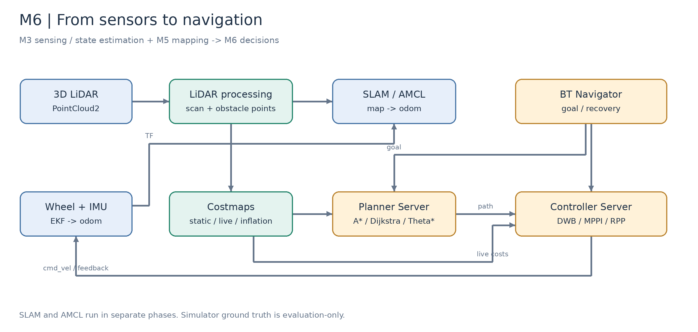
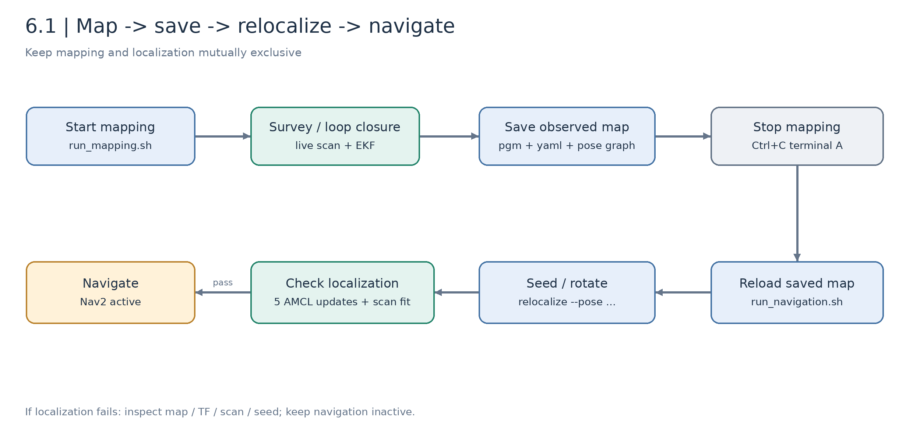

# M6 决策层：定位导航与路径规划（4 课时）

[English](README.md) | [返回课程目录](../../README_CN.md)

M3 提供雷达、IMU 与连续里程计，M5 建立环境地图，M6 则利用这些结果做导航决策。本模块沿着 **激光建图 → 保存地图 → 重定位 → 全局规划 → 激光障碍检测与局部避障 → 多机协同基础** 展开，以课程 J501 底盘仿真为主线，保留后续实车迁移位置。



*图 M6-1：系统架构示意。状态估计、地图定位、规划控制与实时检测各有独立输入输出，不能只凭机器人能移动就认为整个链路已经完成。*

## 学习目标与章节安排

| 章节 | 理论重点 | 课堂实操与产出 |
| --- | --- | --- |
| [6.1 ROS 2 Nav2 框架搭建与配置](6.1_Nav2_Setup_and_Configuration/README_zh_CN.md) | TF、EKF、AMCL、Lifecycle、Behavior Tree | 雷达巡航建图，保存并重载地图，重定位通过后导航 |
| [6.2 全局与局部路径规划算法](6.2_Global_and_Local_Path_Planning/README_zh_CN.md) | Dijkstra / A\* / Theta\*，DWB / MPPI / RPP，代价地图 | 同场景规划比较、固定参考路径局部避障、参数与失败记录 |
| [6.3 动态避障与行人预测](6.3_Dynamic_Obstacle_Avoidance_and_Pedestrian_Prediction/README_zh_CN.md) | RANSAC、欧式聚类，跟踪与预测原理 | 激光障碍点、三维框、定位轨迹与绕行效果图；预测为扩展 |
| [6.4 多机协同与编队导航基础](6.4_Multi-Robot_Collaboration_and_Formation_Navigation/README_zh_CN.md) | DDS、命名空间 / TF、Leader-Follower、失效处理 | 通信练习和离线编队目标计算；双车闭环待集成 |

每课约 1 课时，采用预装软件与已有场景。首次依赖下载、反复调参、完整动态目标评估和实车测试安排在课前或课后。四节正文均提供原理、公式、图解、实操指令和验收方式，不把未来集成任务写成已验证结果。

## 前置章节与实验环境

- [M1.4 ROS 2 Humble](../M01-Platform-and-Dev-Environment/1.4_Getting_Started_with_ROS2_Humble/README_zh_CN.md)：节点、话题、Action、Launch。
- [M3.1 雷达接入](../M03-LiDAR-and-Multi-Sensor-Fusion/3.1_LiDAR_Integration_and_Point_Cloud_Preprocessing/README_zh_CN.md)：点云格式与外参。
- [M3.4 EKF](../M03-LiDAR-and-Multi-Sensor-Fusion/3.4_EKF_and_State_Estimation/README_zh_CN.md)：轮速与 IMU 融合。
- [M5.1 机器人运动估计](../M05-3D-Reconstruction-and-SLAM/5.1_Motion_Estimation_VO_VIO_LIO/README_zh_CN.md)：VO / VIO / LIO、Fast-LIO2 与里程计；本课未运行 Fast-LIO2。
- [M5.2 完整 SLAM 系统](../M05-3D-Reconstruction-and-SLAM/5.2_Complete_SLAM_Loop_Closure_and_Optimization/README_zh_CN.md)：回环、位姿图与全局优化。
- [M5.5 地图管理与导航接口](../M05-3D-Reconstruction-and-SLAM/5.5_Map_Management_Relocalization_and_Navigation_Interface/README_zh_CN.md)：课程接口衔接位置，正文待补；本模块提供可运行的二维流程。
- [M4.2 多目标跟踪](../M04-AI-Vision-And-Edge-Acceleration/4.2_Multi-Object_Tracking/README_zh_CN.md)：用于视觉和多目标预测扩展。

| 项目 | 当前课程基线 |
| --- | --- |
| 系统 | Ubuntu 22.04、ROS 2 Humble |
| 仿真 | Gazebo Fortress 6.16.0、STEP 转换的差速底盘 |
| 导航 | Nav2 1.1.20 验证环境；AMCL + MPPI 为闭环基线 |
| 里程计 | `robot_localization`，轮速前向速度与 IMU 角速度 |
| 激光 | Fortress 规则射线三维雷达，近似 MID-360 视场，非原生 Livox 扫描 |
| 地图 | SLAM Toolbox 实时观测地图；预制地图仅作显式算法基准 |
| 硬件 | 仿真只需开发机；后续 J501 + 底盘 + 雷达，双机另需第二套设备 |

ROS 2 不内置物理仿真器。当前源码使用 Fortress 与 `ros_gz_bridge`，不要将官方 Humble 示例中的 Gazebo Classic 命令直接套入本课程。真实 Livox `CustomMsg`、逐点时间和 Fast-LIO 适配仍需单独验证。

## 主线操作顺序



*图 M6-2：每一步依赖前一步的实际结果。保存地图不会自动停止 SLAM 或启动 AMCL。*

终端 A：

```bash
cd /home/darklee/mobile-robot-full-stack-course
./modules/m06_navigation/build.sh
./modules/m06_navigation/run_mapping.sh
```

终端 B：

```bash
cd /home/darklee/mobile-robot-full-stack-course
source modules/m06_navigation/setup.bash
ros2 run j501_navigation survey --output build/m06_results/survey.json
ros2 run j501_navigation save_map --output build/m06_maps/office
```

在 A 中 Ctrl+C 结束建图，再运行 `./modules/m06_navigation/run_navigation.sh`。B 中执行：

```bash
ros2 run j501_navigation relocalize --pose 0 0 0
# 等待 succeeded=true 后再导航
ros2 run j501_navigation navigate --planner astar --controller MPPI --goal 9 5.7 0
ros2 service call /algorithm_view/save std_srvs/srv/Trigger '{}'
```

详细输入检查、坐标关系和排错见 6.1。`build/m06_maps/` 是本机生成物，新克隆仓库应重新采集；本机已有 EKF 地图时可显式指定 `map:="$PWD/build/m06_maps/ekf/office.yaml"`。预制地图基准的目标约为 `(4.5,2.7)`，不应与自建地图的 `(9,5.7)` 混用。

## 共用接口

| 接口 | 来源与职责 |
| --- | --- |
| `/wheel/odometry`、`/imu/data` | 仿真传感器；实车替换为 M3 驱动输入 |
| `/odom` 与 `odom → base_footprint` | EKF，保持唯一 TF 发布者 |
| `/livox/lidar` | `PointCloud2`；话题名不代表已模拟完整 MID-360 |
| `/scan` | 点云高度切片，供建图、AMCL 与局部清除 |
| `/perception/obstacles` | 非地面障碍点，实际参与局部代价地图 |
| `/perception/boxes`、`/perception/detections` | 聚类框与几何信息，无跨帧 ID 或语义分类 |
| `/map` 与 `map → odom` | 建图由 SLAM 发布，重定位由 Map Server / AMCL 接管 |
| `/cmd_vel` | 控制器至底盘，Humble 本课使用 `geometry_msgs/msg/Twist` |
| `/clock` | 仿真时间；实车改用系统时间 |

## 效果图与已完成范围


*图 M6-3：真实仿真记录生成的算法效果图。蓝线是定位估计，检测点和框来自注明时间的单帧；右图是三维点簇正交投影。*

已有建图、重定位、规划、局部绕行、检测及失败案例可从 [导航实验包](../../modules/m06_navigation/j501_navigation/README_zh_CN.md) 和 [验证目录](../../modules/m06_navigation/j501_navigation/validation) 查看。它们使用不同场景和参数版本，应按记录分别解释，不能拼成统一性能排名。

尚未完成的部分：真实 MID-360 非重复扫描 / Fast-LIO 适配、多帧跟踪与两秒预测、预测控制、多机器人在线协调和实车实验。6.3 / 6.4 已提供这些部分的理论、接口设计与练习，结果保持待补。

## 实车与提交材料

每节末尾有实车记录表，后续填入硬件型号、外参、协方差、场地、速度、轨迹、图片、视频和失败原因。仿真参数中的质量、摩擦与悬挂仍是估算值，不能用作实车标定结果。

课程提交材料应包含地图与位姿图、版本和参数、定位记录、规划 / 控制结果、检测效果图与失败分析。物理实验没有开始时填写“未开展”，不补造数据。

新增示意图的 [图片目录](images/README.md) 提供 draw.io 源文件、SVG、PNG 和生成脚本；实测截图继续引用配套包原图。
