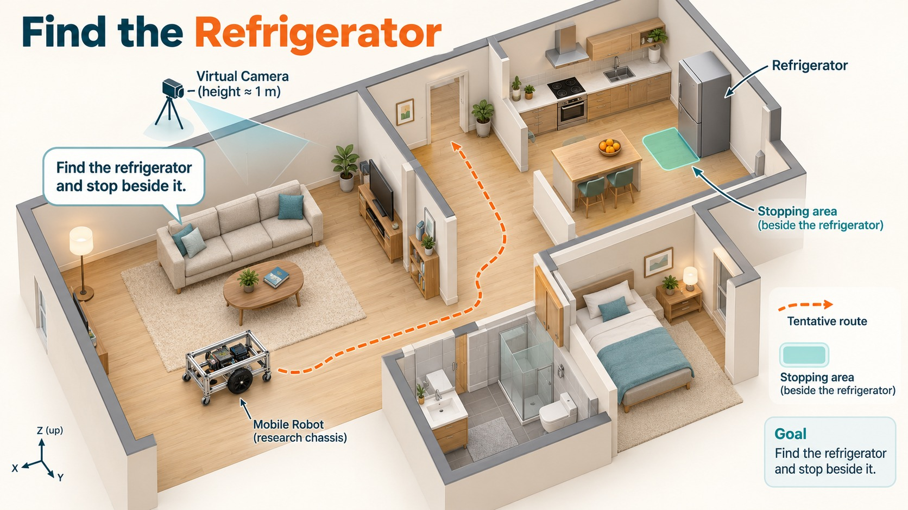
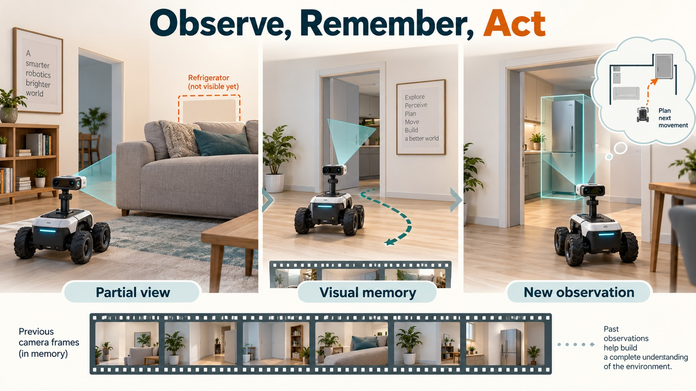
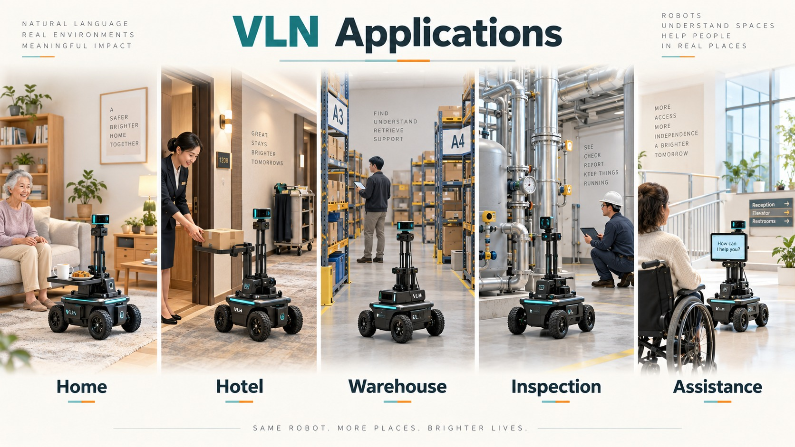

# 7.1 视觉语言导航入门：机器人如何理解“找到冰箱”

[English](README_en_US.md) | [中文](README_zh_CN.md)

你对小车说：“找到房间里的冰箱，并停在它旁边。”你没有提供地图坐标，也没有逐个告诉它哪里该转弯。小车需要从沿途画面中寻找目标、选择移动方向，并判断什么时候停车。本章从这个任务出发，认识视觉语言导航。

## 学习目标与阅读准备

- 解释指令、相机图像、导航决策和运动反馈各自的作用。
- 说明当前画面与视觉历史的区别。
- 理解地图、学习模型和控制器怎样配合。
- 为一个应用写出目标、运行条件和可检查的完成标准。

本章从概念讲起，不要求先安装 ROS 2、SLAM 或 Nav2。7.2 读算法时会用到数组、概率和三角函数；7.3 实践需要 Linux 与 Python 基础。

## 7.1.1 先看任务：一句话里包含多少要求



*图 7.1-1，室内冰箱查找任务中的路线选择与停靠区域。*

人进入陌生房间时，可能先看看哪里通向厨房，再从家电外形中辨认冰箱，沿空地接近，最后选择附近可以停留的位置。这里既用到了“冰箱长什么样”的知识，也用到了刚才看见的房间布局和“自己能否通过”的判断。

本章贯穿使用同一句英文指令：

```text
Locate the refrigerator in the room and stop beside it.
```

把这句话拆开，可以得到四项要求：

| 表达 | 系统需要理解什么 | 对导航的影响 |
| --- | --- | --- |
| Locate | 确定目标在哪里；当前看不到时需要查找 | 可能要转向或移动到新视角 |
| the refrigerator | 识别冰箱，并确定指令所指的实例 | 需要与高柜、门等相似外形区分 |
| in the room | 任务所指的搜索范围 | 结合沿途观察理解房间，而非只看起始画面 |
| stop beside it | 选择冰箱附近可通行的停车位置，并结束运动 | 既要接近目标，也要考虑车身空间和停车 |

`beside` 没有给出精确距离，也未指定冰箱哪一侧。在应用中，需要结合可用空间和用户意图明确停车区域，再由评价程序检查是否满足要求。例如，“停在冰箱前方的空地，且不挡住柜门”比单说“旁边”更具体。本章视频保留原指令，评价其结果时也保留这项语义边界。

**停下来想一想：** 如果房间有两台冰箱，应该怎样补充指令？如果冰箱一侧贴墙、另一侧堆着物品，哪些位置仍适合停车？

## 7.1.2 什么是视觉语言导航

视觉语言导航（Vision-and-Language Navigation，VLN）研究智能体怎样结合自然语言与沿途视觉观察，选择行动并完成移动任务。这里的智能体可以是真实机器人，也可以是 MuJoCo 中的小车；两者都需要经历“观察环境—决定怎么走—移动后再观察”的过程。

先用一个简化关系表示每次决策：

$$
a_t=\pi_\theta(I,O_{\leq t}).
$$

$I$ 是任务指令；$O_{\leq t}$ 表示截至第 $t$ 次决策已经获得的相机观察；$\pi_\theta$ 是经过训练的决策模型，$\theta$ 表示其参数；$a_t$ 是本次模型给出的行动表示。不同方法的行动表示可以是“左转”等类别，也可以是一段局部路径。

LightNav 使用 **token** 表达输出。token 是模型词表中的一个符号，可以表示文字片段，也可以表示专门定义的指向或动作编号。本章模型先生成图像指向与动作编号，配套解码器再把动作编号还原为十个局部路径点。控制器根据路径和小车当前位置计算线速度、角速度，仿真器据此更新位置与朝向。7.2 解释模型和解码，7.3 解释控制与仿真。

### VLN、VLM、VLA 分别在说什么

| 名称 | 核心含义 | 在本章中的位置 |
| --- | --- | --- |
| VLM：视觉语言模型 | 联合处理图像与文字的模型 | 提供对象、空间关系和指令理解的基础 |
| VLA：视觉语言动作模型 | 在视觉和语言条件下生成行动表示的模型 | LightNav 将导航动作编码成可生成的 token |
| VLN：视觉语言导航 | 根据语言和视觉完成移动的任务 | 是整套系统要解决的问题 |

这三个词处在不同层次。以冰箱为例：VLM 的能力可以用于识别“画面右边是冰箱”；VLA 进一步生成行动表示；VLN 系统还要执行行动、获取新画面并判断结束。理解图像、产生动作和完成导航可以据此分别检查。

### 三种常见的导航指令

用户提供的信息不同，系统需要完成的工作也不同：

| 指令类型 | 例子 | 机器人需要做什么 |
| --- | --- | --- |
| 按路线行走 | “穿过门后左转，在第二扇窗前停下。” | 识别门和窗，按顺序执行，并维护路线进度 |
| 寻找目标物体 | “找到冰箱，并停在它旁边。” | 寻找目标，选择接近路线，再决定停车位置 |
| 跟随移动目标 | “跟随穿蓝衣服的人。” | 持续确认目标身份，并随着人的移动调整运动 |

本章集中讨论第二种。第一种更依赖路线步骤与场景的对应，第三种还需要持续跟踪目标变化；三者的历史需求和结束条件各有侧重。

## 7.1.3 从语言描述到环境中的目标

坐标导航可以直接接收地图中的目标位姿，例如 $(5.5\,\mathrm{m},15.6\,\mathrm{m},0\,\mathrm{rad})$。给定地图后，这三个数明确了目标位置与朝向；定位、规划和控制模块负责让小车到达那里。

“找到冰箱”提供的是对象描述。系统需要先判断当前看到的哪个对象符合描述；看不到时，还要寻找新的观察位置。**把语言描述与环境中的对象、区域或位置对应起来，称为语义落地（grounding）。** 例如，把“冰箱”对应到当前图像中的灰色家电，是一次图像层面的语义落地；进一步确定其旁边的可达空地，才接近运动目标的选择。

### 地图和学习模型怎样配合

一种常见方案是在地图上关联对象，再将语言请求转成可规划的目标区域。例如，系统先在语义地图中找到冰箱，再调用规划与控制模块前往附近空地。学习模型也可以参与其中，负责识别对象或理解指令。

另一种方案主要根据图像和指令直接预测行动或局部路径。LightNav 属于这类模型：它利用当前与过去的视觉线索生成下一段参考，再根据新观察继续决策。它的输入接口不要求先提供一张带冰箱坐标的地图。

这两种安排可以组合。地图是环境信息的一种表示，学习模型是处理信息的一种方法，系统可以同时使用二者。本章重点学习图像驱动的 LightNav，再认识执行端如何处理坐标和碰撞。

在本章实验中，MuJoCo 提供的小车真实位姿用于路径坐标转换、相机生成和日志记录；场景几何用于碰撞检查。冰箱的评分坐标不会作为隐藏提示传给模型。**模型负责根据图像和指令提出路径，集成端负责把路径接到小车的实际运动上。**

## 7.1.4 怎样利用过去的画面，并用行动获得新观察



*图 7.1-2，相机观察随位置与朝向变化，先前采集的画面为后续判断提供视觉线索。*

### 当前画面看不到的东西，之前可能看见过

相机每次只能拍到朝向前方的一部分空间。小车刚进入房间时，可能只看到沙发；移动到门口后，才发现门后的冰箱；继续转弯时，冰箱又可能暂时离开画面。因此，当前这张图不能完整说明房间里有什么，也不能单独说明小车刚才看见过什么。这就是**部分可观测性**：传感器当前提供的信息，只覆盖环境真实情况的一部分。

这里的**视觉历史**，指小车在本次导航过程中，按照先后顺序采集的相机图像。例如，“起点看到沙发”“到门口看到冰箱”，“转弯后看到墙面”就是一段视觉历史。这些图像来自当前任务；模型训练时看过的图片属于另一类信息。

导航系统会保存采集图像，再选择其中一部分，与当前画面和任务指令一起交给模型。这样，即使冰箱暂时离开当前视野，之前拍到冰箱的画面仍可能为下一次决策提供线索。连续画面也有助于模型理解视角如何变化。

模型能否正确利用线索，需要通过实际输出检验。保留图像可以帮助关联先前看见的门和目标，但系统并未因此自动获得“所有区域都搜索过”的准确清单。7.2 将解释 LightNav 如何选择历史帧，以及近期和较早画面为何采用不同处理方式。

图像的先后关系也必须可靠。较早的真实画面可以有用；把旧画面当成刚采集的新画面，或者打乱采集顺序，则会提供错误的时间线索。小车停车时连续拍到相似画面属于正常现象，需要与重复提交同一次采集记录区别开。

### 行动可以帮助看清环境

若沙发挡住了门后区域，只凭当前画面无法确定那里是否有冰箱。小车移动到能看清门内的位置，就会获得新的信息。这个动作既改变位置，也改变下一张图像的内容。

因此，评价某次转向时，可以同时看两个问题：

1. 它是否帮助接近目标？
2. 它是否帮助看见之前被遮挡的区域？
后者需要对照动作前后的实际图像判断，不能仅凭模型给出转向就推断它正在有效探索。

### 看得见和走得过，是两个问题

提高相机位置，可能让冰箱从沙发后露出来；车身能否通过门洞，则取决于车宽、朝向和障碍位置。本章虚拟相机约 1m 高，DM-H65 车体平面边界约 0.49m 宽，碰撞检查还覆盖轮子与脚轮包络。

迁移到底盘时，要分别检查图像是否能提供目标线索、路径是否容得下完整车身，以及控制器能否沿路径移动。

### 闭环反馈具体反馈了什么

本章的闭环包含两类反馈： **模型**收到运动后新采集的相机画面，用于下一次预测；**控制器**持续收到小车当前位置与朝向，用于修正跟踪误差。二者工作频率不同，但都与当前仿真状态对应。

例如，模型预测向门口前进，控制器使小车移动，仿真相机随后拍到更近的门框；下一次预测基于这些新画面调整方向。这条“**决策影响运动，运动改变观察，观察再影响决策**”的联系，就是闭环。

LightNav 一次推理可能需要数秒，控制器却每几十毫秒更新一次。因此系统可以在等待新预测时继续跟踪仍然有效的旧路径；旧路径用尽、过期或出现风险时停车。7.3 将解释这种异步配合。

## 7.1.5 VLN 可以用在哪里，怎样判断值得做



*图 7.1-3，视觉语言导航在家庭服务、配送、查找、巡检与辅助移动中的应用。*


| 场景 | 用户可能怎样说 | 落地时需要解决的问题 |
| --- | --- | --- |
| 家庭服务 | “去厨房冰箱旁等我。” | 对象歧义、家具遮挡、儿童宠物与隐私 |
| 酒店配送 | “到电梯旁的服务台。” | 相似布局、门禁、电梯交互与人员流动 |
| 仓储查找 | “找到靠近装卸区的蓝色货架。” | 属性匹配、通道宽度与货物位置变化 |
| 设施巡检 | “去右侧配电柜前，拍一张照片。” | 到达姿态、拍摄视角、任务授权与失败恢复 |
| 辅助移动 | “带我到门口右侧的空位。” | 舒适性、可靠停止与接管机制 |

自然语言可以让用户直接表达意图，**减少用户必须了解地图编号、坐标或复杂按钮的负担**。与此同时，一句话可能存在多个合理解释，视觉识别也可能出错。因此，应用设计需要确定四件事：目标能否被相机观察？指令能否转成可检查的条件？失败后怎样处理？用户如何停止任务？

可以从需求倒推方案：固定地点配送可能用地点列表和规划器就能完成；用户经常提出新的对象描述时，语言理解和开放类别识别更有价值。VLN 是否适合，取决于它为具体任务减少了什么操作负担，以及能否处理相应的不确定性。

**应用练习：从上表选一个场景，写出一条普通指令、一条歧义指令和一条当前相机无法支持的指令，说明需要补充哪些条件。**

## 7.1.6 怎样评价“找到了，并停在旁边”

评价前先区分四层结果：

| 结果 | 要检查的证据 |
| --- | --- |
| 模型预测有效 | 请求响应关联正确、token 可解码、路径数值有限 |
| 闭环形成 | 预测影响仿真运动，并产生新观察与后续预测 |
| 目标接近 | 实际运动使独立测量的目标距离减少 |
| 任务成功 | 事先定义的目标关系、结束、停稳和无碰撞条件均满足 |

“模型 STOP”表示模型要求结束；“用户 STOP”表示人工取消。评价程序还要检查停车位置和运动记录，才能给出任务成绩。冰箱任务若没有预先登记评价区域，就保留接近与停止的观察结果，不事后用另一个目标的坐标代替评分。

### 成功率 SR

若有 $N$ 次独立试验，第 $i$ 次成功记为 $S_i=1$，失败记为 $S_i=0$，成功率为：

$$
\mathrm{SR}=\frac{1}{N}\sum_{i=1}^{N}S_i.
$$

例如 10 次独立试验成功 6 次，SR 就是 0.6。试验应事先规定起点、目标、预算和评分规则，再报告全部结果；只挑选一段顺利的视频，无法估计整体成功率。

### 成功加权路径长度 SPL

成功任务还可能走得很绕。SPL 同时考虑是否成功与行驶效率：

$$
\mathrm{SPL}=\frac{1}{N}\sum_{i=1}^{N}S_i\frac{L_i}{\max(P_i,L_i)}.
$$

$L_i$ 是起点到有效目标区域的最短可行路径长度，$P_i$ 是实际行驶长度，单位一致。若某次成功任务最短可行路线为 2m、实际走了 3m，它对平均值的贡献约为 0.667；失败时贡献为 0。最短可行路线需要考虑家具和通道，不能用穿过障碍物的直线替代。

不同基准会规定不同的到达距离、目标区域和停止条件。比较 SR、SPL 时，先确认任务条件一致。

## 小结与自测

本章从“找到冰箱”解释了语言目标、当前图像、视觉历史、模型决策和运动反馈。模型提出行动，控制器执行并读取位姿，运动后的新图像再参与下一次决策。评价时分别检查预测、闭环、接近和任务完成。

1. 视觉历史包含什么？它与训练数据、地图有什么区别？
2. 为什么识别冰箱的图像框后，还需要选择可通行的停车位置？
3. 模型和控制器分别接收什么反馈？
4. 怎样用动作前后的画面判断一次转向是否帮助解除遮挡？
5. 单次成功行驶 4m，最短可行路线为 2m，其 SPL 贡献是多少？
6. 为什么“模型 STOP”“用户 STOP”和“任务成功”要分别记录？

**提交物：** 拆解冰箱指令；写出一段可能的观察顺序；选择一个应用定义运行条件和评价规则。

## 参考阅读

- [R2R 论文](https://arxiv.org/abs/1711.07280)：自然语言路线指令与导航。
- [Habitat 评测建议](https://arxiv.org/abs/1807.06757)：成功与路径效率等评价原则。
- [VLN-CE 官方实现](https://github.com/jacobkrantz/VLN-CE)：连续空间导航设置。
- [LightNav-0 论文](https://arxiv.org/html/2608.30935v2)：本章算法案例。

[返回 M7](../README_zh_CN.md) · [7.2 读懂LightNav-0](../7.2_Semantic_Grounding_and_Learned_VLN/README_zh_CN.md)
