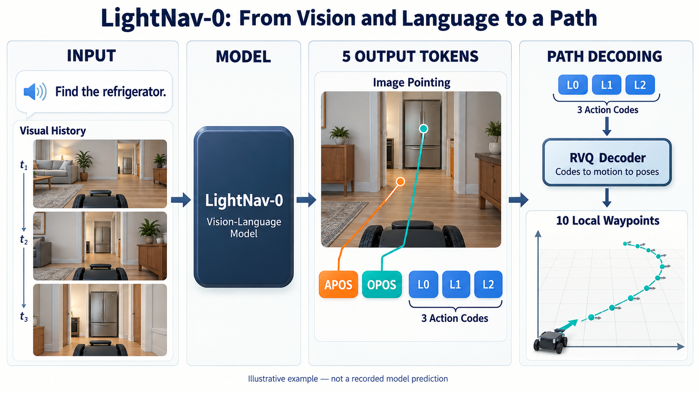
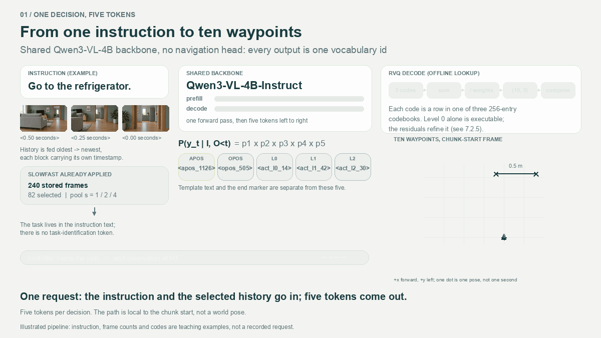
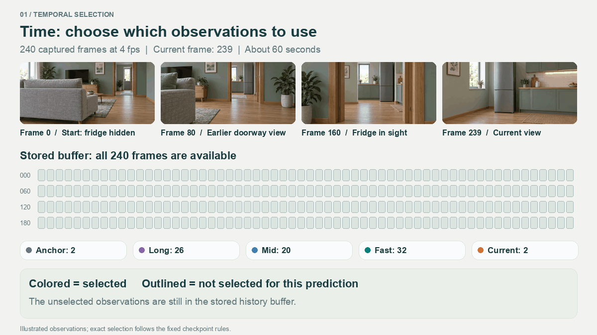
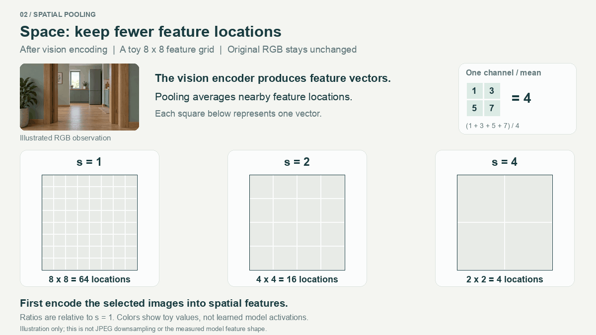
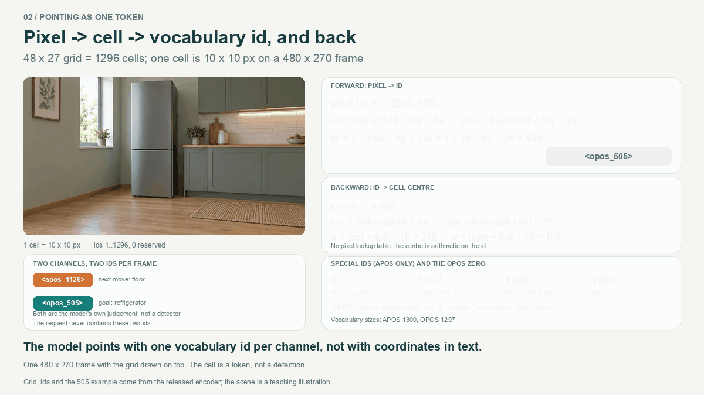
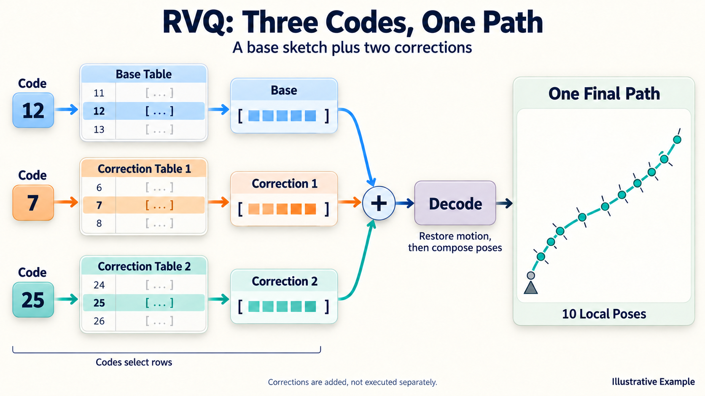
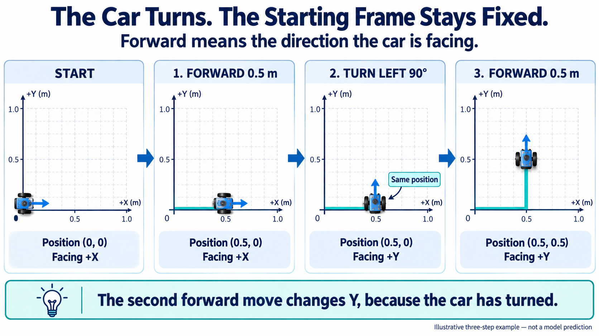
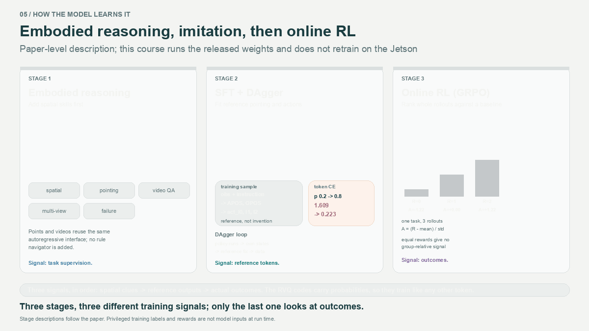

# 7.2 读懂 LightNav-0：从视觉语言理解到导航轨迹

[English](README_en_US.md) | [中文](README_zh_CN.md)

前文用“找到房间里的冰箱，并停在旁边”认识了视觉语言导航。本章将以一个具体的 VLN 算法：LightNav-0 介绍怎样把相机画面和语言指令变成一段可供小车跟踪的路径。

先抓住一条主线：**模型读取指令与视觉历史，生成两个图像指向和三个动作编号；解码器把动作编号还原成十个路径点。**

*LightNav-0核心流程。APOS／OPOS表示图像中的行动与目标指向，三个动作编号经RVQ解码得到十个局部累计位姿。*

## 学习目标

- 理解 LightNav 如何利用视觉语言模型生成导航结果。
- 说清 SlowFast、APOS／OPOS、RVQ 分别解决什么问题。
- 区分模型预测的路径、控制器的执行与最终任务结果。

## 7.2.1 为什么语言模型也能生成导航路径？

语言模型擅长逐个生成 **token**，即词表中的符号。一个 token 可以是一段文字，也可以是专门定义的标记。视觉语言模型（Vision-Language Model，VLM）还能将图像转换成数值特征，与文字一起处理，因此可以回答“画面里有什么”“冰箱在哪边”等问题。

但是，回答“向冰箱走过去”还不足以驱动小车。执行端需要知道往哪个方向移动、走多远、怎样转弯。LightNav 的办法是：**给模型增加一组导航专用符号，让符号对应明确的空间含义。**

输出包含五个任务 token：

| 输出 | 回答的问题 |
| --- | --- |
| APOS：行动指向 | 下一步打算朝画面哪里行动？ |
| OPOS：目标指向 | 指令中的目标在画面哪里？ |
| 三个动作编号 | 这次建议采用怎样的一段局部路径？ |

两个指向表达图像中的空间意图，三个动作编号共同表示一段几何路径。模型仍然按顺序生成符号，配套解码器负责把符号转换成图像位置和运动数据。

以“找到房间中的冰箱”任务为例：目标在门后的房间里，模型可以将 OPOS 指向冰箱，将 APOS 指向门口，再给出一段朝门口前进的路径。这样既能检查模型关注了哪里，也能取得比“前进、左转”更具体的运动建议。

## 7.2.2 整体结构：一次预测怎样完成？

LightNav-0 基于 Qwen3-VL-4B-Instruct 视觉语言模型。它沿用共享的模型主干和逐个生成 token 的方式，通过训练学会输出导航符号，无需另外增加一个专用的连续轨迹预测头。

一次请求可以按五步理解：

1. **选择观察。** 从本次任务按时间顺序保存的相机图像中，选择当前与部分历史画面。
2. **提取视觉特征。** 视觉编码器把画面转换成数值特征，再按历史层级压缩空间细节。
3. **联合理解。** 将图像特征、时间信息和指令交给语言模型，结合目标、场景与过去的观察进行判断。
4. **生成导航符号。** 依次输出 APOS、OPOS 和三个动作编号；**前面已生成的符号也会参与后续预测**。
5. **解码为路径。** 解码器查表恢复运动数据，计算出十个相对本次采集起点的累计位姿。

*图 7.2-1，一次LightNav决策的输入、五个导航token与十点路径。*

视觉历史就是本次导航先后拍到的图像。模型可以参考此前看到的沙发、门口和冰箱，而不只依据眼前一张照片。

**为什么只生成五个符号，仍可能等待几秒？** 因为生成之前还要处理图像和整段输入上下文。缓存可以复用部分已完成的计算；下文的 SlowFast 则直接减少每次需要处理的视觉信息。实际推理延迟要按完整请求测量。

## 7.2.3 SlowFast：近期看得细，较早看得简

小车接近冰箱时，眼前的门框、地面和障碍物需要看清；先前看过的房间也可能帮助判断目标方向。如果每次都输入全部历史，而且每张图都保留同样多的细节，任务越长，计算负担就越重。

**SlowFast 是一种视觉历史处理方法。** 它从时间和空间两个方面减少输入：近期画面密一些、细一些，较早画面疏一些、粗一些。名称与小车行驶速度无关。

### 时间压缩：这次少看一些画面

假设按 4Hz 采集，也就是每 0.25 秒拍一张。约一分钟后，已有 240 帧。SlowFast 不把这 240 帧全部用于当前预测，而是按“距离现在多久”分层选择。

*图 7.2-2，SlowFast根据观察距当前的时间，选择当前、近期、中期、长期与起始画面。*

取法是：**当前与近期连续保留，中期隔一段选一组，长期分散选取，并额外保留起始观察。**

本例中，未选中的 158 帧只是没有进入这一次预测，原始历史仍可保留。下一次预测时，系统会根据新的当前时刻重新选帧。它按照时间规则采样，不是先识别出“哪张有冰箱”再保证保留那张，因此仍可能遗漏信息。

### 空间压缩：选中的旧画面少保留一些细节

选好图像后，视觉编码器将其变成按空间位置排列的特征，可以想象成覆盖画面的方格。每格存放一组描述局部外形与上下文的数值。**空间池化**就是把相邻几格的特征汇总成较少的格子。

*图 7.2-3，空间池化将8×8特征网格汇总为4×4或2×2网格。*

以同一个 8×8 特征网格为例：

| 池化因子 | 汇总方式 | 保留的空间位置 |
| --- | --- | ---: |
| 1 | 不合并 | 8×8，共64个 |
| 2 | 每2×2区域汇成一格 | 4×4，共16个 |
| 4 | 每4×4区域汇成一格 | 2×2，共4个 |

因子为 2 时，横、纵两个方向都缩小，所以位置数变为四分之一。

### 两种压缩怎样配合？

| 观察范围 | 时间上怎样选 | 空间上怎样处理 |
| --- | --- | --- |
| 当前 | 保留最新画面 | 保留较细特征 |
| 近期 | 密集选取 | 适度汇总 |
| 中期与长期 | 间隔或分散选取 | 较早画面采用更粗的表示 |
| 起始观察 | 保留任务开头的参照 | 用较少特征概括 |

时间压缩减少“输入几张”，空间压缩减少“选中画面保留多少特征”。实际顺序是：**先选帧，再视觉编码，最后对编码后的特征做空间池化。** 代码里的 post-ViT pooling 就是“视觉编码之后的空间池化”；ViT 是视觉 Transformer 编码器的简称。

精确层级和选帧规则见[深入阅读](ADVANCED_READING_zh_CN.md#slowfast-配置与时间表示)。

## 7.2.4 APOS 与 OPOS：目标在哪里，下一步往哪里？

“看到冰箱”和“朝冰箱直走”是两件事。假设冰箱在门后，旁边还有桌子，小车可能需要先对准门口，再进入房间。为表达这种区别，LightNav 使用两个图像指向：

- **OPOS 是目标指向：** 指令中的冰箱在画面哪里。
- **APOS 是行动指向：** 下一步打算朝画面中的哪里行动，例如门口的可通行地面。

*图 7.2-4，橙色APOS标出行动方向，绿色OPOS标出目标位置。*

模型怎样用一个符号指向图像？将输入画面划分为 **48列、27行**的网格，每格分配一个编号。模型生成编号，程序再将标记画回对应格子的中心。

例如，在 480×270 的画面中，每格是 10×10 像素。从零开始计数，第10行、第24列的编号为 `1 + 10×48 + 24 = 505`，对应中心像素 `(245,105)`；编号0留给特殊情况。

图像像素也没有直接给出距离，不能把 OPOS 的像素坐标按比例当成米。

当目标暂时不在视野里时，OPOS 可以不给出普通目标点；APOS 则还支持左转、右转、停止等特殊值。所以读输出时，要先判断它是普通网格点还是特殊状态，再解释其含义。

在本案例中，**OPOS 指向冰箱、APOS 指向门口地面是合理的分工。** 但 APOS 落在地面并不保证整辆车能通过，路径仍要接受碰撞检查。核验指向时，还必须使用对应采集帧；转向后，旧像素不能直接叠加到新画面。

## 7.2.5 RVQ：三个编号怎样描述一段路径？

一条十点路径要记录十组“位置＋朝向”，共30个数。LightNav 不把这30个数逐个写出来，而是**预测三个编号，让解码器查表还原路径**。编号为什么有这个作用？

### 先想成“基础草稿＋两次修正”

画一条弯曲路线，可以先画出大致形状，再修改不准确的地方，最后补充细节。RVQ也采用类似思路：第一层表达主要部分，第二层补充修改量，第三层再修正剩余差异。最终合成的是一条路径。

类比里的“草稿”和“修改量”，在程序中都是表示运动的一组数。三层的数值相加后，再转换成路径；小车不会先走基础路线，再分别走两条修正路线。

### 编号只是地址，表里存的数才参与计算

先把问题缩小：不用30个数，只尝试表达一个数 `1.00`。假设已经准备好三张表，模型给出编号 `12、7、25`，解码器分别查出：

| 查哪张表 | 模型给出的编号 | 该行存放的数 | 累加结果 |
| --- | ---: | ---: | ---: |
| 基础表 | 12 | 0.80 | 0.80 |
| 第一张修正表 | 7 | 0.15 | 0.95 |
| 第二张修正表 | 25 | 0.05 | 1.00 |

这里的编号和数值是人为构造的教学示例，没有距离单位。编号12表示“取基础表中索引为12的条目”，不是前进12米，也不等于0.80；0.80是这个条目中存放的内容。**相加的是查出的内容，不是12＋7＋25这三个编号。**

*图 7.2-5，三个编号分别查表，取出的运动特征相加后解码为一条十点路径。*

### “残差”就是还没表达出来的部分

想表达 1.00，第一层给出 0.80，还差0.20；第二层补上 0.15，还差 0.05；第三层再补上 0.05。这种“目标数值减去当前近似后，还剩多少”的差值，就叫**残差**。

现在再看术语：查找表叫**码本**，表中存放的一组数叫**码字**，用后续表逐层补充残差的方法叫**残差向量量化**（Residual Vector Quantization，RVQ）。算例恰好补齐，真实量化通常还会有误差。

### 回到真正的十点路径

本章的真实案例中，每张表有256个条目，每个条目存放30个运动特征数值。模型从每张表预测一个编号，解码器取出三组数并逐项相加，随后按配套规则恢复运动单位。完整过程是：

**三个编号 → 查表取数并相加 → 恢复十组运动增量 → 组合成十个累计位姿。**

增量描述“这一步又移动、转向多少”，累计位姿描述“走完这一步，相对起点到了哪里”。7.2.6继续解释两者怎样转换。

训练时，已知示范路径可以编码成三个编号，供模型学习；导航时，模型根据指令与图像预测编号，再交给解码器还原。码本随模型一起准备好，每次导航无需重新建立。查表能确定地恢复数值，路径是否适合当前场景仍取决于预测和后续检查。

## 7.2.6 十点路径：转弯后，“向前”是哪边？

上一节还原出了十组运动变化，例如“向前移动一点”“再左转一点”。要把这些变化变成路径，需要回答：**每一步走完，小车相对出发位置到了哪里，车头朝向哪边？**

### 车头会转，记录位置的坐标不跟着转

想象你站在小车的出发位置看它移动。把它出发时的前方记作 X 方向、左方记作 Y 方向，这两条方向就固定下来。小车转弯后，车头的“前方”会变，但你记录位置的方向不变。

位置和车头朝向合起来叫**位姿**，写作 `(x, y, θ)`。前两个数表示相对起点的位置，最后一个数记录车头相对初始方向的角度。

### 跟着小车走三步

从 `(0, 0)` 出发，先让车头朝 X 方向：

1. **前进0.5m。** 小车到达 `(0.5, 0)`，车头仍朝 X 方向。
2. **原地左转90°。** 位置仍是 `(0.5, 0)`，只是车头转向了 Y 方向。
3. **再沿车头前方前进0.5m。** 这次沿 Y 方向移动，终点是 `(0.5, 0.5)`，车头仍朝 Y 方向。

*图 7.2-6，起点与三步运动后的四个状态。X始终朝初始前方，Y始终朝初始左方；车头左转后，再次前进增加Y。*

关键在第三步：**“向前”是相对当时的车头说的。** 车头已经左转，这次前进自然不会继续增加原来的 X。原地转弯不改变位置，却会影响下一步往哪里走。

### 增量说“又走多少”，路径点说“已经到哪”

“再向前0.5m”描述的是本次运动，叫**增量**；“现在位于 `(0.5, 0.5)`，朝向左转90°后的方向”描述的是从起点算起的结果，叫**累计位姿**。

不转弯时更容易看清：连续两次前进0.15m，两个增量都是0.15m，但两个累计位置分别是0.15m和0.30m。第二个位置已经包含第一次移动，不能再加一次0.15m。

转弯时，解码器会先考虑车头朝向，再把本次移动计入累计位置。数学上，这种平面位置与朝向的组合用 **SE(2)** 描述；理解上面的三步例子即可，公式留在深入阅读。

### LightNav返回的十个点已经累计好了

接口中的每个点都记录了：**相对本次图像采集时的小车起点，建议到达的位置与朝向。** 解码器已经完成增量组合，执行端不再把十个点逐个相加。

接下来，执行端使用采集时小车在房间里的位置和朝向，把这条局部路径转换到仿真场景中，再交给控制器跟踪。实际运行步骤见7.3。

十个点描述的是建议经过的空间位置与朝向，没有规定每个点必须在第几秒到达。实际速度由控制器决定，真正走过的轨迹也要另行记录。

## 7.2.7 模型怎样学会导航？

仅仅给词表增加符号，模型还不知道什么时候该输出它们。论文通过三阶段训练，把原有视觉语言能力逐步转向导航。

### 第一步：加强空间与行动理解

认识“冰箱”不等于理解“从哪里能走到冰箱旁边”。具身推理中间训练利用空间关系、图像指向、视频问答和多视角关联等任务，加强模型理解环境与行动关系的能力。例如，判断“哪个开口可以进入下一间房”，就比只识别门更接近导航需求。

### 第二步：学习示范的导航输出

监督微调使用配对数据：给定指令与观察，提供参考的 APOS、OPOS 和轨迹。参考轨迹先编码成 RVQ 编号，模型学习预测这些符号，于是视觉理解与动作表示连接起来。

但只学习专家走过的路线还不够。模型自己运行时可能偏离路线，看到与示范不同的画面。如果训练里没有这类状态，它可能不知道怎样纠正。

**DAgger（数据集聚合）**用于补充这类数据：让当前策略运行，在它实际到达的状态上取得参考策略的纠正标注，再加入训练。重点是让训练覆盖“模型自己可能走到哪里”，而不只覆盖理想路线。

### 第三步：根据整段运行结果继续优化

单次输出像示范，不代表整段任务一定完成。在线强化学习让模型在仿真中执行任务，根据整次运行的回报更新策略。论文采用的 GRPO 是组相对策略优化：比较同一任务下多次尝试的回报，让较好的行为更容易再次出现。

*图 7.2-7，LightNav通过具身推理、监督微调与在线强化学习三个阶段学习导航。*

三个阶段可以概括为：**先理解空间与行动关系，再模仿参考输出，最后用实际运行反馈改善决策。** 训练数据和奖励提供学习信号；部署时，模型仍根据图像和指令预测，不会收到具体目标的真实世界坐标作为隐藏提示。

这些训练提高了导航能力，但新场景、新相机和新底盘仍可能带来偏差。模型可以指对冰箱却给出穿不过门框的路径，也可能在尚未靠近时决定停止。实际能力需要结合输入、预测与真实执行结果评价。

## 如何理解停止与任务结果？

APOS 的 STOP 是指向通道中的特殊状态；动作停止则由动作解码结果及响应中的顶层 `stop` 字段表达。二者要分别读取。APOS STOP 与非零动作同时出现时，本地集成会按一致性规则拒绝运动，应记录为语义冲突，而不是笼统地称为解码失败。

模型停止、用户点击 STOP、碰撞保护停车也有不同来源。**是否完成“找到冰箱并停在旁边”，还要检查真实位置、速度、碰撞和任务规定的停止条件。** 模型 STOP 是可观察的决策，不直接等于任务成功。

## 本章回顾与自测

现在可以把算法串起来：**指令和视觉历史 → SlowFast选择与压缩 → 模型生成两个指向和三个动作编号 → RVQ解码 → 十个局部累计位姿。** 执行端再把路径转换到世界坐标，跟踪运动，并提供新的相机观察。

1. LightNav 为什么能沿用语言模型的输出方式生成导航路径？两个指向和三个动作编号各表达什么？
2. SlowFast 的时间压缩与空间压缩分别减少什么？为什么池化因子2可以让64个空间位置变成16个？
3. 冰箱在门后时，为什么 OPOS 指向冰箱、APOS 指向门口可以同时合理？
4. 用残差算例说明三层码本怎样共同表达一段路径；训练时编码参考轨迹与推理时预测编号有什么区别？
5. 前进0.5m、左转90°、再前进0.5m，为什么终点是(0.5, 0.5)？接口十点为什么不能再逐点累加？
6. 三阶段训练分别补充什么能力？为什么模型已经输出STOP，仍需独立检查任务结果？

无需背诵配置字段。需要公式、精确参数、源码和复算入口时，查阅[深入阅读](ADVANCED_READING_zh_CN.md)；想关联真实图像、token与十点路径时，进入[实验手册：解读真实预测](../7.3_From_Navigation_Prediction_to_Closed_Loop_Control/LAB_GUIDE_zh_CN.md#实验二解读真实预测)。

## 参考与后续阅读

论文、固定源码、模型版本与素材复算入口见[深入阅读：版本与源码](ADVANCED_READING_zh_CN.md#版本与源码)。动画是教学示意，不代表真实推理耗时或导航成绩。

[7.1 VLN入门](../7.1_VLN_Fundamentals/README_zh_CN.md) · [返回M7](../README_zh_CN.md) · [7.3 运行LightNav导航Demo](../7.3_From_Navigation_Prediction_to_Closed_Loop_Control/README_zh_CN.md)
