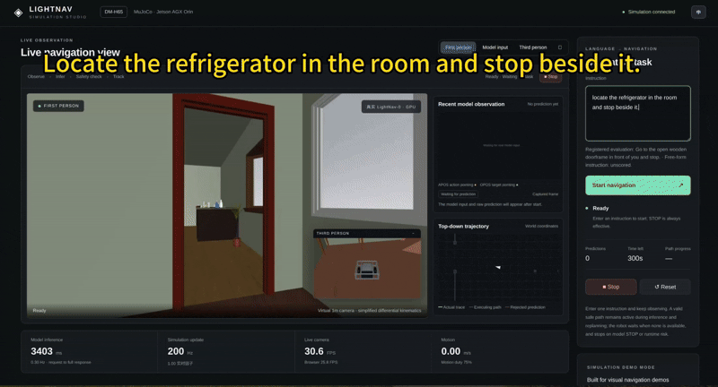

# M7 视觉语言导航：从LightNav原理到Jetson冰箱Demo

[English](README.md) | [中文](README_zh_CN.md)

> Locate the refrigerator in the room and stop beside it.

本章以DM-H65底盘寻找冰箱为主线：先理解视觉语言导航，再读懂LightNav-0如何生成路径，最后在AGX Orin上运行真实GPU模型与MuJoCo仿真，观察预测、运动和新图像形成闭环。



*底盘观察房间、跟踪预测路径并接近冰箱的运行过程。*

## 三个部分怎么学

| 章节 | 核心问题 | 产出 |
| --- | --- | --- |
| [7.1 VLN入门](7.1_VLN_Fundamentals/README_zh_CN.md) | 指令、图像、行动与反馈怎样形成导航任务？ | 指令拆解与评价条件 |
| [7.2 读懂LightNav-0](7.2_Semantic_Grounding_and_Learned_VLN/README_zh_CN.md) | SlowFast、APOS/OPOS和RVQ怎样生成十点路径？ | 一次预测的原理解释 |
| [7.3 在Jetson上运行导航Demo](7.3_From_Navigation_Prediction_to_Closed_Loop_Control/README_zh_CN.md) | 怎样启动服务、打开网页并输入指令？ | 一次Demo运行记录 |

先学概念，再读算法，最后运行已部署Demo。本次MuJoCo实验不要求先安装ROS 2、SLAM或Nav2。三篇正文、实验手册、深入阅读和代码入口均提供中英文版本，英文为默认入口；历史记录保留原语言。

## 目录结构

```text
M07-Vision-Language-Navigation/
├── README.md / README_zh_CN.md
├── 7.1_VLN_Fundamentals/          # 中英文正文与配图
├── 7.2_Semantic_Grounding_and_Learned_VLN/
│   ├── README_en_US.md / README_zh_CN.md
│   ├── ADVANCED_READING.md / ADVANCED_READING_zh_CN.md
│   └── assets/                  # 图片与教学动画
├── 7.3_From_Navigation_Prediction_to_Closed_Loop_Control/
│   ├── README_en_US.md / README_zh_CN.md
│   ├── LAB_GUIDE.md / LAB_GUIDE_zh_CN.md
│   └── assets/demo.gif
├── code/                        # 源码覆盖层、配置、锁文件、工具与示例
├── assets/                      # 共享及历史素材
└── SHA256SUMS.txt
```

## 代码与实践入口

- **配套代码：** 从[代码说明](code/README_zh_CN.md)查看目录用途、固定版本、材料检查和准备入口。
- **已部署设备：** 按[7.3](7.3_From_Navigation_Prediction_to_Closed_Loop_Control/README_zh_CN.md)和[实验手册入口A](7.3_From_Navigation_Prediction_to_Closed_Loop_Control/LAB_GUIDE_zh_CN.md#入口-a已部署设备快速体验)检查当前状态，复用已有服务。
- **新设备：** 按[入口B](7.3_From_Navigation_Prediction_to_Closed_Loop_Control/LAB_GUIDE_zh_CN.md#入口-b新设备准备)准备固定源码、双环境、模型、场景及外部CAD包。
- **自己的底盘：** 从[自定义底盘材料](code/examples/custom-chassis/README_zh_CN.md)完成部件检查和独立预览，再适配后端。
- **暂无设备：** 观看运行演示，分析[真实离线样例](code/evidence/README_zh_CN.md)。
- **算法细节：** 查阅[深入阅读](7.2_Semantic_Grounding_and_Learned_VLN/ADVANCED_READING_zh_CN.md)。

## 当前进度与实验结果

**课程材料：** 中英文教程、配套代码与运行演示已整理。

**实现验证：** 已有证据覆盖真实LightNav GPU推理与底盘持续仿真运动。当前Demo采用简化差速运动学、几何前瞻跟踪和快速碰撞检查，分别记录模型原始路径、有限局部修复与实际轨迹；不涉及实车轮胎、脚轮和制动标定。

**冰箱案例：** 视频标有三倍速，包含17次预测、接近冰箱和模型STOP。该自由任务没有注册独立成功评分，因此保留行为观察结果，不将视频终态换算为成功率。

**历史样例：** 更早的门框记录包含五次预测，最终因危险路径停止，严格成功为false。它与冰箱视频、另一次八次预测的冰箱失败复测分别记录。

**外部材料：** 权重、ARM wheel和教师CAD包需要单独取得。CAD包尚无公共下载入口，新设备复现仍依赖教师提供资产。具体准备方式见[实验手册](7.3_From_Navigation_Prediction_to_Closed_Loop_Control/LAB_GUIDE_zh_CN.md)，完整性见[校验清单](SHA256SUMS.txt)。
