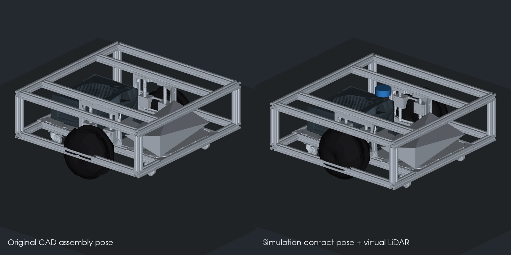

# J501 Chassis: STEP to URDF Simulation Model

[中文](README_zh_CN.md) | [M6 outline](../../../docs/M06-Localization-Navigation-and-Path-Planning/README.md)

Converted from `urdf_from_step/Assembly.step` at the course repository root. All 359 part instances are represented in ten visual meshes, with two drive joints, four passive swivel / rolling caster pairs, primitive collisions, and estimated inertias. The runtime target is **Ubuntu 22.04, ROS 2 Humble, and Gazebo Fortress 6**. The original ROS 1 converter is not required.



## Files and Geometry

- [Simulation URDF](urdf/j501_chassis.urdf): drive plugins and virtual LiDAR.
- [Original CAD pose](urdf/j501_chassis_cad.urdf): original assembly configuration, without virtual LiDAR or simulation plugins.
- [Xacro source](urdf/j501_chassis.urdf.xacro): generates both URDF files.
- [Geometry](config/geometry.yaml), [estimated dynamics](config/dynamics.yaml), and [CAD manifest](config/cad_manifest.json).
- [Conversion script](tools/convert_step.py): reproducible assembly import, part mapping, mesh simplification, and URDF generation.

Use meters throughout. `base_footprint` lies on the ground; `base_link` is on the chassis centerline. CAD +X is the provisional front, +Y left, and +Z up; verify the actual front on hardware.

| Quantity | This CAD model |
| --- | --- |
| Frame outline | Approximately 0.490 × 0.490 m |
| Drive tyre radius | Approximately 0.081521 m |
| Tyre center separation | Approximately 0.376591 m |
| Tyre collision width | Approximately 0.062272 m |
| Caster radius | 0.015 m, with inferred swivel / rolling axes |
| Suspension compression for simulation | Approximately 0.039651 m |

These dimensions differ from the Python SDK defaults of `0.0825 m / 0.42 m`. Use the CAD dimensions in simulation and calibrate the effective rolling radius and track width separately on hardware.

## CAD Pose and Ground Contact

In the source assembly, the drive tyres extend about 40 mm below the casters. The simulation configuration raises each wheel carrier, associated bearings, and drive wheel along the suspension direction to align the six idealized contact surfaces. Suspension is locked at that pose, not modeled as a spring. Set `suspension_compression:=0` to restore the source pose.

Joint relationships are inferred from geometry, not recovered mechanical mates. The fixed body and electronics are estimated at 12 kg; the complete model, including carriers, wheels, casters, and virtual LiDAR, totals approximately 15.27 kg. Mass, center of mass, damping, friction, and effort values are estimates. The Gazebo drive plugin uses velocity control and does not establish hardware torque or braking performance.

Collisions use a conservative body box and wheel cylinders. Complete caster visuals follow swivel; independent rolling joints drive collision wheels without separately cutting tyre visuals from the compound CAD solid. Visual meshes are simplified; the original STEP is unchanged.

## Build and Launch

Use the [J501 navigation lab](../j501_navigation/README.md) for complex maps, global planning, and local avoidance. The description-only entry below serves chassis checks in the single-obstacle scene.

Run from the repository root in a ROS 2 Humble terminal without ROS 1 Noetic / Conda Python paths:

```bash
source /opt/ros/humble/setup.bash
sudo apt update
sudo apt install ros-humble-ros-gz ros-humble-xacro \
  ros-humble-robot-state-publisher ros-humble-joint-state-publisher-gui ros-humble-rviz2
colcon build --base-paths modules/m06_navigation \
  --packages-select j501_chassis_description --symlink-install \
  --cmake-args -DPython3_EXECUTABLE=/usr/bin/python3
source install/setup.bash
ros2 launch j501_chassis_description sim.launch.py
```

For a server-only run:

```bash
ros2 launch j501_chassis_description sim.launch.py headless:=true rviz:=false
```

GPU LiDAR still requires working EGL / Ogre2 rendering. Use a display session if headless rendering is unavailable.

From another terminal sourced into the same workspace, command low-speed travel, then stop:

```bash
ros2 topic pub --rate 10 /cmd_vel geometry_msgs/msg/Twist '{linear: {x: 0.1}, angular: {z: 0.0}}'
# After Ctrl+C, explicitly stop; the Gazebo plugin retains its last command.
ros2 topic pub --once /cmd_vel geometry_msgs/msg/Twist '{}'
```

Inspect the original CAD pose and joint sliders:

```bash
ros2 launch j501_chassis_description display.launch.py cad_pose:=true
```

## ROS 2 Interfaces

| Topic | Purpose |
| --- | --- |
| `/cmd_vel` | `geometry_msgs/msg/Twist` input |
| `/odom` | Differential-drive `nav_msgs/msg/Odometry` |
| `/joint_states` | Drive and caster joint states |
| `/tf`, `/tf_static` | `odom → base_footprint → base_link → components` |
| `/scan` | Virtual planar LiDAR: 10 Hz, 360 beams, 12 m range |
| `/clock` | Simulation time; use `use_sim_time:=true` |
| `/simulation/ground_truth` | Actual simulated pose for evaluation only, excluded from navigation input |

Future Nav2 integration should use `robot_base_frame: base_footprint`, `odom_topic: /odom`, the scan obstacle source, and an approximately `±0.245 m` square footprint. SLAM Toolbox or AMCL must supply `map → odom`; this package does not start Nav2, SLAM, or EKF.

The launch file is for one robot with absolute topic names. Multi-robot use needs namespace, frame, and bridge isolation.

## Verified Behavior

Headless loading, forward motion, turning, stopping, and message interfaces were exercised locally with ROS 2 Humble and Gazebo Fortress 6.16.0. See [model checks](validation/model_checks.json) and [Gazebo measurements](validation/gazebo_smoke.json).

| Check | Recorded result |
| --- | --- |
| URDF / SDF | URDF parsing, SDF conversion, and ROS 2 package build passed |
| Structure and inertia | 15 links, 14 joints, 10 continuous joints; positive physical inertias and six nominal ground contacts |
| Visuals | Ten meshes, 214,978 triangles, all 359 CAD instances mapped |
| Forward motion | `0.1 m/s × 3 s` produced approximately 0.3002 m actual displacement |
| Turning | `0.3 rad/s × 3 s` produced approximately 0.4152 rad actual yaw versus 0.9000 rad encoder odometry |
| LiDAR and stopping | Valid 360-beam scans with obstacle returns; odometry velocity settled after zero command |

Short-turn actual yaw differs substantially from wheel-integrated odometry. The record retains this difference; further calibration should consider caster alignment, contact friction, and control settings. These checks cover basic simulation and interfaces; full Nav2 navigation experiments remain separate work.

While the simulation runs, repeat the motion check in a terminal sourced into the same ROS 2 workspace. The script publishes simulated velocity commands:

```bash
/usr/bin/python3 modules/m06_navigation/j501_chassis_description/tools/smoke_test.py
```

## Reproduce Conversion

The generated model runs without CAD dependencies. The converter checks the source SHA-256 because joint mapping is specific to this assembly; inspect and update the mapping before converting a changed source.

```bash
uv venv /tmp/j501-cad-venv --python /usr/bin/python3
uv pip install --python /tmp/j501-cad-venv/bin/python \
  -r modules/m06_navigation/j501_chassis_description/tools/requirements-cad.txt
env -u PYTHONPATH /tmp/j501-cad-venv/bin/python \
  modules/m06_navigation/j501_chassis_description/tools/convert_step.py \
  urdf_from_step/Assembly.step --cache-dir /tmp/j501-step-cache
check_urdf modules/m06_navigation/j501_chassis_description/urdf/j501_chassis.urdf
ign sdf -p modules/m06_navigation/j501_chassis_description/urdf/j501_chassis.urdf
env -u PYTHONPATH /tmp/j501-cad-venv/bin/python \
  modules/m06_navigation/j501_chassis_description/tools/validate_model.py
```

The optional cache accelerates conversion and is not a runtime dependency. The manifest records CAD provenance; licensing remains subject to the repository's licensing notes.
