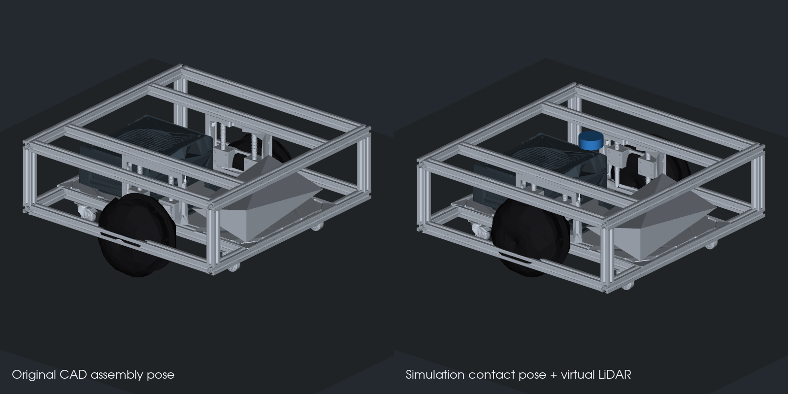

# J501 底盘 STEP → URDF 仿真模型

[English](README.md) | [M6 课程框架](../../../docs/M06-Localization-Navigation-and-Path-Planning/README_zh_CN.md)

模型来自仓库根目录的 `urdf_from_step/Assembly.step`。保留 359 个零件实例的外观，合并为 10 个视觉网格，增加两侧驱动轮关节、四套万向轮的转向 / 滚动关节、简化碰撞体和估算惯性。运行目标为 **Ubuntu 22.04 + ROS 2 Humble + Gazebo Fortress 6**，无需运行原目录中的 ROS 1 转换器。



## 文件与坐标

| 文件 | 用途 |
| --- | --- |
| [urdf/j501_chassis.urdf](urdf/j501_chassis.urdf) | 可直接读取的仿真 URDF，包含驱动插件与虚拟雷达 |
| [urdf/j501_chassis_cad.urdf](urdf/j501_chassis_cad.urdf) | 原始 CAD 装配位姿，无虚拟雷达和仿真插件 |
| [urdf/j501_chassis.urdf.xacro](urdf/j501_chassis.urdf.xacro) | 参数化源文件，两个 URDF 都从它生成 |
| [config/geometry.yaml](config/geometry.yaml) | 从这份 STEP 提取的尺寸、坐标与悬挂接地偏移 |
| [config/dynamics.yaml](config/dynamics.yaml) | 可修改的质量、阻尼估算 |
| [config/cad_manifest.json](config/cad_manifest.json) | STEP 校验和、359 个零件的分组、网格校验和与三角面数 |
| [tools/convert_step.py](tools/convert_step.py) | 可重复执行的转换脚本 |

长度单位统一为米。`base_footprint` 位于地面，`base_link` 位于底盘中心线上；`+X` 暂按 CAD 的正 X 方向作为车头，`+Y` 为左，`+Z` 为上，实机车头方向仍需核对。

| 参数 | 本次 CAD 模型 |
| --- | --- |
| 框架外廓 | 约 0.490 × 0.490 m |
| 驱动轮半径 | 约 0.081521 m |
| 两侧轮胎中心距 | 约 0.376591 m |
| 轮胎碰撞圆柱宽度 | 约 0.062272 m |
| 万向轮半径 | 0.015 m，轴线 / 转向中心从 CAD 几何推定 |
| 仿真悬挂压缩偏移 | 约 0.039651 m |

这些尺寸与 Python SDK 的默认 `0.0825 m / 0.42 m` 不同，不能直接互相覆盖。仿真以本模型的 CAD 尺寸为准；实机需重新标定有效滚动半径和轮距。

## 为什么有两个版本

STEP 原始装配中的驱动轮最低点比万向轮低约 40 mm。本包保留原始装配版本；仿真版本将轮架、对应轴承和驱动轮沿悬挂方向上移，使六个轮的理想碰撞面接地。

悬挂在指定高度锁定，不模拟弹簧。`suspension_compression:=0` 可恢复原始位姿。关节连接关系由零件位置和结构推定，不代表 STEP 包含可直接恢复的机械运动副。

固定车体与电子部件共估算 12 kg，另加轮架、轮胎和万向轮等，含虚拟雷达的模型总质量约 15.27 kg；质量、重心、阻尼、摩擦和关节力矩值均未经过实机测量。Gazebo 差速插件使用速度控制，不能据此认定真实电机的力矩或制动性能。

碰撞使用保守的车体包围盒和轮子圆柱，不用精细外观网格进行物理计算。万向轮的完整 CAD 外观随转向关节旋转，滚动关节独立计算碰撞；未把单个复合实体的轮胎外观另行切割。视觉网格经过简化，原始 STEP 保持不变。

## 安装与启动

需要复杂地图、全局规划与局部避障时，使用 [J501 导航实验入口](../j501_navigation/README_zh_CN.md)。下列描述包入口用于单障碍物场景中的底盘检查。

以下命令从课程仓库根目录执行。在只加载 ROS 2 Humble 的终端中操作，避免混入 ROS 1 Noetic 或 Conda 的 Python 路径。

```bash
source /opt/ros/humble/setup.bash
sudo apt update
sudo apt install ros-humble-ros-gz ros-humble-xacro \
  ros-humble-robot-state-publisher ros-humble-joint-state-publisher-gui ros-humble-rviz2

colcon build --base-paths modules/m06_navigation \
  --packages-select j501_chassis_description --symlink-install \
  --cmake-args -DPython3_EXECUTABLE=/usr/bin/python3
source install/setup.bash

ros2 launch j501_chassis_description sim.launch.py
```

启动 Gazebo、ROS 桥接和 RViz2，世界中预置一个位于前方的障碍物。无窗口运行可使用：

```bash
ros2 launch j501_chassis_description sim.launch.py headless:=true rviz:=false
```

虚拟雷达使用 GPU 渲染；无窗口时仍需可用的 EGL / Ogre2 渲染环境。若环境不支持无窗口渲染，可在有显示服务的会话中运行。

在另一个已加载同一工作空间的终端测试低速运动，然后发送零速：

```bash
ros2 topic pub --rate 10 /cmd_vel geometry_msgs/msg/Twist '{linear: {x: 0.1}, angular: {z: 0.0}}'
# Ctrl+C 结束发布后发送停车命令；Gazebo 插件会保持最后一条速度指令。
ros2 topic pub --once /cmd_vel geometry_msgs/msg/Twist '{}'
```

仅检查原始 CAD 结构与关节时使用：

```bash
ros2 launch j501_chassis_description display.launch.py cad_pose:=true
```

## ROS 2 接口与 Nav2 接入点

| 接口 | 类型 / 作用 |
| --- | --- |
| `/cmd_vel` | `geometry_msgs/msg/Twist`，输入差速速度指令 |
| `/odom` | `nav_msgs/msg/Odometry`，Gazebo 差速里程计 |
| `/joint_states` | `sensor_msgs/msg/JointState`，驱动轮与万向轮关节状态 |
| `/tf`、`/tf_static` | `odom → base_footprint → base_link → 各部件` |
| `/scan` | `sensor_msgs/msg/LaserScan`，10 Hz、360 束、12 m 的虚拟平面雷达 |
| `/clock` | 仿真时间；仿真节点使用 `use_sim_time:=true` |
| `/simulation/ground_truth` | 仿真实际位姿，仅用于验证；不作为定位 / 导航输入 |

Nav2 后续配置使用 `robot_base_frame: base_footprint`、`odom_topic: /odom`、`scan` 障碍源，以及约 `±0.245 m` 的方形足迹。`map → odom` 仍需由 SLAM Toolbox 或 AMCL 提供；本包不启动 Nav2、SLAM 或 EKF。

这是单机器人启动入口，话题使用绝对名称。多机实验需要进一步增加命名空间、frame 和桥接隔离。

## 已完成的验证

已在本机 ROS 2 Humble + Gazebo Fortress 6.16.0 中完成无窗口加载、前进、转向、停车和消息通路检查，记录见 [模型检查](validation/model_checks.json) 与 [Gazebo 实测](validation/gazebo_smoke.json)。

| 检查 | 本次结果 |
| --- | --- |
| URDF / SDF | URDF 解析、SDF 转换和 ROS 2 包构建通过 |
| 结构与惯性 | 15 个 link、14 个 joint，其中 10 个连续关节；惯性正定，六轮理想接地 |
| 网格 | 10 个文件、214,978 个三角面，所有 359 个 CAD 实例都有对应分组 |
| 前进 | `0.1 m/s × 3 s`，仿真实际位移约 0.3002 m |
| 转向 | `0.3 rad/s × 3 s`，实际转角约 0.4152 rad，轮速里程计约 0.9000 rad |
| 雷达与停车 | 360 束有效扫描格式，能测到障碍物；零速后里程计速度收敛 |

短时转向的实际转角与轮速积分存在明显差异，已保留在记录中。后续需结合万向轮对正、接触摩擦与控制参数继续标定；当前验证覆盖基础仿真运行和接口，完整 Nav2 导航实验另行开展。

仿真运行期间，可在同一 ROS 2 工作空间终端复验。该脚本会发布仿真速度指令：

```bash
/usr/bin/python3 modules/m06_navigation/j501_chassis_description/tools/smoke_test.py
```

## 重新转换

日常仿真直接使用已生成的 URDF / 网格，不需要 CAD 依赖。修改原始 STEP 后需要重新检查映射；脚本核对源文件 SHA-256，避免把其他装配误当作这套关节结构。

```bash
uv venv /tmp/j501-cad-venv --python /usr/bin/python3
uv pip install --python /tmp/j501-cad-venv/bin/python \
  -r modules/m06_navigation/j501_chassis_description/tools/requirements-cad.txt
env -u PYTHONPATH /tmp/j501-cad-venv/bin/python \
  modules/m06_navigation/j501_chassis_description/tools/convert_step.py \
  urdf_from_step/Assembly.step --cache-dir /tmp/j501-step-cache

check_urdf modules/m06_navigation/j501_chassis_description/urdf/j501_chassis.urdf
ign sdf -p modules/m06_navigation/j501_chassis_description/urdf/j501_chassis.urdf
env -u PYTHONPATH /tmp/j501-cad-venv/bin/python \
  modules/m06_navigation/j501_chassis_description/tools/validate_model.py
```

缓存仅加速重复转换，不是运行依赖。CAD 及其衍生网格的来源保留在清单中；许可状态与仓库根目录的说明保持一致。
