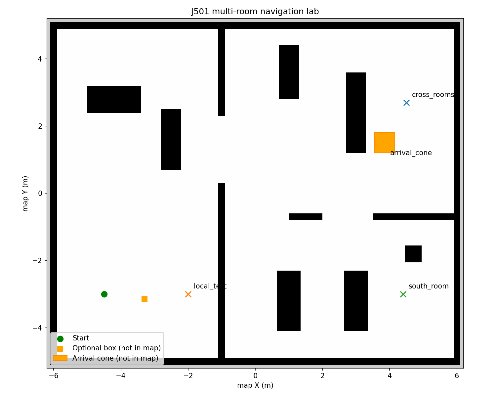
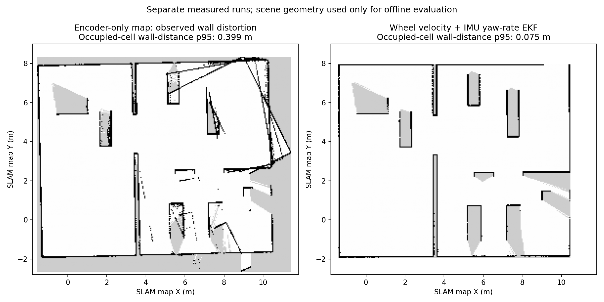
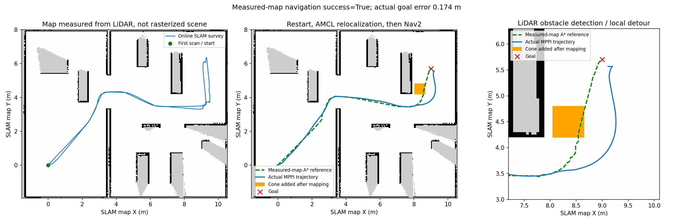
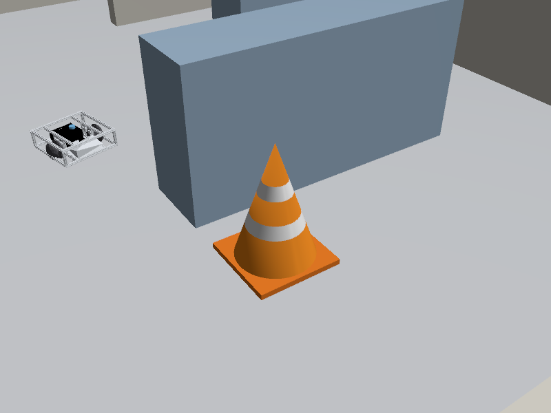
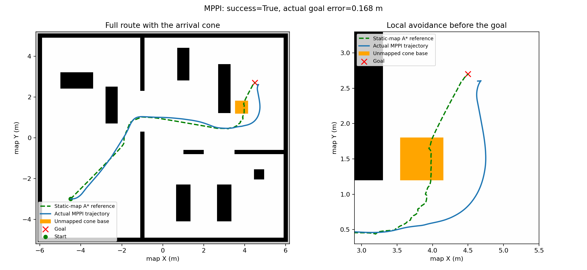
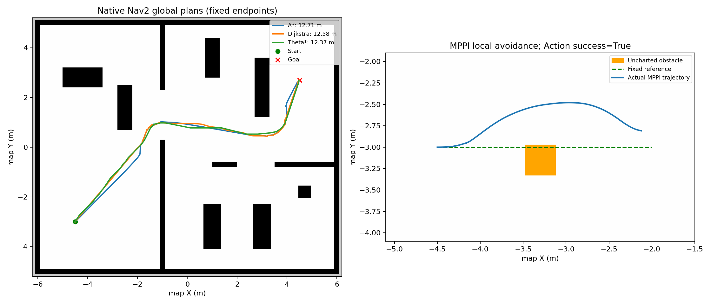

# J501 Multi-Room Global Planning and Local Avoidance Lab

[中文](README_zh_CN.md) | [6.2 Algorithms and tutorial](../../../docs/M06-Localization-Navigation-and-Path-Planning/6.2_Global_and_Local_Path_Planning/README_en_US.md)

ROS 2 Humble, Gazebo Fortress, and Nav2. [office.yaml](scenes/office.yaml) defines the world. Course navigation uses a map measured by live SLAM; scene-rasterized maps are algorithm fixtures only. Global planning handles mapped walls; local control uses LiDAR detections of new obstacles.



Three native global planners (`A*`, Dijkstra, `Theta*`) and three local controllers (DWB, MPPI, RPP) are executable. Readable standalone global-search implementations supplement the Nav2 C++ plugins.

## Course Workflow: Map, Relocalize, Then Plan

See [6.1](../../../docs/M06-Localization-Navigation-and-Path-Planning/6.1_Nav2_Setup_and_Configuration/README_en_US.md) for the full workflow and [6.3](../../../docs/M06-Localization-Navigation-and-Path-Planning/6.3_Dynamic_Obstacle_Avoidance_and_Pedestrian_Prediction/README_en_US.md) for perception. The default regular-ray 3D sensor approximates MID-360 field of view, not Livox's native non-repetitive scan.

Terminal A, after stopping previous simulation:

```bash
cd /home/darklee/mobile-robot-full-stack-course
./modules/m06_navigation/build.sh
./modules/m06_navigation/run_mapping.sh
```

Terminal B, survey manually chosen waypoints and save actual SLAM output:

```bash
source modules/m06_navigation/setup.bash
ros2 run j501_navigation survey --output build/m06_results/survey.json
ros2 run j501_navigation save_map --output build/m06_maps/office
```

Stop mapping in terminal A with Ctrl+C, then run `./modules/m06_navigation/run_navigation.sh`. Terminal B:

```bash
ros2 run j501_navigation relocalize --pose 0 0 0
ros2 run j501_navigation global_plan --planner astar --goal 9 5.7 0
ros2 run j501_navigation navigate --controller MPPI --goal 9 5.7 0
```

The map comes from `/scan → SLAM Toolbox`, not scene rasterization. A missing measured map does not silently select the prebuilt one. Nav2 activates only after covariance, scan/map agreement, and consecutive AMCL-update checks. Mapping omits the cone; navigation restores it, and `/perception/obstacles` feeds the local obstacle layer.

The first-scan map goal is approximately `(9,5.7)`, versus `(4.5,2.7)` in the old fixture. The fixed-map exercises and historical records below explicitly use:

```bash
./modules/m06_navigation/run_navigation.sh demo_map:=true lidar:=2d odometry_source:=wheel
```

## Algorithm View: Trajectory and Detected Obstacles


This figure is rendered from actual simulation output. Left: saved map, initial global reference, and full localized trajectory. Center: the detour near the goal. Right: orthographic projection of LiDAR points and a detected 3D cluster box. These are geometric detections, not semantic cone classification.

`run_navigation.sh` starts `algorithm_view` by default. In RViz, green `Initial global reference` is the first global route; blue `Localized trajectory` is the AMCL/EKF pose trace; orange points are non-ground obstacles; colored boxes and `Cnumber | point count` identify compact clusters in one frame. The trace remains after navigation. Enable `LiDAR detected boxes` to inspect all raw clusters, including large connected walls. Cluster numbers are not persistent tracking IDs.

Start mapping and relocalize as described above. To use the existing EKF map, terminal A:

```bash
./modules/m06_navigation/run_navigation.sh map:="$PWD/build/m06_maps/ekf/office.yaml"
```

Terminal B:

```bash
source modules/m06_navigation/setup.bash
ros2 run j501_navigation relocalize --pose 0 0 0
ros2 run j501_navigation navigate --controller MPPI --goal 9 5.7 0
# Keep terminal A running; export PNG and re-plottable JSON after navigation
ros2 service call /algorithm_view/save std_srvs/srv/Trigger '{}'
```

Default outputs are `build/m06_results/algorithm_view.png` and `.json`. Override with launch argument `view_output:=/absolute/path/result`. The plot selects a compact obstacle near the route and labels its acquisition time; the trajectory covers the full run, while points and boxes are a single detection snapshot. The [raw record](validation/algorithm_view/snapshot.json), [navigation result](validation/algorithm_view/navigation.json), and [RViz screenshot](assets/algorithm_view_rviz.png) are retained. Re-render offline with `python3 modules/m06_navigation/j501_navigation/j501_navigation/plot_algorithm_view.py <record.json> --output <figure.png>`.

For an older launch, run `ros2 run j501_navigation algorithm_view --ros-args -p use_sim_time:=true` once; do not duplicate the node with the new launch. The visualizer reads map, localization TF, plan, and real detection output only. Simulator truth and scene object lists are excluded. The independent evaluation `/lab/actual_path` display is hidden by default to avoid confusion with the blue localization estimate.

## Mapping Drift Fix and Startup Checks

Odometry now defaults to M3.4-style wheel/IMU EKF: forward wheel velocity, zero lateral velocity, and IMU yaw rate only. Integrated wheel position/yaw and absolute IMU orientation are excluded; EKF alone publishes `odom → base_footprint`. Scan projection now rounds to the nearest ray. `odometry_source:=wheel` remains an explicit comparison.



For these separate runs, the p95 occupied-cell distance to scene surfaces decreased from approximately 0.400 m to 0.075 m. This one-way metric does not establish coverage of unseen walls. See [records](validation/ekf_mapping/environment.json). The user's map/session and default map are preserved; the newly measured map is available locally at `build/m06_maps/ekf/office.yaml` via explicit `map:=`. Fresh experiments should map and save again.

The client now detects mapping mode in about one second and reports save → Ctrl+C mapping → start navigation → relocalize. Unlocalized navigation reports the `relocalize` prerequisite instead of an opaque 60-second timeout. **Saving a map does not switch the running launch mode.**

## Measured Mapping → Relocalization → Cloud Avoidance



The [workflow record](validation/lidar_workflow/environment.json) uses the default 3D pipeline. A 14-waypoint survey produced the occupancy map and pose graph; mapping was stopped before reload. Planner Server was `unconfigured` before relocalization. AMCL corrected approximate seed `(0.2,-0.1,0.1)`; five passing updates then activated navigation.

| Check | One local run |
| --- | --- |
| Measured-map navigation | Action success, approximately 13.077 m actual path, 0.174 m actual goal error |
| Sampled footprint evaluation | Approximately 0.268 m minimum clearance, zero contact samples; not continuous safety proof |
| Detection capture | 584 frames, all with ground fits; approximately 63 ms median processing time |
| Cone geometry | Independent evaluator matched 410 frames; one near-range center error was 0.064 m, not a whole-scene accuracy score |

Raw [survey](validation/lidar_workflow/survey.json), [relocalization](validation/lidar_workflow/relocalization.json), [navigation](validation/lidar_workflow/navigation.json), [perception](validation/lidar_workflow/perception.json), and [observed map](validation/lidar_workflow/office.yaml) are supplied. Only independent evaluation uses truth/scene geometry. `actual_trajectory` is in simulator-world coordinates; `actual_trajectory_map` applies an evaluation-only map-frame relation to avoid misleading endpoint errors.

## Traffic Cone Before the Goal

The default world includes an orange and white `arrival_cone` at `(3.85, 1.5)`, about 1.4 m before the cross-room goal. Its height is 0.85 m and square base is 0.6 × 0.6 m. A cone collision mesh and base occupy the original route, with room to pass on the right.



The cone exists in Gazebo but is excluded from `office.pgm`. For the historical 2D benchmark below, explicitly start terminal A with `./modules/m06_navigation/run_navigation.sh demo_map:=true lidar:=2d odometry_source:=wheel controller:=MPPI`, then execute in terminal B:

```bash
ros2 run j501_navigation navigate --planner astar --controller MPPI \
  --goal 4.5 2.7 0 --output build/m06_results/navigation_cone.json
```

Near the goal, watch laser returns and the local costmap detect the cone, then compare the blue actual trajectory with the green global route. The global costmap only has static and inflation layers, so periodic global replanning does not learn the cone. Gazebo displays its orange and white appearance; RViz shows scan points and local obstacle costs rather than a cone robot link.

Edit `unmapped_cones` in the [scene](scenes/office.yaml), regenerate with `generate_scene.py`, rebuild, and restart. The default 3D measured-map workflow uses goal `(9,5.7)`; historical cone records here use `demo_map:=true lidar:=2d odometry_source:=wheel` and `(4.5,2.7)`. Clearance evaluation conservatively uses the square base; scene geometry is evaluation-only, while navigation uses laser, odometry, and AMCL.

A fresh-start `A* + MPPI` run completed the full route: approximately 13.082 m actual path, 0.168 m actual goal error, 0.259 m minimum sampled footprint clearance, and zero contact samples. See the [record](validation/navigation_cone_mppi.json). The local cost at the cone center peaked at 99; the global value of 42 comes from existing shelf inflation rather than cone marking.



Controllers respond differently to the added obstacle: [DWB failed to progress at a corner before reaching it](validation/failures/dwb_arrival_cone_stagnation.json), while MPPI completed the avoidance task. Loading a controller does not establish success on every task.

## Isolate Global Planning and Local Avoidance

The global `/plan` uses the complete static map; the local costmap receives live `/scan`. Save a straight reference before creating an uncharted obstacle:

```bash
ros2 run j501_navigation global_plan --goal -2 -3 0 --output build/m06_results/local_path.json
ros2 run j501_navigation obstacle
ros2 run j501_navigation local_follow --controller MPPI \
  --path build/m06_results/local_path.json --obstacle -3.3 -3.15 0.35 0.35 \
  --output build/m06_results/local_mppi.json
ros2 run j501_navigation obstacle --remove
```

`--obstacle` supplies evaluation geometry, not detection or control input. The laser discovers the obstacle. RPP primarily tracks an existing path and may stop; DWB and MPPI can also encounter local minima. Record actual task status.

## Executable Programs

| Command | Execution |
| --- | --- |
| `global_plan --planner astar\|dijkstra\|theta_star` | Native Nav2 `ComputePathToPose`, exporting path JSON |
| `benchmark --trials 3` | Compare three global plugins with fixed endpoints, without motion |
| `grid_plan --algorithm astar\|dijkstra\|theta_star` | [Standalone search](j501_navigation/grid_search.py), without running ROS nodes or simulation |
| `navigate --planner astar --controller MPPI` | `NavigateToPose`, planning, tracking, and recovery |
| `local_follow --controller DWB\|MPPI\|RPP --path ...` | `FollowPath`, fixed reference without global replanning |
| `obstacle` / `obstacle --remove` | Create / remove an uncharted Gazebo obstacle |
| `obstacle --crossing --duration 20` | Bounded crossing experiment using discrete pose updates |

See [clients](j501_navigation/clients.py), [parameters](config/nav2_params.yaml), and [behavior tree](behavior_trees/navigate.xml). DWB uses Rotation Shim for initial heading alignment before trajectory sampling.

## Measured Results and Scope



Validated locally with ROS 2 Humble, Nav2 1.1.20, and Gazebo Fortress 6.16.0. The existing records below predate the arrival cone; the static map is unchanged. Controller tasks differ, so these measurements do not support a speed ranking.

| Check | Record |
| --- | --- |
| Three global plugins, three trials each | `A*` approximately 12.709 m, Dijkstra 12.584 m, `Theta*` 12.373 m; [raw results](validation/nav2_global_planners.json) |
| Teaching search | Separate [grid_search.json](validation/grid_search.json); costs and path extraction differ from native plugins |
| Cross-room `A* + DWB` | Action success, approximately 12.951 m actual path and 0.115 m endpoint error; recovery retries occurred; [record](validation/navigation_dwb.json) |
| MPPI fixed-reference avoidance | Action success, approximately 2.596 m actual path, 0.148 m minimum sampled footprint clearance; local obstacle cost peaked at 99, global cost at that point stayed 0; [record](validation/local_mppi_obstacle.json) |
| RPP tracking | Successful separate short task without a temporary obstacle; [record](validation/local_rpp_tracking.json) |
| Failed cases | [MPPI symmetric-obstacle stagnation](validation/failures/mppi_initial_symmetric.json), [DWB tolerance-mismatch timeout](validation/failures/dwb_tolerance_timeout.json) |

Clearance uses discrete actual-trajectory samples and scene boxes. Zero footprint-contact samples do not establish continuous safety. Navigation uses AMCL / odometry / laser; ground truth is evaluation-only. Dynamics remain estimates; hardware acceptance and full pedestrian prediction are pending.

In RViz2, green is `/plan`; orange `/local_plan` primarily serves DWB; blue `/lab/actual_path` is published while a motion client runs. MPPI sampling visualization is off by default, and RPP does not publish DWB's local-path topic.

## Dependencies, Regeneration, and Checks

Use system Nav2, SLAM Toolbox, and SciPy when present. Otherwise `build.sh` downloads and extracts dependencies under `build/m06_nav2_deps/` without installing or removing system packages. The optional [bootstrap tool](tools/bootstrap_nav2.py) checks downloads and supplies the diagnostic-library ABI needed by newer Nav2 builds. The workspace no longer relies on the previous `/tmp` build.

```bash
# Regenerate matching geometry and occupancy after scene edits
/usr/bin/python3 modules/m06_navigation/j501_navigation/tools/generate_scene.py
# Restart after algorithm parameter edits
./modules/m06_navigation/build.sh
/usr/bin/python3 -m unittest discover -s modules/m06_navigation/j501_navigation/tests -v
```

See [6.2](../../../docs/M06-Localization-Navigation-and-Path-Planning/6.2_Global_and_Local_Path_Planning/README_en_US.md) for principles, tutorials, tuning, and extensions, and [6.1](../../../docs/M06-Localization-Navigation-and-Path-Planning/6.1_Nav2_Setup_and_Configuration/README_en_US.md) for maps, localization, and interfaces.
