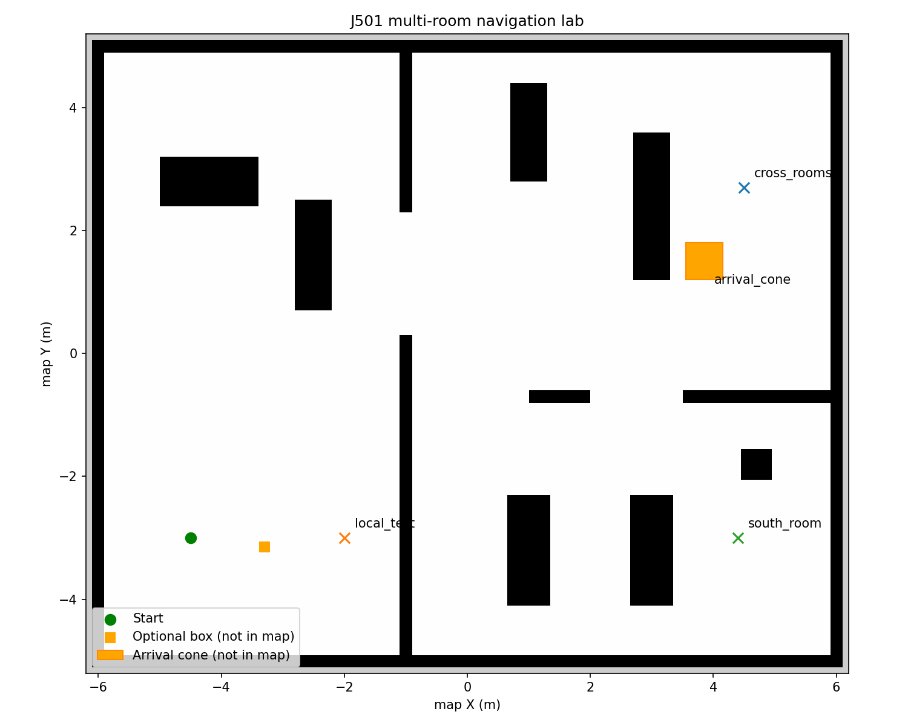
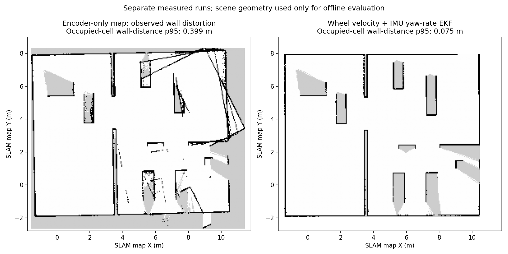
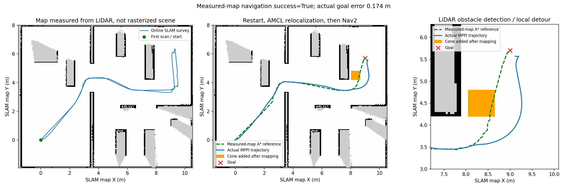
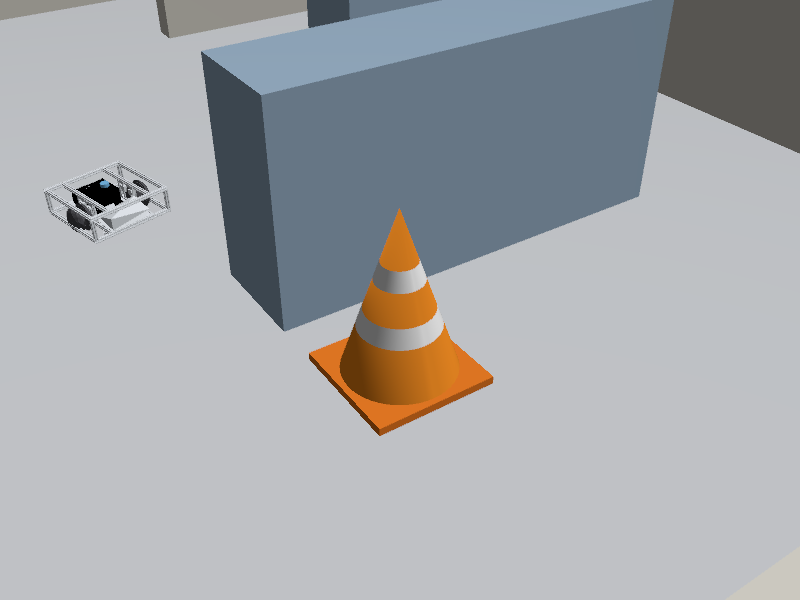
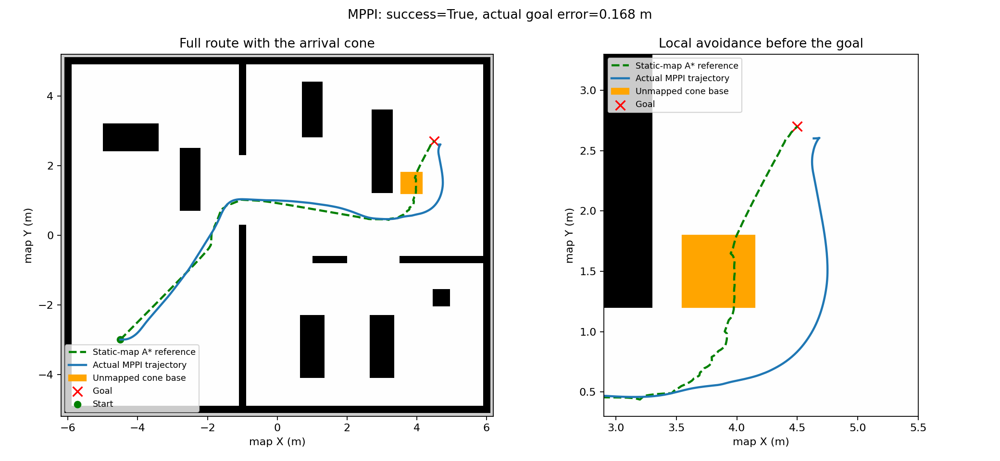
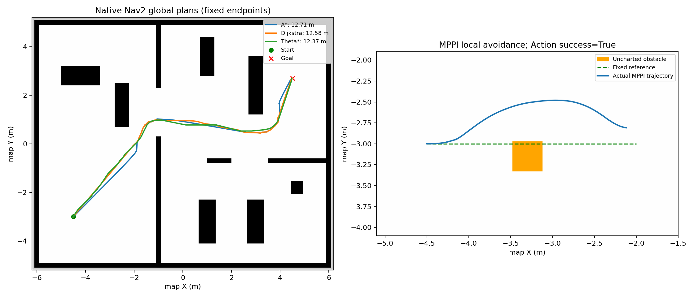

# J501 多房间全局规划与局部避障实验

[English](README.md) | [6.2 算法原理与教程](../../../docs/M06-Localization-Navigation-and-Path-Planning/6.2_Global_and_Local_Path_Planning/README_zh_CN.md)

ROS 2 Humble + Gazebo Fortress + Nav2。世界来自 [office.yaml](scenes/office.yaml)，课程导航地图由实时 SLAM 采集生成；同源栅格化地图仅作算法基准。全局规划绕过已建图墙体，局部控制使用激光检测处理新障碍。



提供三种全局规划器（`A*`、Dijkstra、`Theta*`）与三种局部控制器（DWB、MPPI、RPP）。程序使用真实 Nav2 C++ 插件，另外提供可独立运行的三种全局搜索教学实现。

## 课程主线：先建图，再重定位与规划

完整教程见 [6.1](../../../docs/M06-Localization-Navigation-and-Path-Planning/6.1_Nav2_Setup_and_Configuration/README_zh_CN.md)，检测原理见 [6.3](../../../docs/M06-Localization-Navigation-and-Path-Planning/6.3_Dynamic_Obstacle_Avoidance_and_Pedestrian_Prediction/README_zh_CN.md)。默认三维传感器近似 MID-360 视场，使用规则射线，非 Livox 原生非重复扫描。

终端 A，结束旧仿真后：

```bash
cd /home/darklee/mobile-robot-full-stack-course
./modules/m06_navigation/build.sh
./modules/m06_navigation/run_mapping.sh
```

终端 B，沿人工指定路点采集雷达并保存实际 SLAM 地图：

```bash
source modules/m06_navigation/setup.bash
ros2 run j501_navigation survey --output build/m06_results/survey.json
ros2 run j501_navigation save_map --output build/m06_maps/office
```

在终端 A Ctrl+C 结束建图，然后 `./modules/m06_navigation/run_navigation.sh`。终端 B：

```bash
ros2 run j501_navigation relocalize --pose 0 0 0
ros2 run j501_navigation global_plan --planner astar --goal 9 5.7 0
ros2 run j501_navigation navigate --controller MPPI --goal 9 5.7 0
```

地图来自 `/scan → SLAM Toolbox`，不是场景文件生成。默认地图缺失时不会自动退回预制地图。重定位需通过协方差、扫描与地图一致性及连续 AMCL 更新检查后，才激活 Nav2。建图时移除锥桶，导航时再加入，检测结果 `/perception/obstacles` 参与局部障碍层。

SLAM 首帧地图的目标约为 `(9,5.7)`，原预制地图目标为 `(4.5,2.7)`，两者不可混用。以下固定地图算法实验与旧记录使用显式基准模式：

```bash
./modules/m06_navigation/run_navigation.sh demo_map:=true lidar:=2d odometry_source:=wheel
```

## 算法效果图：轨迹与聚类障碍物


这是仿真实际输出生成的图。左图叠加已保存地图、初始全局参考和全程定位轨迹；中图放大终点前的避障路段；右图显示一个聚类点簇附近的激光点与三维框的正交投影。点簇是几何检测结果，不是锥桶语义识别。

`run_navigation.sh` 默认启动 `algorithm_view`。RViz 中：绿色 `Initial global reference` 是首次全局路线，蓝色 `Localized trajectory` 是 AMCL + EKF 定位轨迹，橙色点为非地面障碍点，彩色框与 `C编号 | 点数` 是紧凑点簇。导航结束后轨迹继续显示；所有原始墙体大簇仍可通过勾选 `LiDAR detected boxes` 查看。`C编号` 只在当前帧有效。

先按前面的建图、重定位流程启动仿真并完成一段导航。使用已有 EKF 地图时，终端 A 可以运行：

```bash
./modules/m06_navigation/run_navigation.sh map:="$PWD/build/m06_maps/ekf/office.yaml"
```

终端 B：

```bash
source modules/m06_navigation/setup.bash
ros2 run j501_navigation relocalize --pose 0 0 0
ros2 run j501_navigation navigate --controller MPPI --goal 9 5.7 0
# 导航结束后，保留终端 A，保存 PNG 效果图和可复绘 JSON
ros2 service call /algorithm_view/save std_srvs/srv/Trigger '{}'
```

默认输出 `build/m06_results/algorithm_view.png` 与 `.json`，可以在 launch 时通过 `view_output:=/absolute/path/result` 修改。静态图会自动选取路径附近的一个紧凑障碍点簇帧，并标出采集时间；轨迹覆盖整段记录，不能把图上的单帧点云误读成全程障碍物地图。本次 [原始记录](validation/algorithm_view/snapshot.json)、[导航结果](validation/algorithm_view/navigation.json)与 [RViz 截图](assets/algorithm_view_rviz.png)已保留；用 `python3 modules/m06_navigation/j501_navigation/j501_navigation/plot_algorithm_view.py <记录.json> --output <图片.png>` 可以离线复绘。

若使用旧 launch，可额外执行一次 `ros2 run j501_navigation algorithm_view --ros-args -p use_sim_time:=true`；新版已自动启动时不要重复运行。可视化节点只读取地图、定位 TF、规划路径和真实检测输出，不订阅仿真真值或场景障碍列表。用于独立误差评估的 `/lab/actual_path` 默认隐藏，避免与蓝色定位轨迹混淆。

## 建图漂移修正与启动阶段检查

默认里程计现已改为 M3.4 的轮速 + IMU EKF：仅融合轮速前向速度、零侧向速度约束与 IMU Z 轴角速度；不融合轮速累计位置 / 航向或 IMU 绝对朝向，EKF 独占 `odom → base_footprint`。修正投影角度取整，减少扫描方向偏差。原 `odometry_source:=wheel` 保留作对照。



本次分别保存用户的旧轮速地图与新采集的 EKF 地图，离线占用点到场景墙面距离的 95% 分位约为 0.400 m → 0.075 m；这个指标不代表所有未观测区域已完整建图。见 [验证记录](validation/ekf_mapping/environment.json)。旧地图、当前仿真和默认地图均保留；本机新观测地图另存 `build/m06_maps/ekf/office.yaml`，可显式传入 `map:=` 加载。独立重建时仍按课程流程重新建图保存。

在建图模式执行 `navigate`，新版客户端约 1 秒内提示“保存地图 → Ctrl+C 结束建图 → 启动导航 → 重定位”；在导航尚未定位时，提示执行 `relocalize`，不再只等 60 秒后报告节点未激活。**保存地图不会自动切换运行模式。**

## 建图 → 重定位 → 点云避障的验证记录



[完整记录](validation/lidar_workflow/environment.json)来自默认三维主线：14 个巡航路点完成后，保存实际 SLAM 栅格地图与位姿图，关闭建图再重新加载。重定位前 Planner Server 为 `unconfigured`；近似位姿 `(0.2,-0.1,0.1)` 经 AMCL 修正，连续 5 次更新通过检查后激活导航。

| 检查 | 本机单次结果 |
| --- | --- |
| 自建地图导航 | Action 成功，实际行驶约 13.077 m，实际终点误差约 0.174 m |
| 采样足迹评估 | 最小净空约 0.268 m，接触样本为 0；非连续安全证明 |
| 障碍检测记录 | 584 帧中地面拟合均成功；处理耗时中位数约 63 ms |
| 锥桶几何检测 | 独立评估匹配到 410 帧；一个近距离点簇中心误差约 0.064 m，不是全场景准确率 |

原始 [建图](validation/lidar_workflow/survey.json)、[重定位](validation/lidar_workflow/relocalization.json)、[导航](validation/lidar_workflow/navigation.json)、[检测](validation/lidar_workflow/perception.json)与[观测地图](validation/lidar_workflow/office.yaml)已保存。检测器不读取场景或真值；真值只供独立评估器使用。`actual_trajectory` 为仿真世界坐标，`actual_trajectory_map` 用评估变换转到保存地图，避免混用地图坐标造成虚假终点误差。

## 终点前锥桶避障

场景默认自带橙白相间的锥桶 `arrival_cone`，位于 `(3.85, 1.5)`，距离跨房间目标约 1.4 m。锥桶高 0.85 m、底座 0.6 × 0.6 m，放在原全局路径附近，右侧留有绕行空间。模型包含真实锥形碰撞网格与底座。



锥桶只加入 Gazebo，不写入 `office.pgm`。以下复验旧二维基准，终端 A 显式选择 `./modules/m06_navigation/run_navigation.sh demo_map:=true lidar:=2d odometry_source:=wheel controller:=MPPI`，终端 B 执行：

```bash
ros2 run j501_navigation navigate --planner astar --controller MPPI \
  --goal 4.5 2.7 0 --output build/m06_results/navigation_cone.json
```

接近终点时，观察雷达与局部代价地图发现锥桶，以及实际蓝色轨迹偏离绿色全局路径、绕过锥桶后回到目标。全局代价地图只含静态层与膨胀层，周期性全局重规划仍不会把锥桶当成已知障碍。RViz 的机器人模型不包含锥桶；橙白外观在 Gazebo 中显示，RViz 中显示其扫描点和局部障碍代价。

位置与尺寸见 [场景配置](scenes/office.yaml) 的 `unmapped_cones`。修改后运行 `generate_scene.py`、重新构建并重启。默认三维主线使用自建地图目标 `(9,5.7)`；本节旧基准记录使用 `demo_map:=true lidar:=2d odometry_source:=wheel` 和 `(4.5,2.7)`。客户端用底座外接方形计算保守足迹净空，这些场景几何仅参与评估，导航输入仍为雷达、里程计与 AMCL。

本机从原始出生点执行 `A* + MPPI` 完成了全程导航，实际路径约 13.082 m，实际终点误差约 0.168 m，最小采样足迹净空约 0.259 m，接触样本为 0。见 [完整记录](validation/navigation_cone_mppi.json)。锥桶中心在局部代价地图中的障碍代价达到 99；全局对应点代价为原有货架膨胀产生的 42，不含锥桶标记。



控制器对新增障碍的适应能力不同：本次 [DWB 在到达锥桶前的转角未能继续推进](validation/failures/dwb_arrival_cone_stagnation.json)；MPPI 完成了绕行。不要把各控制器启动成功等同于都能完成同一任务。

## 全局与局部避障的独立实验

全局 `/plan` 来自完整静态地图；局部代价地图接收实时 `/scan`。下列实验固定一条直线路径，再增加静态地图没有的障碍，单独观察局部控制：

```bash
ros2 run j501_navigation global_plan --goal -2 -3 0 --output build/m06_results/local_path.json
ros2 run j501_navigation obstacle
ros2 run j501_navigation local_follow --controller MPPI \
  --path build/m06_results/local_path.json --obstacle -3.3 -3.15 0.35 0.35 \
  --output build/m06_results/local_mppi.json
ros2 run j501_navigation obstacle --remove
```

`--obstacle` 只给评估器提供几何尺寸，不作为检测或控制输入。雷达负责发现障碍。RPP 主要跟踪已有路径，遇到挡路物可能停车；DWB、MPPI 也可能陷入局部极小，结果应按实际任务状态记录。

## 可执行程序

| 命令 | 实际执行内容 |
| --- | --- |
| `global_plan --planner astar\|dijkstra\|theta_star` | Nav2 `ComputePathToPose`，输出路径 JSON |
| `benchmark --trials 3` | 固定起终点比较三种真实全局插件，不控制运动 |
| `grid_plan --algorithm astar\|dijkstra\|theta_star` | [独立搜索源码](j501_navigation/grid_search.py)，无需运行仿真或 ROS 节点 |
| `navigate --planner astar --controller MPPI` | `NavigateToPose`，执行规划、跟踪与恢复行为树 |
| `local_follow --controller DWB\|MPPI\|RPP --path ...` | `FollowPath`，固定参考路径，不调用全局重规划 |
| `obstacle` / `obstacle --remove` | 在 Gazebo 创建 / 删除地图中没有的障碍 |
| `obstacle --crossing --duration 20` | 使用离散位姿更新创建有限时长的横穿实验 |

查看 [客户端源码](j501_navigation/clients.py)、[算法配置](config/nav2_params.yaml)、[行为树](behavior_trees/navigate.xml)。DWB 使用 Rotation Shim 先对齐路径方向，再执行其轨迹采样。

## 实测结果与范围



本机验证环境为 ROS 2 Humble、Nav2 1.1.20、Gazebo Fortress 6.16.0。下表原有实验完成于加入终点锥桶之前，静态地图保持相同。以下是不同任务的检查结果，不能据此给控制器作速度排名。

| 检查 | 记录 |
| --- | --- |
| 三种全局插件，各 3 次 | `A*` 约 12.709 m，Dijkstra 约 12.584 m，`Theta*` 约 12.373 m；见 [原始数据](validation/nav2_global_planners.json) |
| 独立教学搜索 | 搜索结果另存 [grid_search.json](validation/grid_search.json)，与原生 Nav2 的代价和路径回溯不同 |
| 跨房间 `A* + DWB` | Action 成功，实际路径约 12.951 m，终点误差约 0.115 m；含恢复与重试，见 [记录](validation/navigation_dwb.json) |
| 固定路径 MPPI 避障 | Action 成功，实际路径约 2.596 m，最小采样足迹净空约 0.148 m；局部障碍代价峰值 99，全局对应点为 0，见 [记录](validation/local_mppi_obstacle.json) |
| RPP 跟踪 | 在另一个无临时障碍的短路径任务中完成跟踪，见 [记录](validation/local_rpp_tracking.json) |
| 失败案例 | [对称障碍前 MPPI 停滞](validation/failures/mppi_initial_symmetric.json)、[DWB 终点容差不一致导致超时](validation/failures/dwb_tolerance_timeout.json) |

足迹净空按离散实际轨迹与场景盒体计算，接触样本为零不代表连续安全证明。导航使用 AMCL / 里程计 / 雷达；仿真真值仅用于评估。质量、摩擦与悬挂仍是估算参数，实机验证与完整行人预测实验尚待开展。

RViz2 中绿色为 `/plan`；橙色 `/local_plan` 主要用于 DWB；蓝色 `/lab/actual_path` 在运动客户端运行期间显示实际轨迹。MPPI 默认未开启采样轨迹可视化，RPP 不发布 DWB 的局部路径话题。

## 依赖、重建与检查

已有系统 Nav2 / SLAM Toolbox / SciPy 时直接复用；缺失时 `build.sh` 下载并解包依赖到 `build/m06_nav2_deps/`，不安装或卸载系统软件包。可选 [bootstrap 脚本](tools/bootstrap_nav2.py) 使用下载校验和，并补齐旧系统可能缺少的诊断库 ABI。源码与构建目录都不依赖之前的 `/tmp` 工作空间。

```bash
# 修改场景后同时更新 Gazebo 世界与占用地图
/usr/bin/python3 modules/m06_navigation/j501_navigation/tools/generate_scene.py
# 修改算法参数后重新启动仿真；参数已随源码保存
./modules/m06_navigation/build.sh
/usr/bin/python3 -m unittest discover -s modules/m06_navigation/j501_navigation/tests -v
```

完整原理、教程、调参说明与扩展边界见 [6.2](../../../docs/M06-Localization-Navigation-and-Path-Planning/6.2_Global_and_Local_Path_Planning/README_zh_CN.md)。地图定位与接口基础见 [6.1](../../../docs/M06-Localization-Navigation-and-Path-Planning/6.1_Nav2_Setup_and_Configuration/README_zh_CN.md)。
